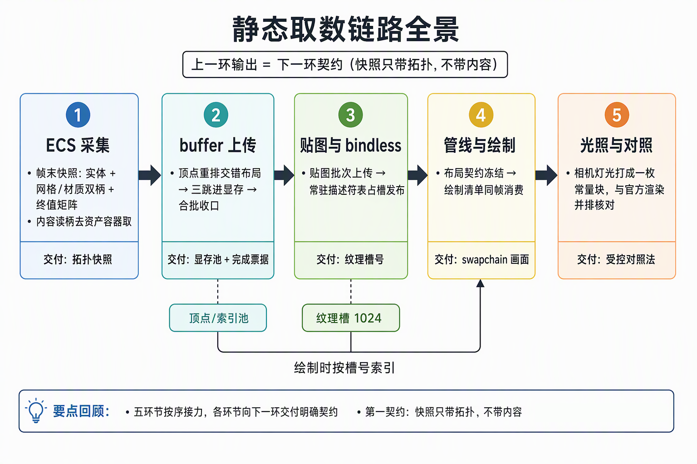
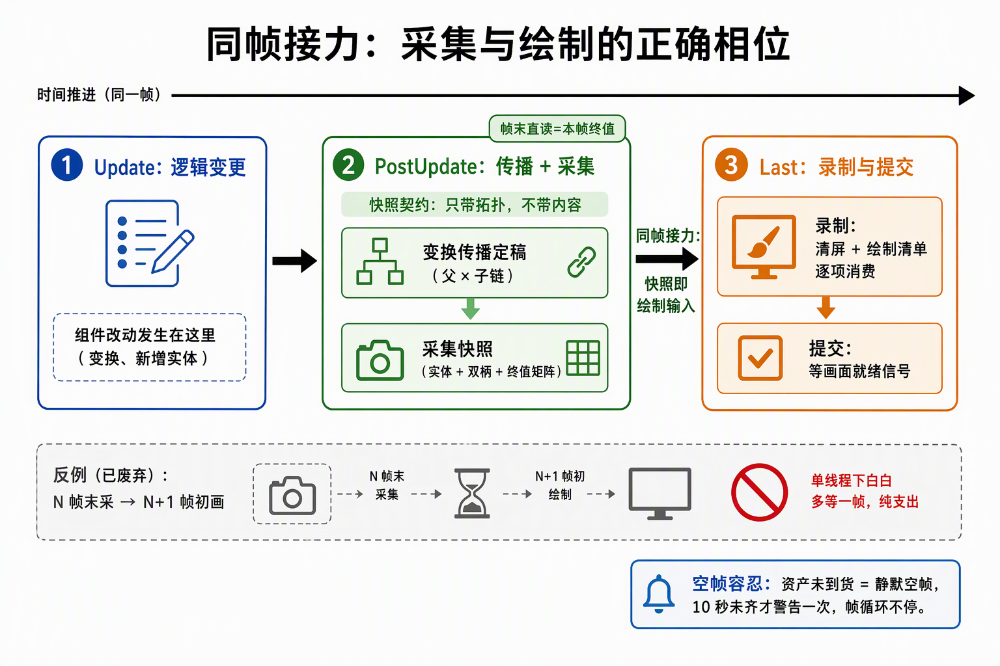
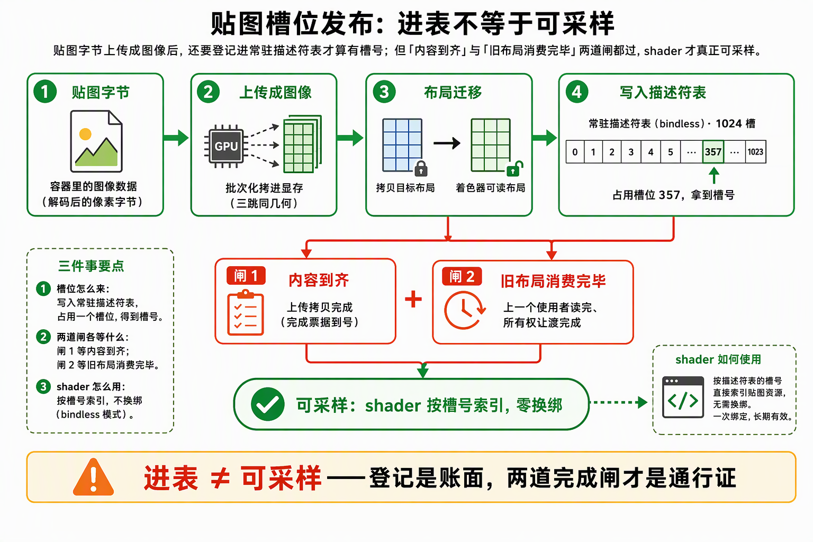

# 功能流程导读：静态取数链路全景

面向下一个读代码的人：步骤 3（3.1~3.5 主链 + 3.6~3.13 工具追加段）打通了"Bevy 资产 → GPU 常驻资源 → bindless 画出来"的静态版本。本文按链路顺序走读五个环节：每个环节**读什么、写什么、交付给下一环什么契约**。判定线与验收证据归各段 README/施工记录；机制深究归各专题篇，不在此重复。

一句话说明：**这是整条渲染器的地基链**——禁渲染宿主里，官方渲染族的活全部由自研代码接管：ECS 帧末采集快照、三跳上传进显存、bindless 常驻描述符表免换绑、图形管线按冻结契约消费绘制清单。步骤 4 起的一切增量能力都长在这条静态链上。

## 一、链路全景

五个环节依次接力，上一环的输出就是下一环的输入契约：

1. **ECS 侧取数（3.1）**：场景进场 + 帧末采集快照——拓扑快照 `CollectedScene`（实体 + 网格/材质双柄 + 终值矩阵），内容读柄去 `Assets` 容器取。
2. **buffer 侧上传（3.2）**：顶点/索引重排交错布局，三跳路径进显存，合批收口发完成票据。
3. **贴图与 bindless（3.3）**：贴图批次上传 + 常驻描述符表槽位发布，shader 按槽号索引不换绑。
4. **管线与绘制（3.4）**：三方布局冻结的图形管线，动态渲染，DrawList 同帧消费直出 swapchain。
5. **光照与对照（3.5）**：相机/灯光 UBO 数值链与 bevy 同源，材质三模式，官方渲染并排对照收官。

## 二、ECS 采集：帧末快照与同帧接力

**快照只带拓扑不带内容**（entity + 双柄 + 终值矩阵）是全链第一契约：内容读柄去容器取，增量复杂度不先付（步骤 4 的活）。

关键时序决策：采集钉在 **PostUpdate、传播链之后**（Update 读 `GlobalTransform` 会差一帧，帧末直读才是本帧终值）；绘制从 Update 挪到 **Last 形成同帧 relay**——"N 帧末采、N+1 帧初画"在单线程宿主里是伪流水线纯支出。空帧容忍是正常态不是失败（异步到货静默等，10s 凑不齐 warn 一次）。

场景进场侧的三个"禁渲染补位"是这段的隐形地基：资产根路径编译期指根、ImageLoader 手动注册（否则贴图句柄永远加载中且无任何报错）、材质组件反射注册（否则展开树 panic）。

## 三、buffer 上传：三跳路径与合批收口

独显上"最快"分属两块芯片：显存 GPU 快但 CPU 够不着，系统内存 CPU 可写但 GPU 读要过总线——三跳各取最优：

*读图：三跳的执行者换人——第一跳 CPU 对映射内存写入，红色一跳是 GPU 跑的拷贝命令；旗标只声明能力，堆才是物理位置。*

staging 环两槽轮转让 CPU 与 GPU 时钟解耦（GPU 拷第 N 批时 CPU 写第 N+1 批）；一批上传的收口七步与全流程唯一 CPU 等待点：

顶点重排为 32B 交错布局（位置+法线+UV），索引统一 uint32，不认识的属性拒绝而不是吞掉——静态链的"合批提交、票据跨族等待"形状在此定稿，步骤 4/6 的增量与流送都复用这套搬运收口。

## 四、贴图与 bindless：从字节到可采样

贴图链路把容器里的 `Image` 字节批次化上传成 VkImage，再经**槽位发布链**进常驻描述符表（容量 1024 槽，FlightHelmet 24 槽去重 15）：

三个机制钉：

- **进表 ≠ 可采样**：写进描述符表只代表"槽位登记"，可采样还要等上传完成（内容到齐）与最后使用完成（旧布局消费完毕）两道闸——原理篇全篇核心。
- **跨族所有权**：上传在 transfer 族、采样在 graphics 族，图像布局链与所有权让渡把两个队列接起来（timeline 信号量在 3.2.1 落的底座）。
- **sRGB 解码在采样端**：png 字节 → VkImage → 采样值的编码链在贴图段就钉死，最终屏幕编码恰好一次的地基由此打下。

## 五、管线与绘制：双集契约与同帧消费

图形管线是一份**三方冻结的打包清单**：顶点输入布局（对齐 3.2.3 的 32B 交错）、两组描述符集布局（set0 bindless 常驻表、set1 帧 UBO——5.1 起扩为三集加 set2 表集）、着色器二进制。shader 与 CPU 两侧对同一布局各自声明，对不上即验证层报错——契约冻结买来的是"管线对象零改动可换 shader 前端"的余地。

绘制侧一帧的收口：Last 阶段录制——清屏 → 逐 DrawList 项绑定双集 + 绘制（模型矩阵与贴图槽号随项走）→ 提交等 acquire 信号量。深度用 **反向 Z**（near=1 远=0，与后续 Hi-Z/CSM 成套）；swapchain 是 UNORM 底板 + SRGB view 别名三件套（3.4 拍板），编码恰好一次从这一刻起成为贯穿红线。

## 六、光照与对照：UBO 数值链

3.5 把光照做成可对照的：相机与方向光参数打成一枚 128B UBO（数值链与 bevy `prepare_lights` 同源），材质三模式（unlit / lambert / normal 调试直出）做 A/B 分项；收官方式是与官方 bevy_render 独立进程**同屏并排对照**——几何、base color、光照方向三分解项核对，全程零 VUID。这套"受控对照法"成为后续 8.2 Filament BRDF、8.6 ACES 对照的模板。

## 七、追加段：观察与操控通道（3.6~3.13）

3.6~3.13 八个追加段不改变取数主链，它们长在主链两侧：

- **结构面**：3.6 代码全量整理（工具/驱动/scene 分层）；3.8 `#[system]` 标注宏（阅读路标 + 编译期校验）。
- **UI 面**：3.7 egui 裸接 ash（overlay 管线 + 输入桥）；3.10 实体层级树；3.11 属性面板编辑；3.9 鼠标摄像机。
- **远程操控面**：3.12 BRP CLI 直控（读方法族 + 写封装 + `tools/brp.py`）；3.13 虚拟鼠标（`WindowEvent` 注入层，不碰真实输入）。

BRP 通道自此成为项目贯穿的测试纪律首选（Remote → 打 Log 重编译 → 鼠标注入仅无人模式），后续所有步骤的压测脚本都踩在这条通道上。

## 八、失败路径速查

| 坑 | 症状 | 归因 |
|---|---|---|
| 静默缺料 | 实体只有网格没有材质，不报错 | PbrPlugin 连带禁用后容器与 handler 双失守；hook 三钩子补缝 |
| 贴图永久 Pending | 无任何错误日志地卡死 | ImageLoader 无人注册；finish 钩子被禁的手动补位 |
| 展开树 panic | WorldAsset 展开反射写崩 | 材质组件反射注册在连带禁用的插件里 |
| 宽高比恒 1.0 | 画面拉伸 | 相机修正系统住渲染族被禁；spawn 写初值 + 幂等修正 |
| 伪流水线 | N 帧末采 N+1 帧初画 | 单线程宿主纯支出；draw_frame 挪 Last 同帧 relay |
| 伪完成票据 | 消费方提前复用显存 | 失败都发生在改票据号之前——虚假完成票据不存在 |
