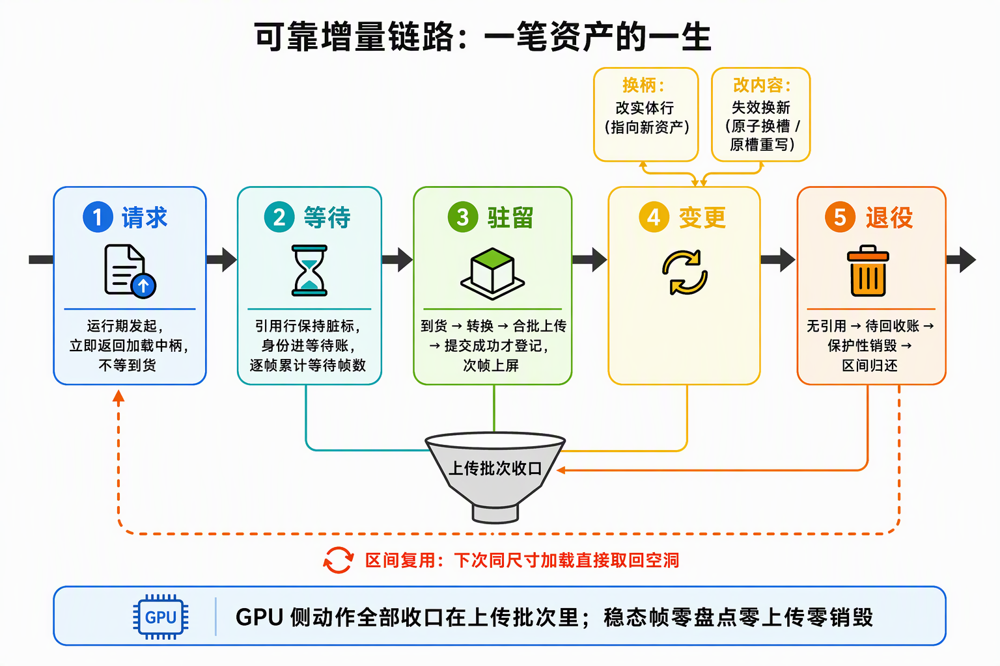
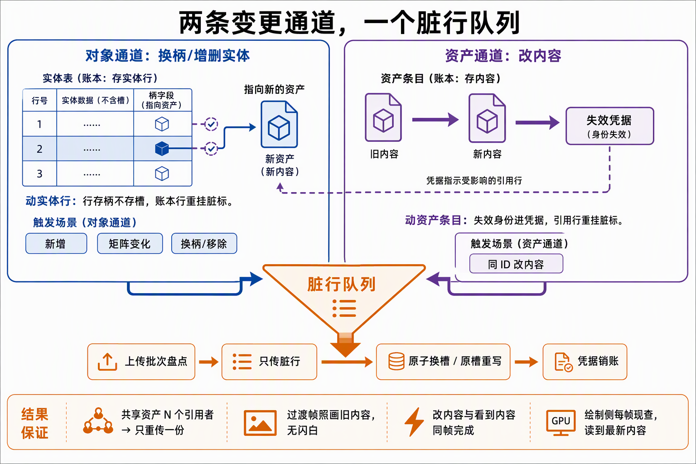
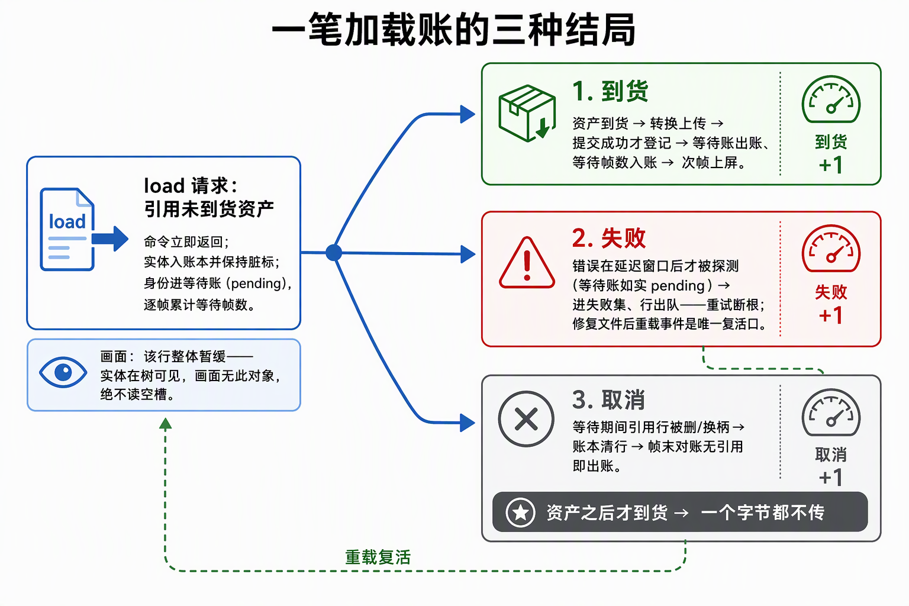
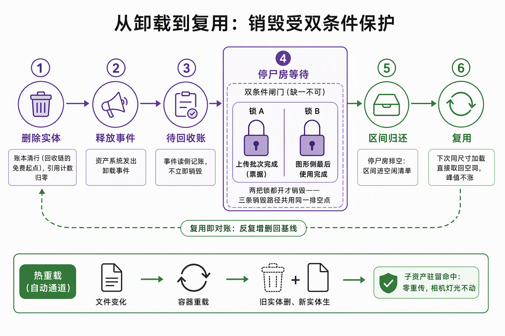

# 功能流程导读：可靠增量链路全景

面向下一个读代码的人：步骤 3 把"一次正确上传"立起来之后，步骤 4（4.1~4.4 主链 + 4.5~4.7 修复与追加段）把它长成能长期处理变更、异步到货、删除与替换的资源链路。本文按"一笔资产的一生"走读：每本账在哪个时刻记什么、两条变更通道怎么并轨、三种结局怎么分流。判定线与验收证据归各段施工记录；账面结构细节归各段流程篇，不在此重复。

一句话说明：**全链的纪律是"零变化零上传"**——稳态帧不付盘点与上传成本；一切动作由变更事件驱动，账本按稳定槽记账、按失效凭据放行、按就绪账等待、按停尸房销毁。

## 一、链路全景：一笔资产的一生

资产生命周期分五段，GPU 侧动作全部发生在上传批次（flush）收口里：

1. **请求**：运行期 `load` 立即返回加载中柄（ID 已定型，锚身份不锚内容），命令不等到货；
2. **等待**：引用行入账本并保持脏标，身份进就绪账 pending，逐帧累计等待帧数；
3. **驻留**：资产到货 → 转换 → 合批上传 → 提交成功才登记驻留（完成票据为证）→ 次帧上屏；
4. **变更**：同 ID 改内容走失效换新（原子换槽/原槽重写），换柄走实体行重挂——两条通道并轨；
5. **退役**：无引用 → 待回收账 → 双条件保护销毁 → 区间归还 free list，下次同尺寸加载直接复用。

## 二、两条变更通道，一个脏行队列

增量发现分两条通道，最后并轨进同一份脏行队列：

- **对象通道（4.1）**：实体行进出与组件变化（新增/矩阵变/换柄/组件移除/despawn）。核心结构是**稳定槽账本**——rows 是跨帧在场全集、dirty 是跨帧重试队列，实体与 GPU 实例槽的关联稳定不重排；变更窗口 = 每系统 tick 自上次运行。取代步骤 3 的每帧全量快照：零变化时实例上传为零。
- **资产通道（4.2）**：容器发出内容变更事件 → 读侧把资产身份记进失效凭据、引用它的账本行重挂脏标 → 上传盘点放宽为"查无**或失效**才传"。mesh 走**原子换槽**（新区间上传成功才换指，旧区间只读不写在飞安全）；贴图走**停尸房 + 原槽重写**（旧图在飞被采样时两个本体都活着，无悬空；槽位占用不增长）；材质是"假驻留"——参数每帧直读进常量块，改参数天然生效零上传。

**判定线一句话**：失效与重传都按资产 ID 记账，实体账本行存柄不存槽、绘制侧每帧现查——N 个引用者共享一份重传，过渡帧照画旧内容无闪白，改内容与看到内容同帧完成。

## 三、异步就绪：一笔账的三种结局

引用了尚未到货资产的实体，在就绪账面里等一个结局：

- **到货**：`Assets` 命中 → 上传提交成功 → pending 出账、等待帧数入账 → 次帧上屏；
- **失败**：加载错误在延迟窗口后才被探测到（期间身份如实 pending）——失败事件进 failed 集、无剩余等待腿的行出队，**僵尸重试队列断根**；修复文件后重载事件是唯一复活口（事件驱动一次性，无自动重试）；
- **取消**：pending 期间引用行被删或换柄 → 账本清行 → 帧末对账时无引用即出账——资产之后才到货也**一个字节都不传**（没有脏行就没有上传凭据）。

画面侧同构：未驻留的行整体暂缓（实体在树可见、画面无此对象），绝不读空槽。

## 四、回收与热重载：销毁受双条件保护

回收是资产增量事件的镜像（"事件 → 凭据 → 上传批次收口"同形，语义从换内容翻成出账销毁）：

一次 load→despawn 周期的账面流转：

1. **清行**：despawn 摘组件 → 账本清行（回收链的免费起点）→ 柄引用计数归零 → 资产释放事件；
2. **记账**：PostUpdate 读事件记入待回收账（就绪账同步出清）；
3. **销毁**：下帧上传批次开头统一排空——销毁必受**"上传票据 ∧ 图形最后使用"双条件**保护（三条销毁路径：网格区间/旧贴图/描述符槽，共用同一排空点）；
4. **复用**：区间归还 free list，下次同尺寸加载 first-fit 直接取回空洞——**复用即对账**（反复增删存量回基线，峰值不涨）。

**热重载**是同一套账的自动触发：文件监听开启后，文件变化 → 容器重载 → 官方展开器删旧实体、生新实体 → 账本清行+入行 → **子资产驻留命中零重传**（容器级身份稳定），相机/灯光不动。WorldAsset 重载同链：实体号换代但账面行数守恒。

## 五、修复转正与追加段

- **4.5 缺陷修复**：待修复清单 F1~F21 转正，GPU 寿命与失败恢复的全账收口（销毁双条件与失败恢复链的定稿在此段）；
- **4.6 实测修复**：用户实测两项（记录型注释清扫、拖拽旋转闪烁）当日修复；
- **4.7 坐标轴指示器**：右上角视图朝向指示器（随相机旋转实时反映三轴）。

## 六、失败路径速查

| 坑 | 症状 | 处置 |
|---|---|---|
| 僵尸重试 | 失败资产每帧重传重试 | failed 集断根：失败出队，复活靠重载事件 |
| 无引用到货 | 无人用的资产白传几十 MB | 帧末对账无引用即出账，结构上不为它转字节 |
| 在飞销毁 | 悬空采样/读到释放显存 | 双条件保护（上传票据 ∧ 最后使用）+ 停尸房延迟销毁 |
| 槽位增长 | 改内容一次涨一个槽 | 原槽重写（在飞可写），槽位占用不随内容变化增长 |
| 重载重复上传 | 热重载把子资产重传一遍 | 容器级身份稳定，驻留命中零重传 |
| 交叠窗口 | 同 ID 边传边换 | 凭据保留重试、成功才销账；运行级复验挂验证环境（验收复核开放项） |
