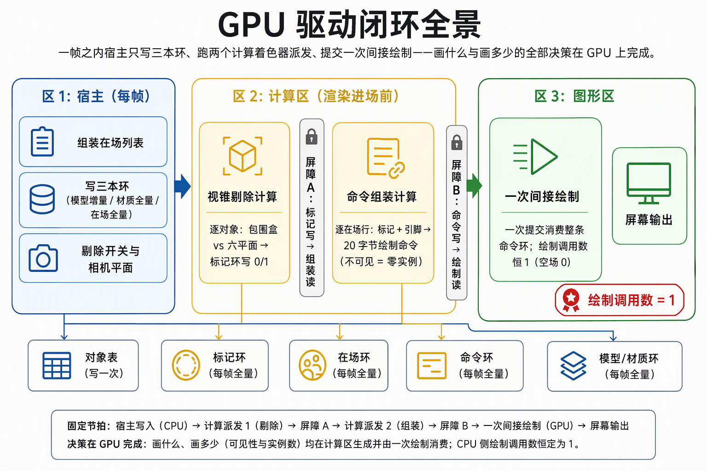
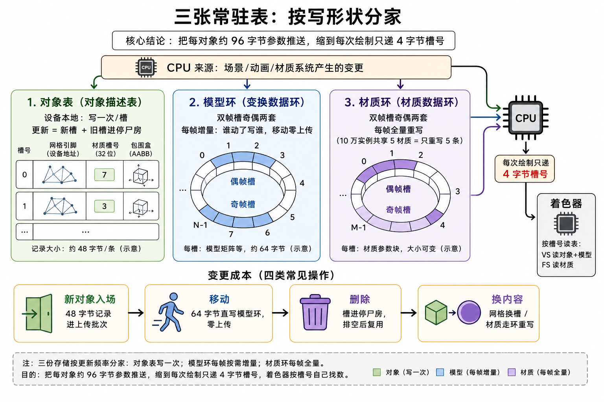
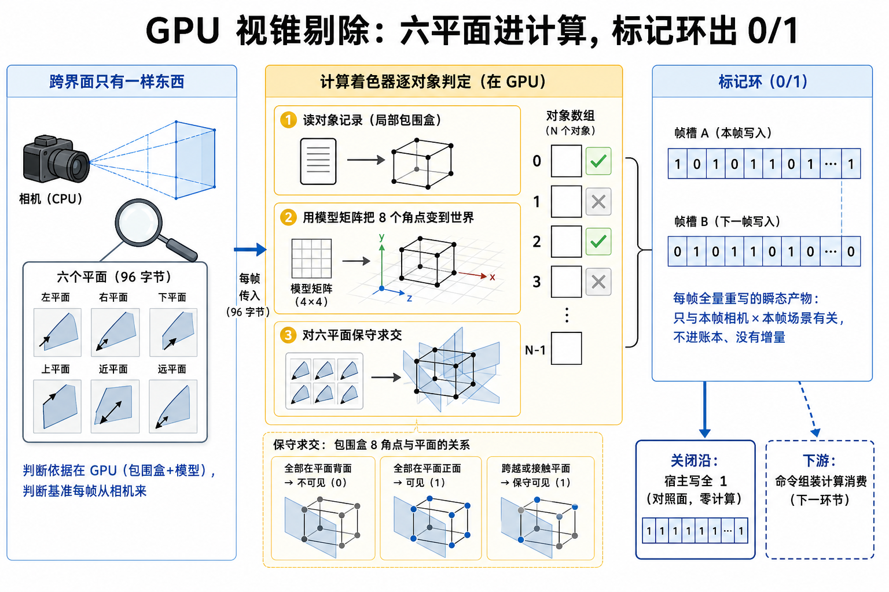
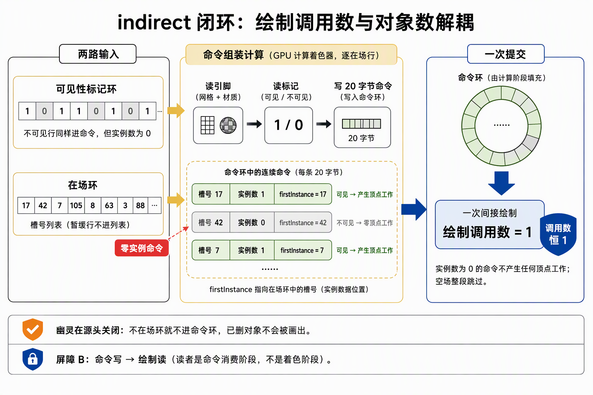
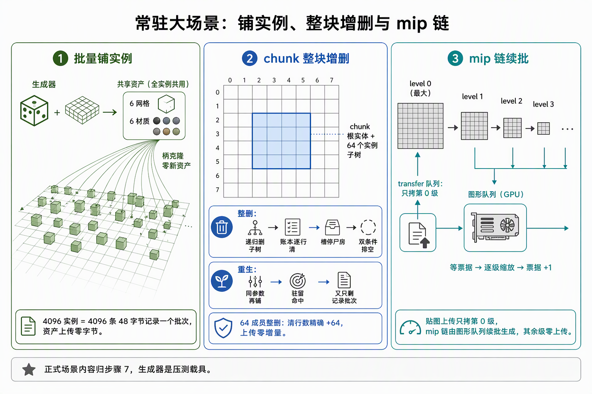

# 功能流程导读：GPU 驱动与常驻大场景全景

面向下一个读代码的人：步骤 5（5.1~5.5）把"画什么、画多少、画哪个"的全部决策从 CPU 搬上 GPU——CPU 从"每帧逐对象递 96B 参数、逐对象决定画不画"变成"每帧递一个 4B 槽号 + 只发相机矩阵"，绘制调用数从此与在场对象数解耦。本文按链路走读：三张常驻表、剔除、命令组装、大场景组织、压测底座。判定线与验收读数归各段施工记录，不在此重复。

一句话说明：**步骤 5 之后，GPU 第一次拿到了自己找数、自己决定画什么的能力**——这是后续一切（Hi-Z 遮挡、GPU LOD、流送、步骤 8 多 pass 管线）能成立的前提；"GPU-driven 闭环不回退"（draw_calls 维持 5.3 口径）自此成为贯穿后续所有步骤的红线。

## 一、链路全景：一帧的 GPU 驱动闭环

每帧的固定次序（渲染进场之前两个 compute，之后一次提交）：

1. **宿主半边**（fence 纪律内）：组装在场列表 → 写三本环（模型增量/材质全量/在场全量）→ 剔除开关裁决；
2. **compute 半边**：视锥剔除 dispatch（写标记环）→ 屏障 A → 命令组装 dispatch（写命令环）→ 屏障 B；
3. **图形半边**：一次 `draw indexed indirect` 消费整条命令环——**绘制调用数恒 1**（空场 0）。

## 二、三张表分家：按"写形状"记账

GPU 第一次拿到"自己找数"的能力，靠的是三份存储按更新频率分家：

| 存储 | 记什么 | 写形状 | 容量 |
|---|---|---|---|
| 对象表（DEVICE_LOCAL） | 每个东西**怎么画**：网格引脚、材质槽号、保守包围盒——写一次/槽 | 更新 = 分配新槽 + 旧槽进停尸房 | 131072 槽 × 48B |
| 模型环（HOST_VISIBLE） | 它**现在在哪**：模型矩阵 | 每帧增量重写（双帧槽奇偶两套，移动零上传） | ×2 帧槽 × 64B/槽 |
| 材质环（HOST_VISIBLE） | 它**长什么样**：材质参数 | 每帧全量重写（10 万实例共享 5 材质 = 只重写 5 条记录） | ×2 帧槽 × 32B/槽 |

**push 从 96B 参数缩到 4B 槽号**：VS 按 `instance_index`（= 槽号）读对象表与模型环，flat varying 带材质槽号给 FS 读材质环——"参数本体零推送"，逐 draw 的 push constants 通道就此退役。材质内容变更不走重传的结构性理由也在此：生效路径是材质环每帧从容器现读，一次材质变更 = 5 条记录重写而非 10 万个对象槽连锁。

四类变更的成本对照：**入行** = 48B 记录进上传批次（资产驻留命中时唯一成本）；**移动** = 一行账本 + 64B 模型环直写，上传零字节；**删除** = 槽进停尸房，排空后回空闲清单；**换内容** = 网格走换槽、材质走环重写零换槽。

## 三、GPU 视锥剔除：判断依据在 GPU，判断基准才过界面

画不画的前半问（在不在视锥里）搬上 GPU 的依据：判断材料（包围盒、模型矩阵）已在 GPU，只有判断基准（视锥）在 CPU 相机里——所以每帧跨界面只有**六个平面（96B/112B push）**：

- compute 对对象表逐槽做"8 角点世界包围盒 vs 六平面"保守求交，往标记环写 0/1；CPU 只算六平面（剔除侧唯一计算），并用库测试钉住同源参照语义；
- 可见标记是**每帧全量重写的瞬态产物**：只与"本帧相机 × 本帧场景"有关，住帧槽环（与模型环同一条 fence 纪律），不进账本、没有增量；
- 关闭沿 = host 向标记环写全 1（A/B 的 B 面，零 GPU 工作）；诊断通道 GPU vs CPU 逐实体对照（BRP `cull-stats`）。

## 四、indirect 闭环：绘制调用数与对象数解耦

命令组装把"画多少、画哪个"的最后一步交给 GPU：

- **组装**：compute 逐在场行读对象表引脚 + 标记 → 写一条 20B 绘制命令；不可见行 `instanceCount=0`（零顶点工作），槽号经 `firstInstance` 传给 VS；
- **两条屏障**恰好闭合两级依赖：标记写 → 组装读（屏障 A，5.2 预置）；命令写 → 绘制读（屏障 B，读者是**命令消费阶段**而非着色阶段，同步域必须开到 indirect 读取）；
- **消费**：`count > 0` 时一次 `draw indexed indirect` 消费整条命令环；`count = 0` 整段跳过（空场）；超上限显式报错不截断；
- **幽灵在源头关闭**：暂缓行不进在场环 = 自动不画；despawn 行不进在场环 = 不会画出已删对象——不需要"固定槽位 + 标记补丁"一类正确性补丁。

## 五、常驻大场景：生成器、chunk 与 mip 链

5.4 的大场景是**压测载具**（程序化生成器保留为机制测试场；正式场景内容归步骤 7）：

- **批量铺实例**：生成器克隆共享 6 mesh/6 材质（柄克隆零新资产）→ 4096 实例 = 4096 条 48B 对象记录一个批次，资产上传零字节；
- **chunk 整块增删**：块根实体（SceneChunk 组件）挂实例子树；整删 = 递归删子树 → 账本逐行清 → 槽停尸房 → 双条件排空复用（64 成员块 removed_rows 精确 +64、上传零增量）；
- **mip 链**：贴图上传只拷 level 0，mip 生成走**续批**（graphics 队列等票据 → blit 逐级 → 票据 +1）——上传编排第一次长出"第二段"。

## 六、分档压测与计量底座

5.5 把"性能成组记录"变成机制：压测矩阵（场景参数/开关组合）钉死 → GPU 时间戳计量底座（T0..Tn 时间戳区间）→ 三档规模读数与瓶颈归因。规模无关性在此实测：10 万档走同一条链，变化的只有参数——账本走访与在场环/材质环重写是 O(N)（在账信息组装写侧，如实计量），**绘制调用与 push 字节恒定**。这套计量底座（perf 时间戳 + BRP stats 分段读数）成为 5.5 之后所有段落的性能验收口径。

## 七、失败与稳态速查

| 坑 | 症状 | 处置 |
|---|---|---|
| 容量耗尽 | 槽位/材质槽分配失败 | Tier② 显式报错不截断（131072/65536 上界） |
| 在飞读旧槽 | 复用槽撕裂 | 槽停尸房 + 排空点帧侧等待收口；环双奇偶两套 |
| 幽灵绘制 | 已删对象仍被画 | 幽灵在源头关闭：不在场环就不进命令环 |
| count 超限 | 在场行数超 indirect 上限 | 显式报错（能力闸门 maxDrawIndirectCount） |
| 支持≠启用 | 驱动接受但未启用 feature | 5.3 起硬校验先例：查询快照 → 校验 → 启用 → 就绪日志 |
