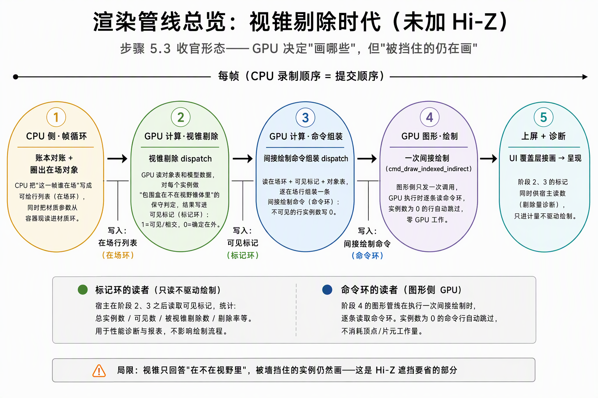
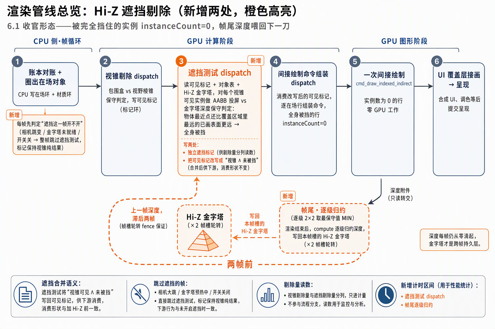

# 渲染管线变化：加 Hi-Z 前后的剔除链对比

> 2026-10-19 随 6.1 收官增补的讲解篇。配合两张管线总览图，说明 6.1 在步骤 5.3 收官形态的渲染管线上改了哪几处、新增数据怎么流；逐时刻走读与账面细节见[Hi-Z遮挡流程篇](Hi-Z遮挡流程：从渲染后深度到遮挡标记的各级账面.md)，判定线与钉子归[施工记录](6.1.1-6.1.6-Hi-Z遮挡施工记录：测试实体载具、深度金字塔、遮挡第二pass与A_B计量.md)。

## 一、变化前：视锥剔除时代（步骤 5.3 收官形态）

一帧的主干是五段横向流水线：CPU 帧循环圈出在场对象（写**在场环**+材质环）→ **视锥剔除 dispatch** 对每个实例做"包围盒在不在视野锥体里"的保守判定，结果写进**标记环**（1=可见/相交，0=确定在外）→ **命令组装 dispatch** 逐在场行组装一条间接绘制命令（**命令环**），视锥不可见的行实例数写 0 → 图形侧**一次间接绘制**（`cmd_draw_indexed_indirect`），执行时逐条读命令环，实例数为 0 的行自动跳过、零 GPU 工作 → UI 接画上屏。

这条链的边界在图中底部：**视锥只回答"在不在视野里"，不回答"看得见吗"**——被墙完全挡住的实例仍然走完组装与绘制。5.5 压测立起的图形段成本里，这部分就是 6.1 要省的量。

## 二、加 Hi-Z 之后：新增两处（6.1 收官形态）

流水线骨架不变，橙色两处是新增：

**新增①：遮挡测试 dispatch（视锥剔除之后、命令组装之前）。** 读可见标记、对象表和 Hi-Z 金字塔，对每个"视锥可见"实例再做一刀保守判定——AABB 投屏 vs 金字塔深度：物体最近角点的深度值，还比覆盖区域里"最远的已画表面"更远 → 全身被挡。写两处：独立遮挡标记（遮挡剔除量分列读数）+ 把可见标记改写成"视锥 ∧ 未被挡"（合并后供下游，命令组装的消费形状不变——5.3 的 build_indirect 零触碰）。

**新增：帧尾逐级归约（虚线回环带）。** 渲染结束后深度附件转只读，compute 逐级 2×2 取最保守值（MIN），写回本帧槽的 Hi-Z 金字塔（×2 帧槽轮转）。回环箭头是这张图的语义核心：**遮挡测试读到的金字塔是"两帧前"的输出**——同帧槽轮转 + 既有帧 fence 保证 CPU 录制时上一轮归约提交已完成，零新增同步形状。深度附件本身每帧仍从零清起（下帧 UNDEFINED 进场照常丢弃），金字塔才是跨帧持久层。

**阶段一的注脚（橙色）：遮挡开关的跳过判定。** 相机大跳 / 金字塔预热中 / 用户关闭 → 整帧跳过遮挡测试，标记保持视锥纯结果——2 帧滞后窗的短暂误剔除由这条 fallback 与"数帧内恢复"兜底。

## 三、对照读图的三个要点

1. **遮挡测试的插位**：必须在命令组装之前（它改写标记，下游消费改写后的结果），也在渲染进场之前（渲染才产生本帧深度，本帧遮挡只能吃历史深度——这就是滞后存在的结构性原因）。
2. **回环箭头的方向**：帧尾归约从"绘制/深度写入之后"引出、跨帧回到"遮挡测试"——箭头画反（渲染前归约、当帧供数）在物理上不成立，深度还没画。
3. **什么没变**：CPU 不回读可见集驱动绘制（红线）、在场环/命令环/间接绘制形状、build_indirect 消费——遮挡只是把标记的语义从"视锥可见"收紧为"视锥可见 ∧ 未被挡"。
