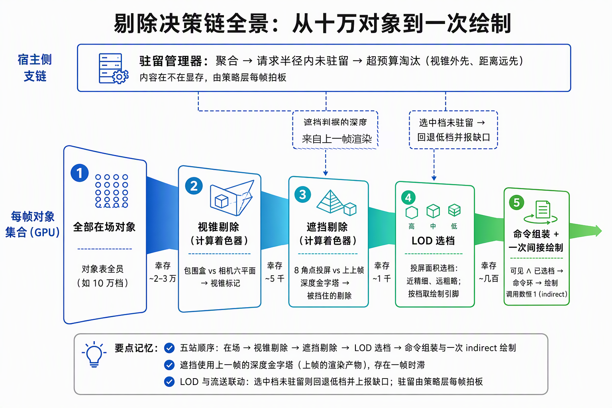
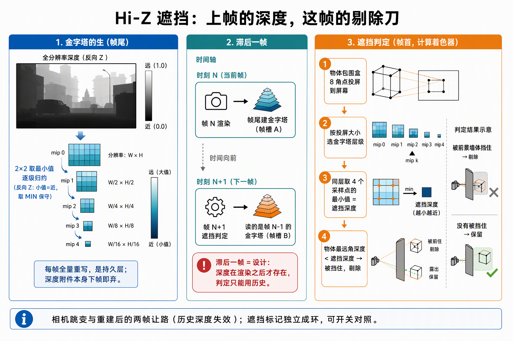
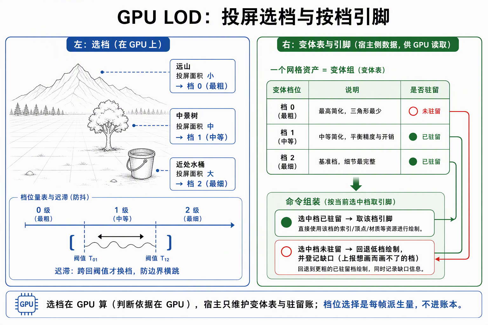
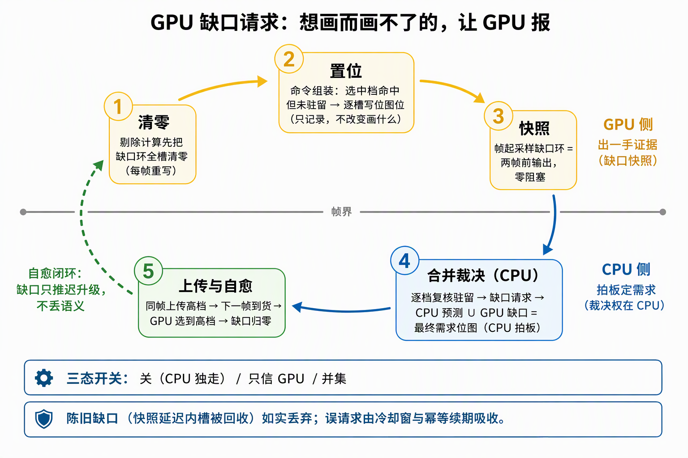

# 功能流程导读：高级剔除、LOD 与流送全景

面向下一个读代码的人：步骤 6（6.1~6.6）在步骤 5 的 GPU 驱动闭环上叠了三把刀——遮挡剔除（不画看不见的）、LOD 选档（画得粗一点）、流送（内容按需进显存）——并最终让 GPU 自己报出"缺什么档位"。本文按剔除决策链与流送闭环走读。判定线与压测证据归各段施工记录；原理深究归各段原理篇，不在此重复。

一句话说明：**剔除链是漏斗、流送是闭环**——每帧的对象集合经过"视锥 → 遮挡"两刀收紧，LOD 决定画哪一档，流送管理器决定内容在不在显存；到 6.6，"命中但没驻留"的缺口由 GPU 标记、CPU 合并裁决、同帧上传、下一帧自愈。

## 一、链路全景：一帧的剔除决策漏斗

GPU 驱动闭环（5.3）的 compute 半边长成三段：视锥剔除（5.2，写视锥标记）→ 遮挡测试（6.1，视锥 ∧ 遮挡）→ 命令组装（5.3，读合并标记）。LOD 选档与流送管理器在同一帧的宿主侧并行运转，为命令组装供"画哪档"的档位表与"内容在不在"的驻留账。

## 二、Hi-Z 遮挡：渲染后深度变成下一帧的剔除刀

视锥剔除只回答"在不在相机视野里"，被房子挡住的物体依然会画。Hi-Z 遮挡把上上帧渲染产生的深度变成金字塔，用来反问"这个包围盒能不能被更近的东西挡住"：

- **金字塔的生**：帧尾把本帧深度（反向 Z，2×2 取 **MIN** 逐级归约成 11 级 R32F 金字塔）——每帧全量重写，下帧即弃；
- **金字塔的死与用**：下帧的遮挡 compute 读"两帧前"的金字塔（帧槽 fence 保证确定值，零新同步形状）——**滞后一帧语义**是设计而非妥协：深度在渲染之后才有，遮挡判定必须用得上帧的历史；
- **遮挡判定**：逐对象 8 角点投屏 → 按投屏大小选 mip 层级 → 同层 4 tap 取 MIN 得遮挡深度上界 → `对象最远角深度 < 遮挡深度` 判剔除（4 tap 必须同一 mip 层级）；
- **稳态保护**：相机跳变门（两帧窗累计位移/旋转超阈值 → 本帧跳过）、重建 warmup 两帧让路、空场金字塔全 0 天然恒可见。遮挡标记独立成环（A/B 归因读数口），合并结果写回视锥标记，命令组装消费形状零触碰。

## 三、GPU LOD：投屏选档与按档引脚

遮挡决定"画不画"，LOD 决定"画哪一档"：

- **选档**：GPU 用包围盒投屏面积算期望档位（近处选精细档、远处选粗档），带**迟滞**防抖（档位边界来回横跳的抑制）；
- **按档引脚**：mesh 资产注册为变体表（基准 + 逐级简化档），对象记录引用组身份；命令组装按"当前选中档是否驻留"选引脚——选中档缺席时回退绘制可用的档位；
- **语义钉**（后续步骤沿用）：shadow pass 对主 LOD 档**再粗一档**（8.3）——主相机覆盖语义直接沿用会过细。

## 四、流送：预算下的驻留闭环（粗 → 细 → 保底）

驻留管理器是**纯策略层**（每帧三件事：聚合 → 请求 → 淘汰），两半都走既有链的既有入口：

- **粗粒度（6.3）**：预算列 = 网格字节（顶点+索引）。半径内的非驻留身份 → 引用行重挂脏标（重传链同帧驻留）；超预算 → 按"视锥外先、距离远先"写卸载回收账 + **冷却窗 60 帧**防抖。决策粒度 = 资产身份组（共享资产同进同出）。
- **细粒度（6.4）**：预算下沉到 **LOD 档逐档 + 贴图字节列**（整资产淘汰升级为子资产条目）；未驻留档走 **fallback 白图保底**——远端对象不消失，画白图占位。
- **保底锚（6.5）**：低保真档常驻（预算再紧也保住"至少画得出"），高档按需——锚无可迁的资产上保底即基准（floor_anchor 保底语义）。
- **关闭沿**：激活→关闭的下降沿**全行置脏**——关掉管理器 = 真正回到全常驻语义，被淘汰资产不会永远缺席。

## 五、GPU 缺口请求：命中但没驻留，让 GPU 报缺口

CPU 预测（半径/距离）不知道 GPU 的真实选档（迟滞、遮挡之后的选择）。6.6 把差集交给 GPU：

1. **置位**：cull compute 先把缺口环全槽清零；命令组装发现"选中档哨兵 = 命中但未驻留" → 逐槽写位图位（缺口只记录，不改变画什么）；
2. **快照**：帧起在 fence 纪律内采缺口环快照——**两帧前输出**，采样零阻塞；
3. **裁决**：驻留管理器把位图反查成 LOD 组、逐档复核驻留（延迟内可能已到货）→ 缺口请求（豁免半径、保留冷却）→ **merged 需求 = CPU 预测 ∪ GPU 缺口**——CPU 拍板，供给权不挪窝；
4. **自愈**：同帧上传 → 下一帧高档到货 → GPU 自然选到高档 → 缺口归零。全程无当帧等待、无确认重试协议；陈旧缺口（快照延迟内的槽回收）如实计数丢弃。

三态开关：Off（CPU 独走）/ GpuOnly（只信 GPU 一手证据）/ Merged（并集）。

## 六、压测与失败路径速查

六段的判定线全部由 `tools/` 一键压测脚本采证（hiz/lod/stream/fine/gap 五脚本族）；挂账 F25（6.2 选档链潜伏缺陷）不阻塞后续步骤。

| 坑 | 症状 | 处置 |
|---|---|---|
| 陈旧遮挡 | 相机跳变后误剔 | OcclusionGate 两帧窗跳过 + warmup 让路，稳定后自动恢复 |
| tile 单点采样不可靠 | 单像素判定错 | 判定只信物体侧 8 角点投屏；tile 单像素不可靠是口径边界 |
| 关闭沿缺席 | 被淘汰资产永不回来 | 管理器关闭沿全行置脏（B 面完整语义） |
| 回访闪现 | 淘汰后立即回访 | 冷却窗 60 帧防抖，恢复延迟如实计量 |
| 陈旧缺口 | 快照两帧延迟内槽被回收 | slot→行反查失败如实丢弃；误请求由冷却与幂等续期吸收 |
| 深度附件采样 | 深度附件不可采样（VUID 实证） | 金字塔才是持久层；深度每帧 UNDEFINED 进场丢弃 |
