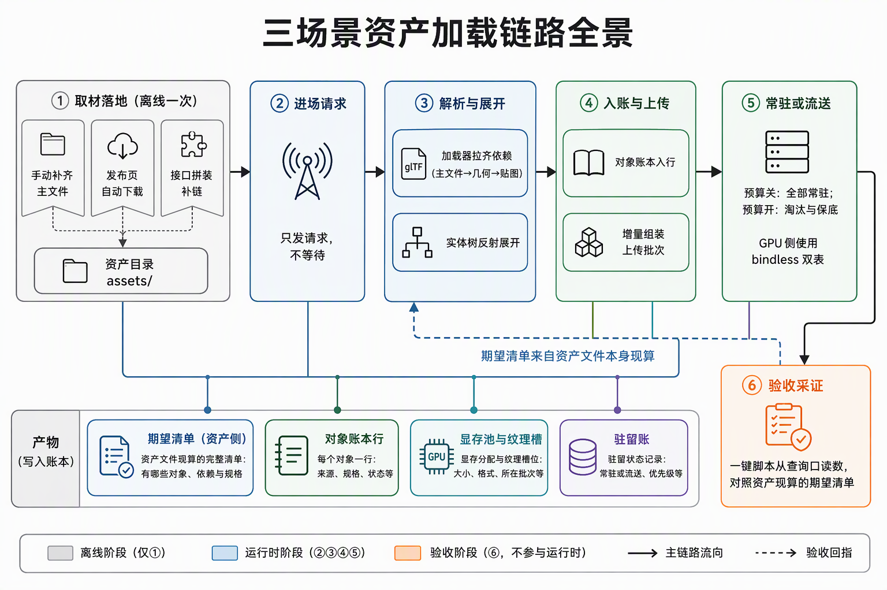
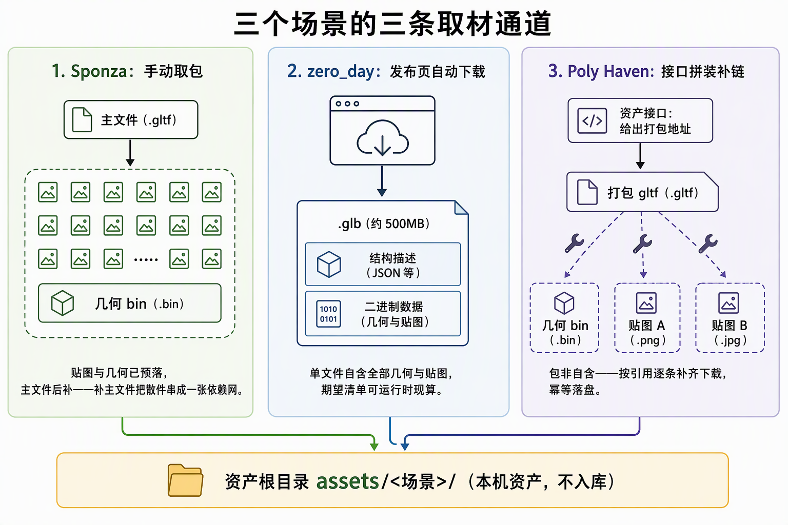
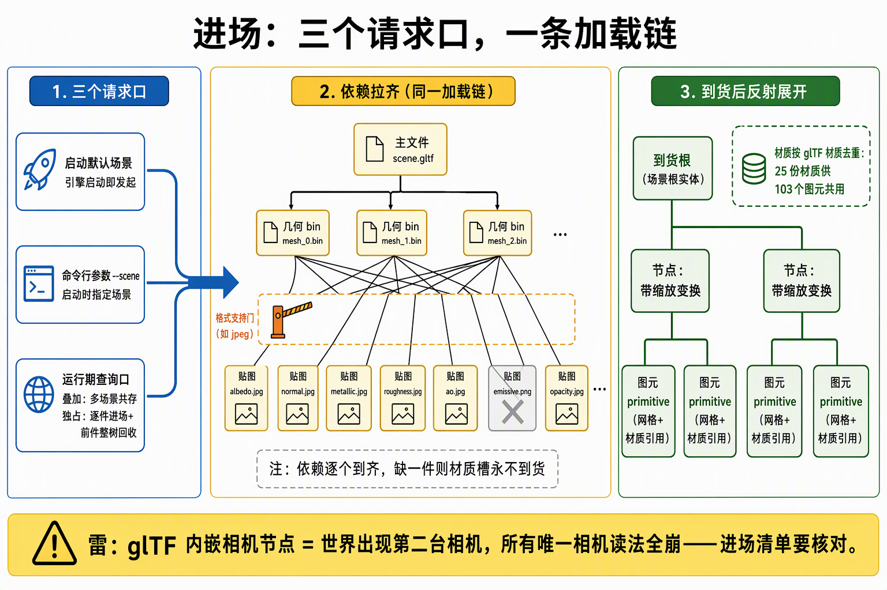
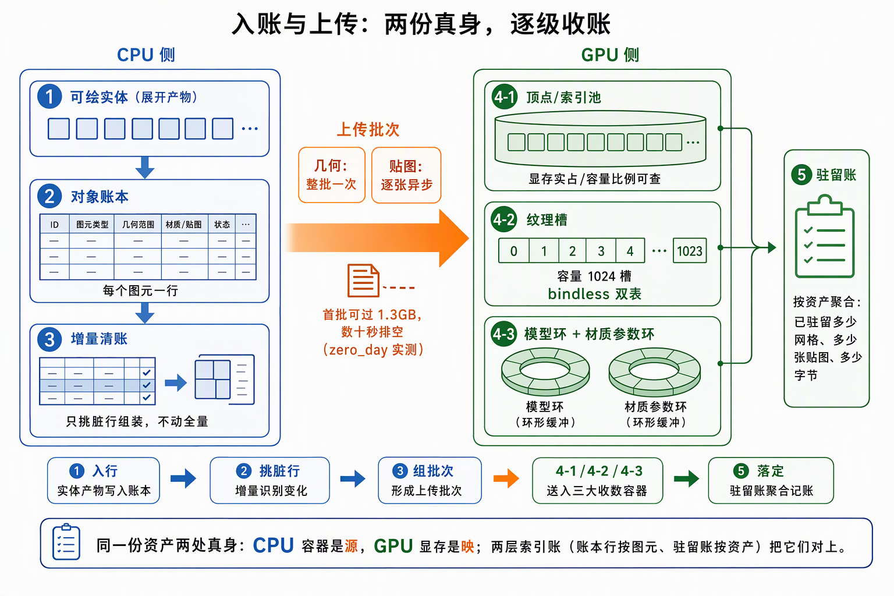
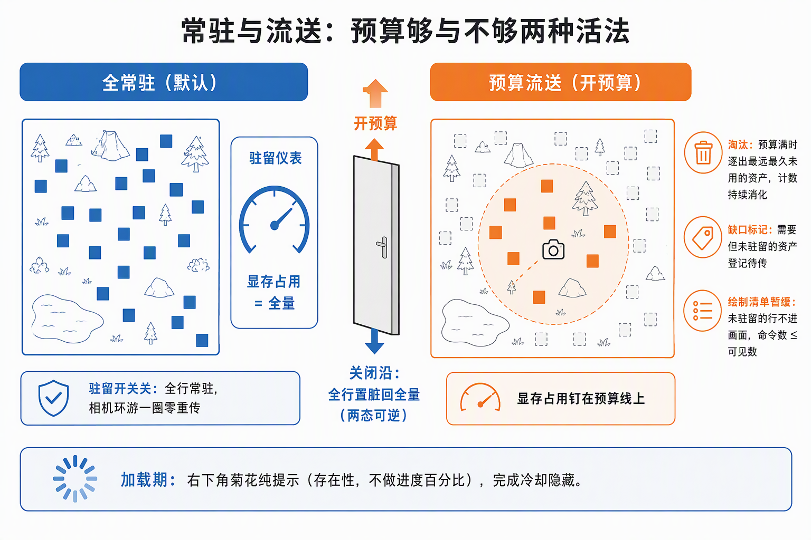
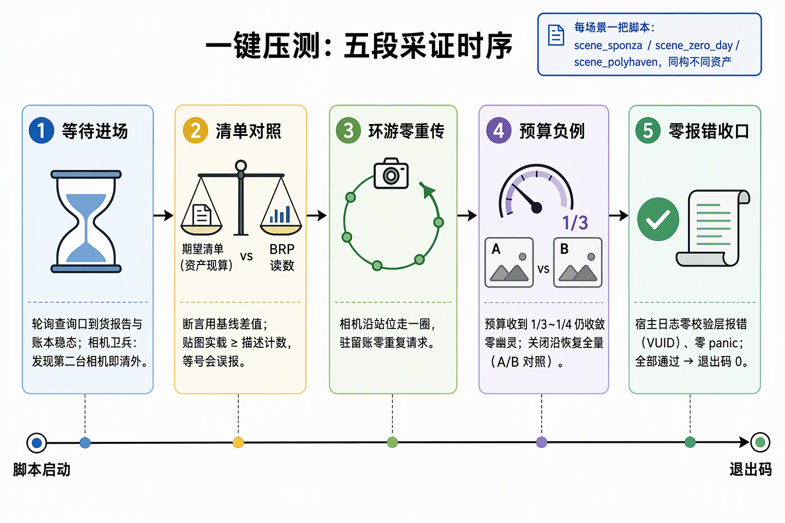

# 功能流程导读：三场景资产加载链路全景

面向下一个读代码的人：步骤 7 把三个真实资产场景（Sponza / zero_day / Poly Haven）接进步骤 3~6 的既有底座，四段全链施工收官后（7.5~7.12 为监控与治理追加段），"资产从哪来、怎么进场、怎么常驻、怎么验收"这条链值得一张全景图。本文按链路顺序走读：每个环节**做什么、读什么、写什么、三种资产在同一环节的差异**。判定线与验收数字归各段施工记录；机制本体（账本/驻留/流送）的细节归步骤 3~6 各篇，不在此重复。

一句话说明：**7.x 没有给加载链新增机制——它证明的是同一条 3.x~6.x 老链路在 1 万倍尺寸跨度和 31 倍规模差距上不用改一行机制**，新增的只有取材通道、进场请求口和验收脚本；唯一一次机制级"改动"是给 loader 补一个 jpeg feature 门。

## 一、链路全景

整条链分五段，离线一次、运行时三步、验收一段：

1. **取材落地**（离线，每场景一次）：资产文件进 `assets/` 根下的场景目录（git-excluded，本机资产）。
2. **进场请求**（Startup 或运行期）：三个请求口走同一条 `server.load` 链——只发请求不等待。
3. **依赖拉齐与展开**：glTF loader 拉齐 bin+贴图依赖 → 实体树反射展开成 primitive 子实体。
4. **入账与上传**：对象账本入行 → 增量 flush → 上传批次上 GPU → bindless 双表与驻留账逐级收数。
5. **常驻或流送**：全常驻基线（预算关）或预算下的驻留流送（淘汰/缺口/白图保底）。
6. **验收采证**：一键压测脚本族从 BRP 读数对照资产现算的期望清单。

三个场景在同一环节的规模对照（验收口径，实数）：

| 场景 | primitive | 材质 | 文件贴图 | 贴图量 | 几何量 |
|---|---|---|---|---|---|
| Sponza | 103 | 25 | 69 张 jpg | 362.8MB | mesh 9.31MB |
| zero_day | 7159 | ——（单 glb 自含） | 396 张 | 2.08GB | 顶点 221.9MB + 索引 71.9MB |
| Poly Haven 四件 | 逐件独占进场 | 互补材质面（布/瓷/黄铜/木雕） | 每件贴图槽全 | 走细粒度字节预算列 | 小件 |

## 二、取材：三个场景三条通道

三个场景的**获取方式**各不相同，落点约定一致（`assets/<场景>/`，AssetServer 相对路径）：

- **Sponza（7.1）**：Khronos glTF-Sample-Assets 手动取包，贴图 69 张预落，**主文件（.gltf/.bin）后补**——补主文件就是把散件串成一张依赖网的收口动作。
- **zero_day（7.2）**：Beeple 科幻走廊约 500MB，release 自动下载（curl）落 `assets/zero_day/`；.glb 单文件**自含**全部几何与贴图，压测脚本运行时解析 glb 头与 JSON chunk 现算期望清单与站位。
- **Poly Haven（7.3）**：`fetch_polyhaven.py` 从官网 API 拼装——API 给打包 gltf 的 URL，但**包非自含**：buffer URI 在 gltf 同目录、贴图 URI 基名要映射到 `Models/jpg/<分辨率>/<资产>/`，获取脚本按 gltf URI 逐条补链防漏，幂等落盘。

## 三、进场：三个请求口，一条加载链

进场请求有三个口，机制上是同一个：

1. **Startup 默认进场**：`load_scene` 发 Sponza（默认场景，本机缺资产则空场）；
2. **启动参数**：`--scene <相对 assets/ 的路径>` 指定任意 .gltf/.glb；
3. **运行期 BRP `load_world`**：动态进场口。**叠加语义**（多场景共存：多个根实体并存、账本各自行、驻留账按资产 ID 聚合）或**独占语义**（逐件进场 + 前件整树回收——Poly Haven 压测的用法）。

到货后走 Bevy 的世界资产展开：根组件到货 → 反射展开实体树 → 逐 primitive 子实体挂网格与材质（材质按 glTF 材质去重）→ 采集核验对照到货报告的期望值（行数/容器/贴图三样俱全，10s 未齐 warn 不停帧）。**内嵌相机是雷**：glTF 里带 camera 节点会让世界出现第二台相机，所有"唯一相机"读法全崩——压测脚本轮询清理代偿，机制卫兵（宿主唯一相机）7.4 立账。

## 四、入账与上传：两份真身，逐级收账

每个资产在链路上都是**两份真身**（CPU 侧容器 + GPU 显存）加两层索引账，加载期把它们逐级接通：

1. **入行**：展开出的可绘实体写进对象账本（PostUpdate 锚点），每 primitive 一行；
2. **增量 flush**：4.1 增量账发现脏行 → 组上传批次——zero_day 首批即 7159 行全脏（批次 #135，单批 1.3GB 过账、50s 排空；Sponza 是 mesh 一批 103 个 + 贴图逐张异步几分钟排空）；
3. **收数**：几何进顶点/索引池、贴图进纹理槽、模型环/材质环照常——bindless 双表（纹理槽容量 1024）与驻留账逐级落定；
4. **采集核验**：到货报告对照场景期望值（content 层随场景走：Sponza 103/25/71），账本行数 vs 实体数 vs 容器数三样俱全才算进场成功。

## 五、常驻与流送：预算够与不够两种活法

驻留管理器（6.3~6.6 本体）在步骤 7 只做真实负载复验，两种形态：

- **全常驻（默认）**：驻留开关关，全部行常驻、稳态零重传——Sponza 与 zero_day 的基线口径；
- **预算流送**：开预算 + 视点半径覆盖 → 淘汰持续消化（zero_day 累计 56006 次）、显存占用钉在预算线上、未驻留行 DrawList 暂缓（命令数 ≤ 可见数，零幽灵行）；远端未驻留对象走 fallback 白图保底（Poly Haven 开细粒度档后贴图整资产淘汰，字节账钉在预算上）；
- **关闭沿**：预算关 → 全行置脏回全量——两态可逆是压测判定线的一部分。

配套的**加载指示弹窗**（7.12）：右下角菊花纯存在性提示，判据走加载三腿（请求在飞/账本未稳态），完成冷却隐藏——零交互、不做进度百分比口径。

## 六、验收：一键压测脚本族

每个场景一把 `tools/scene_*.py`，五段采证结构同构：

1. **等待进场**：轮询 BRP 到货报告/账本稳态（zero_day 另带相机卫兵轮询清外）；
2. **清单对照**：rows/resident/贴图张数 vs 资产现算清单（断言永远用基线差值——独占换场的段间基线要现读；贴图实载 ≥ JSON 计数，等号断言会误报）；
3. **环游/游历零重传**：相机沿站位走一圈，驻留账零重复请求；
4. **预算负例**：1/3~1/4 预算收敛 + 零幽灵行，A/B 关闭沿恢复；
5. **零 VUID/panic**：宿主日志判定，退出码出口。

## 七、失败路径速查

| 坑 | 症状 | 归因与处置 |
|---|---|---|
| 贴图格式 feature 缺（jpeg 首钉） | 画面静默白图、贴图计数对不上 | loader 静默回退无效扩展；feature 门补齐 |
| glTF 引用缺失（bin/贴图没下齐） | 材质槽永不到货、采集核验 warn | fetch 脚本按 URI 逐条补链 |
| 内嵌相机节点 | 第二台 Camera，唯一相机读法全崩 | 脚本轮询清理；机制卫兵归 7.4 |
| 同资产重载 | AssetServer 去重，池条目不随实体涨 | 读数断言用差值，不假设重载翻倍 |
| 预算字段误读 | 读数恒 0 | 协议字段住细粒度嵌套对象，顶层没有 |
| despawn 传播滞后 | 独占换场后秒级读数含前件残行 | 段间基线现读，不跨段复用 |

## 八、边界与去向

- **渲染画质归步骤 8/9**：7.x 三场景只保证"进得来、驻得住、验得了"；材质参数面真正被消费（metallic/roughness/normal/AO）从 8.2 Filament BRDF 起。
- **机制扩展不在本步**：加载链的缺陷走 7.4 单独立账修复先例；程序化场景合成器不主张（5.4 生成器保留作压测载具）。
- **监控与帧治理**：7.5~7.11 是步骤级收官后的追加治理段（FPS 根因/帧率同步/egui 裁剪/帧账劈细），不在本链路范围，见各段施工记录。
