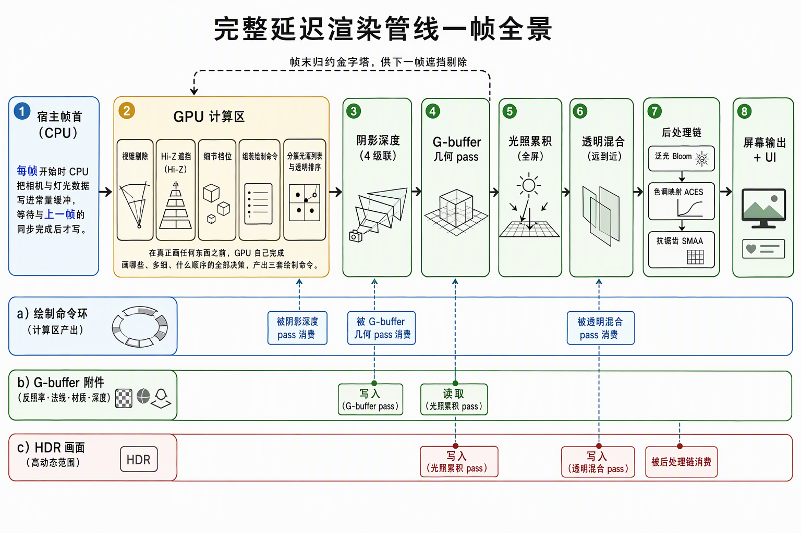
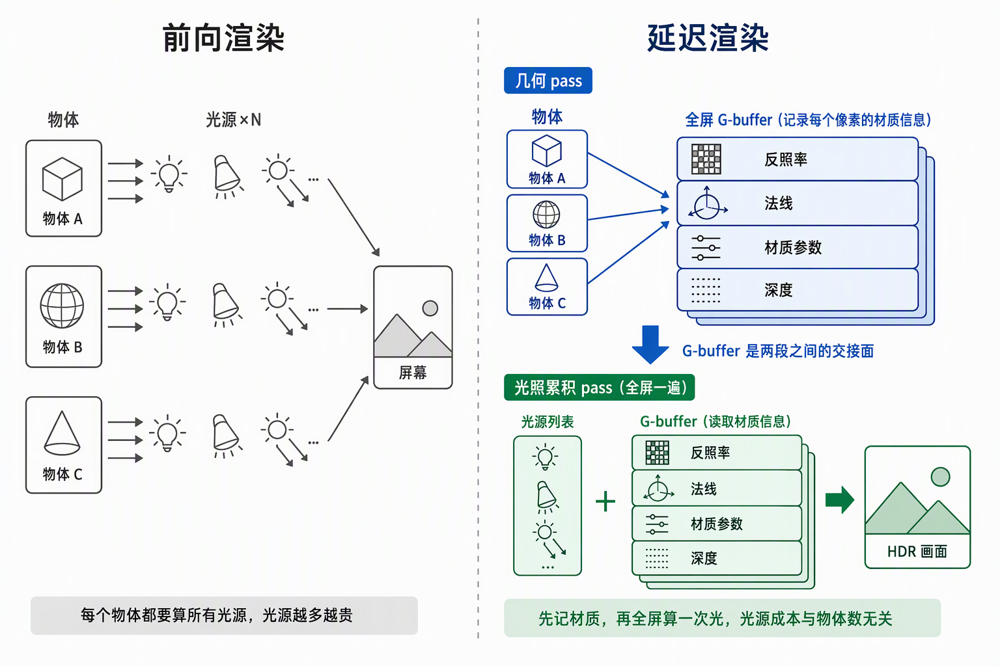
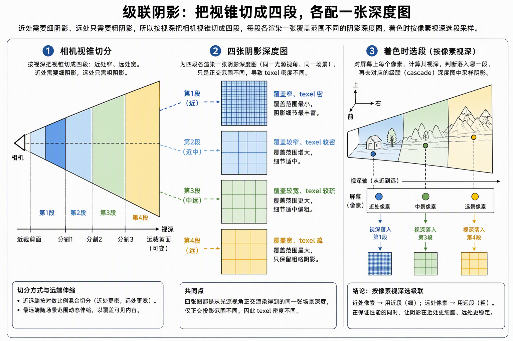
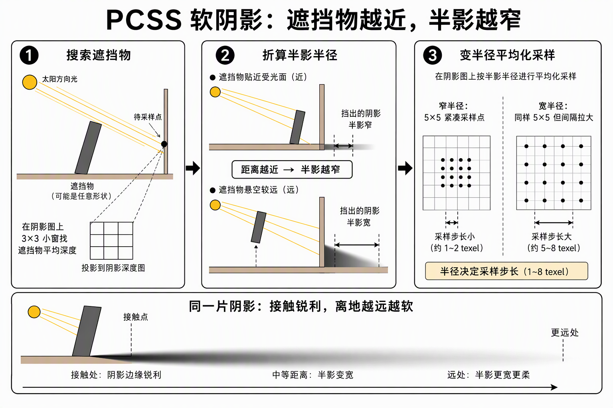
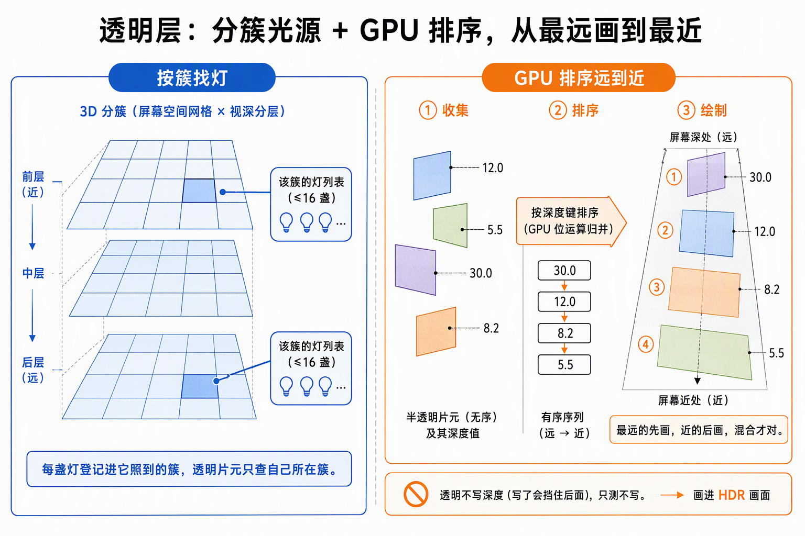
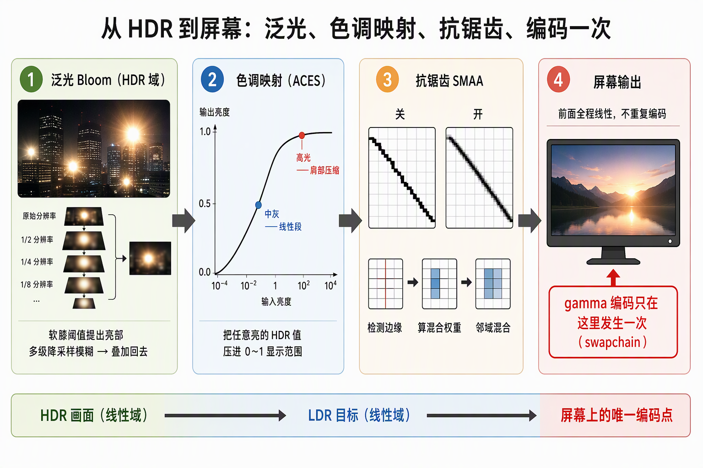

# 功能流程导读：完整延迟渲染管线一帧全景

面向下一个读代码的人：步骤 8 五段（8.1 G-buffer 与透明层 → 8.2 Filament BRDF 与多光源 → 8.3 CSM+PCSS → 8.4 HDR/ToneMapping/Bloom → 8.5 SMAA，追加 8.6 完整 ACES）全部收官后，一帧从"compute 半边 → 单 pass 直出"变成了十几个环节的多 pass 编排。本文按一帧的时间序走读整条链的全景：每个环节**做什么、读什么、写什么、为什么在那儿**。判定线与验收数字归各段施工记录，不在此重复；配图由 [tech-illustration] 逐点生成，每张只解释一个环节的机制。

一句话说明：**"画哪些"由步骤 5/6 的 GPU-driven 骨架决定（不在本文范围），"怎么画"由本条链决定**——不透明几何写 G-buffer 后由全屏光照累积统一算光，透明几何走 Clustered Forward 前向层，最后经 Bloom、色调映射、SMAA 三道后处理落进 swapchain，编码恰好一次。

## 一、一帧全景

一帧分三个大区间，先算账、再画、最后修饰：

1. **宿主帧首**（CPU，`wait_for_slot` fence 之后）：写帧 UBO（208B：相机、方向光、模式、逆矩阵）、shadow UBO（704B：级联矩阵 + 平面）、cluster 均匀数据（160B）、光源常驻表增量。
2. **compute 半边**（GPU，渲染进场之前）：视锥标记 → Hi-Z 遮挡合并 → LOD 档位 → build_indirect（不透明命令环）→ shadow 命令组装 → 透明三件（cluster 光源列表 / 透明行收集 / bitonic 排序 / 命令组装）。
3. **渲染区间**（GPU）：四级联 shadow depth → G-buffer pass → 光照累积（合成）→ 透明 forward → Hi-Z 归约 → Bloom 链 → 色调映射 → SMAA 三 pass → swapchain 直出 + UI 接画。

各环节共用一套帧槽资源（双帧槽环：命令环、UBO、附件都按帧槽 ×2 复用），GPU 对第 N 帧槽的读取由 fence（`wait_for_slot`）保证已排空——宿主每帧的写都发生在 fence 等待之后，这是全链唯一的安全证据，不再逐环节重复。

## 二、为什么延迟：先记材质，后算光

 forward（前向）渲染是"画一个物体时把它受到的所有光照直接算出来"——每个物体都要遍历全部光源，光源一多着色成本随物体数线性涨。延迟渲染把这件事拆成两步：**几何 pass 只负责把每个像素的材质信息记到一张"清单"上（G-buffer），光照 pass 拿这份清单全屏算一遍**——着色成本与像素数挂钩，与场景里画了多少物体无关，多光源从此与物体数解耦。代价是显存里多出几张全屏附件，且透明物体没法走这条路（透明不能覆写别人，只能前向混合——见第六节）。

本项目的 G-buffer 附件布局（契约钉在 `render/pipeline/gbuffer.rs` 头注释，槽位号已冻结）：

| 槽 | 附件 | 格式 | 语义 |
|---|---|---|---|
| 0 | albedo | R8G8B8A8_UNORM | 线性反照率（sRGB 解码在采样端完成） |
| 1 | normal | R16G16B16A16_SFLOAT | 世界空间法线 xyz 直存（w 未用） |
| 2 | motion vectors | ——（不分配） | **只留位不写内容**：本体归步骤 9.x 前置施工件 |
| 3 | matparam | R8G8B8A8_UNORM | r=metallic / g=AO / b=感知粗糙度 / a=reflectance |
| — | depth | D32_SFLOAT | 反向 Z（近大远小），本体在帧槽深度附件 |

世界位置**不占附件**：由深度反投影重建（inv_view_proj，8.1.2），省一张全屏附件。`set_render_mode`（BRP）可在 lambert/unlit/normal/position 四模式间切换，是逐项核对 G-buffer 内容的取证仪器。

## 三、一帧的时刻序

以 `render/pipeline/frames.rs` 的 `record_frame` 为准，逐时刻：

| # | 环节 | 做什么 | 读 | 写 |
|---|---|---|---|---|
| 0 | 进场屏障 + 透明键预填充 | G-buffer/HDR 附件进场；透明键 buffer 填 -inf（排序 padding 基线） | — | 各附件布局就位 |
| 1 | compute 半边 | cull（主视锥 + 四级联标记内联）→ Hi-Z 遮挡 → LOD → build_indirect → shadow_build → cluster_build → 透明收集 → bitonic 排序 → 命令组装 | 上帧 Hi-Z 金字塔、常驻表 | 标记环、不透明/透明/阴影三套命令环 |
| 2 | shadow depth ×4 | 每级联一个小 render pass（D32、反向 Z、GREATER），一次 indirect draw | shadow 命令环 | 4 张级联深度图 |
| 3 | G-buffer pass | 不透明场景一次 multi-draw indirect 写三附件 + 深度（clear 0） | 不透明命令环 | albedo/normal/matparam/深度 |
| 4 | 附件转只读 | albedo/normal → SHADER_READ_ONLY；深度 → DEPTH_READ_ONLY | — | — |
| 5 | 光照累积（合成 pass，全屏） | 读 G-buffer + 光源账，Filament BRDF 算全部直接光 | G-buffer 采样集、光源常驻表、cluster 列表、级联深度图、帧 UBO | HDR 中间目标 |
| 6 | 透明 forward | 深度重绑回附件（loadOp LOAD **只测不写**），HDR 目标原地混合，一次 indirect | 透明命令环、cluster 列表 | HDR 目标（增量） |
| 7 | 深度归还 + Hi-Z 归约 | 深度转 READ_ONLY，逐级 dispatch 重写本帧槽金字塔 | 深度 | Hi-Z 金字塔（供下帧 compute 遮挡） |
| 8 | Bloom 链 | prefilter（软膝阈值提亮部）→ 5 级 dual-Kawase 降采样 → 升采样逐级直加 | HDR 目标 | bloom 参数环、各级目标 |
| 9 | 色调映射 | HDR + bloom 汇 → 三态曲线（关 / Narkowicz / Filament 完整 ACES）→ LDR 目标 | HDR、bloom up[0]、参数 UBO | LDR 目标（线性域） |
| 10 | SMAA 三 pass | 边缘检测 → 混合权重 → 邻域混合直出 swapchain | LDR、edges、blend、两张 LUT | swapchain |
| 11 | UI + 提交 | UI 同实例接画（raster order 盖顶）；swapchain 转 PRESENT_SRC；提交 | — | 屏 |

计时打点 T0..T6 把帧切成 compute / shadow / G-buffer / 合成+透明 / Hi-Z / 后处理各区间（`perf.rs` 8 位时间戳）。

**稳态与失败路径**：空场（在场行 0）时透明三件、排序、shadow、场景绘制整段让路，画面 = 清屏色 + UI；透明行 0 时 bitonic 空排让路（105 派发只在真有透明行的帧出现）；resize/最小化走闸门③整链重建（swapchain → 深度 → Hi-Z → G-buffer → cluster → Bloom → SMAA，全部幂等）；相机缺席帧 UBO 走 identity 兜底。

## 四、光照累积：全屏一遍算完所有直接光

合成 pass（`gbuffer_composite.wgsl`）在 8.2.3 从 Lambert 合成重写为 Filament 标准模型光照累积，逐式照抄口径（`F:\okzkx\filament` 本地检出对照，函数保留原名）：`D_GGX` + `V_SmithGGXCorrelated`（Heitz 完整项）+ `F_Schlick` + `Fd_Lambert`，参数换算链（感知域粗糙度→α=p²、diffuseColor/F0 换算）同源。能量补偿项恒 1（无 IBL），occlusion（AO）乘光源贡献。

每个像素的取数路径：

- **世界位置**：NDC 深度 → 反投影重建（不占附件，精度押反向 Z）。
- **光源账分两路**：方向光在 set1 帧 UBO（单盏 20000 lx，不进表）；点光/聚光走 **光源常驻表**（set2 式 storage + 增量账本，4.1 先例）——shader 不遍历全表，而是按像素所在 **3D cluster**（屏幕 32px tile × 视深 32 片，近 0.1 远 200m，每簇至多 16 盏）取预构建的光源列表，只算落在该簇里的灯。
- **间接光注入项**：`(光照和 + 环境光 + indirect)` 的 indirect 位空置立桩——步骤 9 SCGI 的注入点。环境光 = GlobalAmbientLight 800（对 20000 lx 满日照的 4% 天空补光；步骤 9 IBL 落地后由真间接光接替）。
- **阴影**：方向光项乘 PCSS 可见性（下一节）；点光阴影不主张（外置）。
- **曝光**：输出前统一乘 EXPOSURE 0.00016（8.6 重校锚点——直射中灰面 ≈0.25 HDR、白墙 ≈0.85，落在 Filament 完整 ACES Hill 拟合的线性段；肩部压缩留给真高光）。透明层 shader 同锚。

debug 仪器：`set_render_mode` 四模式 + NoL/NoV/occlusion 输入探针直出，排查期立起，保留为 G-buffer 验收口。

## 五、CSM + PCSS：方向光的级联软阴影

单张 shadow map 无法同时照顾近处 1m 与远处 300m 的阴影精度，CSM（级联阴影贴图）把主相机视锥按视深切成 4 段，每段各渲染一张小深度图——近处级联覆盖窄、texel 密，远处级联覆盖宽、texel 疏，光照累积时按像素视深选级。

级联划分与拟合（`render/shading/shadow.rs`，8.3 收官后重写定稿）：

- **PSSM 混合分割**：λ=0.75（log 为主混少量均匀），near 0.5m；far 不写死——按场景最远视深夹到 80~400m，高机位俯瞰时整场景仍在带内。
- **切片拟合**：每级用 8 角点反投影取 AABB 收紧正交盒 + 包围球 XY 拟合 + texel 网格取整 + 深度向太阳侧延伸到场景顶——治影子脱离投射体与级联边界闪动。
- **shadow pass 走 GPU-driven**（贯穿红线不破）：级联标记内联进 cull（同一世界保守盒 × shadow 平面），shadow_build 逐在场行 × 每级联出一条命令（LOD 档位**再粗一档**；遮挡剔除不参与——Hi-Z 是主相机语义，对 shadow 视锥不合法），CPU 只发级联矩阵，四级联各一次 indirect draw。

采样在光照累积 pass 里走 **PCSS**（软阴影）：不是固定半径的 PCF，而是先在阴影图上做 3×3 blocker search 找遮挡物平均深度，按"遮挡物越近、半影越宽"的比值折算滤波半径（1~8 texel），再用该半径做 5×5 PCF——接触处阴影锐利、远处自然变软。采样前有法线偏移 + 斜率 bias 两道防漏光 bias（8.4.1 修过一版：斜率 bias 曾对相机位置算、随相机乱摆，改用与直射项同一光照向量）。

## 六、透明层：Clustered Forward + GPU 排序

透明物体不能写深度（会挡住后面的透明），也就进不了"先写材质后算光"的 G-buffer——它走**前向**：逐物体带材质直接算光。光源列表复用不透明侧的 3D cluster：每帧 cluster_build 把视锥切成 32px × 32 深度片的网格，逐簇写光源列表，透明片元按所在簇取灯。

绘制顺序（远→近，混合正确的前提）也归 GPU：

1. **收集**：compute 对 alpha<1 的在场行 atomicAdd 紧凑成透明数组，附深度键；
2. **排序**：bitonic 排序全容量恒定派发（105 派发，pow2 容量 16384 保证），prev 透明计数 0 的帧空排让路；
3. **组装**：升序数组**尾部反向**取（padding 的 -inf 键沉底），组最远先画的 20B 命令环；
4. **绘制**：深度附件重绑回 ATTACHMENT 但 loadOp LOAD **只测不写**（不透明深度对透明可见），HDR 目标原地 alpha 混合，一次 indirect 消费——透明 draw 调用数恒 ≤1。

排序买到的是**物体级**深度键排序（与 CPU 排序同档）；透明物体间穿插的逐片元正确性（精确 OIT）归外置拓展。alpha=0 mask 纹理素被不透明覆盖画出是 8.1 既有语义遗留，alpha test 归后续段。

## 七、后处理链：HDR → Bloom → 色调映射 → SMAA → 编码一次

8.1 起 HDR 中间目标（R16G16B16A16_SFLOAT）就是合成与透明的落色面；8.4/8.5/8.6 把"从 HDR 到屏幕"补成完整后处理链：

- **Bloom（HDR 域）**：prefilter 用软膝（阈值 1.0 / knee 0.5）提出高亮区 → 5 级半分辨率 dual-Kawase 降采样（13 tap down / tent up）→ 逐级直加回，最高一级并入色调映射输入。开关 A/B 走 BRP `bloom_set`。
- **色调映射三态**（`present_tonemap.wgsl`，曲线/增益走参数 UBO）：关（HDR 直出，仪器用）/ Narkowicz 拟合（8.4 基线）/ **Filament 完整版 aces::ACES**（8.6 默认）——sRGB→Rec2020 进契约域，过十步管线（AP0/AP1 空间 + glow + 红色修正 + Hill 拟合 + 暗部包围），增益 1.667 乘在 AP1 上，再回 sRGB。8.6 的起因是"曝光锚点落进曲线肩部 + 裸近似高光压缩"导致的受光面发灰：锚点（EXPOSURE 0.00016）与曲线选型分离外露，重校后直射中灰落线性段。
- **SMAA 三 pass（LDR 域）**：tonemap 输出进 LDR 目标（UNORM 线性存储）→ 边缘检测 → 混合权重 → 邻域混合直出 swapchain。LUT（area 160×560 / search 64×16）走预生成贴图（bevy_anti_alias 官方 ktx2 转档嵌入），HIGH 档。
- **输出编码恰好一次**：整条后处理链全程线性——曝光、bloom 叠加、ACES 输出都是线性域数学，唯一的 gamma 编码发生在 swapchain SRGB view 的 ROP 写出（3.4 拍板，贯穿步骤 8 不破）。这是 3.4 挂账到 8.4 才终结的判定线悬案。

UI 在 swapchain 同实例接画（raster order 盖顶），不参与后处理。

## 八、账面与生命周期速查

| 账面 | 写者 | 读者 | 生命周期 |
|---|---|---|---|
| set0/set2 常驻描述符表 | 增量账本（4.x 契约） | 全管线 | 进程级 |
| set1 帧 UBO / shadow UBO / cluster uniform / bloom 参数 | 宿主帧首（fence 后） | 各 pass | 帧槽环 |
| 光源常驻表 | 增量账本（BRP/面板驱动） | cluster_build / 光照累积 / 透明 | 常驻 + 增量 |
| G-buffer 四附件 + 深度 | G-buffer pass | 光照累积（采样）、透明（深度测试）、Hi-Z | 帧槽，每帧覆写 |
| HDR / LDR / bloom 各级 / edges / blend | 后处理链各 pass | 下游 pass | 帧槽，每帧覆写 |
| 命令环 ×3 + cluster 列表 | compute 半边 | 各图形 pass | 帧槽，每帧覆写 |
| Hi-Z 金字塔 | 帧末归约 | 下帧 compute 遮挡 | 帧槽，滞后一帧语义 |

诊断直读（BRP 计数、排序回读）都是帧槽直读 = **两帧前**的输出（fence 纪律），对照前提是相机与数据自产生以来未变。

## 九、边界与去向

- **GI 本体归步骤 9**：indirect 注入位已立桩，SCGI 播种/gather 的取数面就是本文的 G-buffer 三原料（albedo/normal/世界位置）。
- **motion vectors 本体 = 步骤 9.x 前置施工件**（需 InstanceLedger prev/curr 双份模型环），槽位 2 已钉死。
- **反射、精确 OIT、VSM、TAA 均不主张**（外置拓展/边界句照旧）；点光阴影不主张（外置）。
- 曝光锚点与发灰校准的完整因果（0.00063 → 0.00032 → 0.00016 三代）见 [8.6 施工记录](8.6-还原FilamentACES/8.6-施工记录：还原Filament完整ACES与曝光重校.md)与 [8.4.1 修复](8.4-HDR与ToneMapping/8.4-施工记录：HDR、ToneMapping与Bloom.md)。
