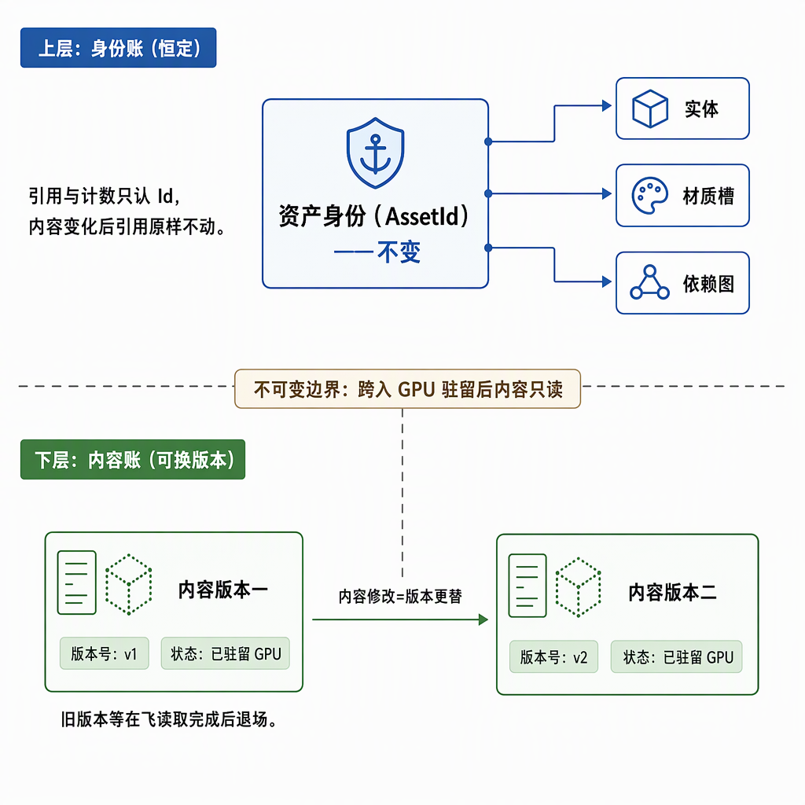
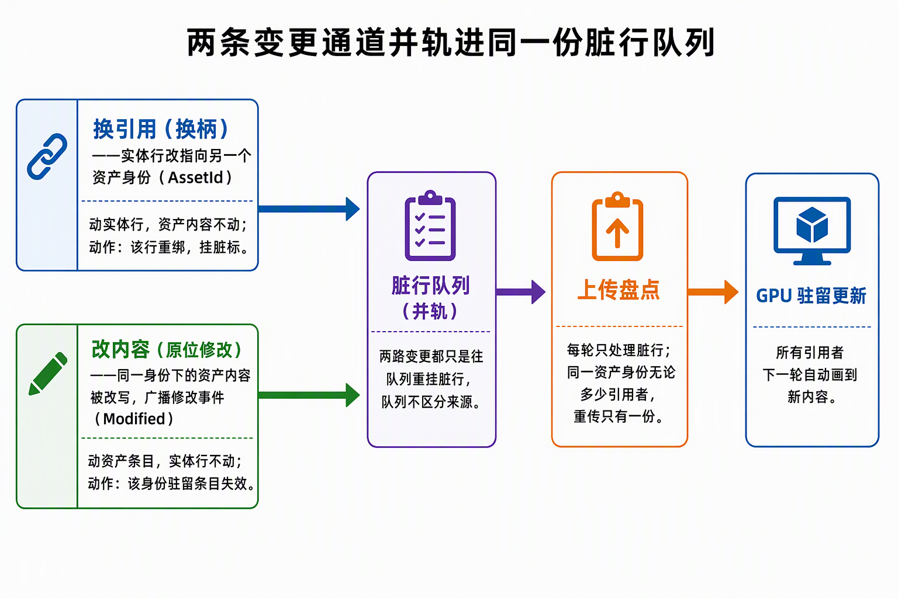
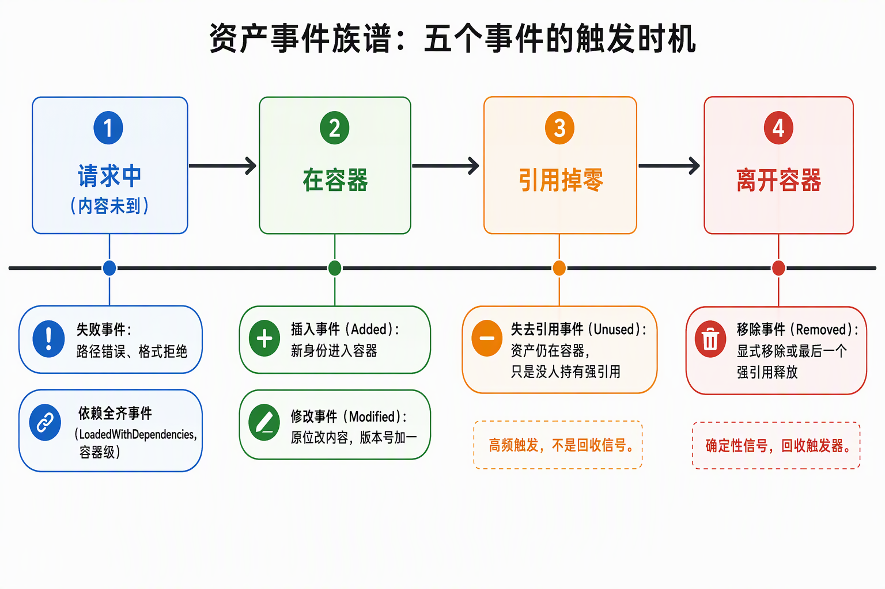

# 变更检测与资产事件语义：判定线、两条变更通道与事件族谱

Bevy 的变更检测不是差分器：`Changed<T>`/`Added<T>` 过滤器底下仍是逐实体扫描比对 tick，省的是"要不要处理"，不是"怎么发现"。资产侧同构——`Assets<T>` 容器只负责广播事件，谁引用了它、缓存过它、把它传上了 GPU，发现与善后全是读侧自己的账。本篇把组件变更的三个入口、AssetId 的身份语义、资产事件的触发时机与失败/恢复的状态转换纪律钉成一组可核对的事实。依据为本仓库 Bevy `0.20.0-dev` checkout 与自研渲染器步骤 4（可靠增量链路）的施工与验收记录，版本相关处随文标注。

## §0 判定线

1. **增量上传 ≠ 增量发现**：`Changed<T>`/`Added<T>` 仍全量扫描匹配实体做 tick 比较，省的是"要不要处理"，不是"怎么发现"；同值复写被 `set_if_neq` 拦下不触发——"扫描≠处理"的分界靠写入方纪律，不靠查询自动变增量。
2. **插入也是变更**：组件插入同样置 changed tick，`Or<(Changed<A>, Changed<B>)>` 一个查询同时覆盖新增与换柄；Changed 的判定窗口是"自上次运行**该系统**的 tick"，每个系统独立，不存在全局窗口。
3. **RemovedComponents 不带旧内容**：移除侧只报告身份不给数据，删除处理依赖移除方自己保存的关联；递归 despawn 走组件移除路径，整树清账免费拿到。
4. **AssetId 锚"身份"不锚"内容"**：热重载、同路径去重、依赖图都要求 Id 先于内容存在且跨内容变化稳定；"内容变→换 Id"会让热重载退化成全库重接线。不可变边界不在资产容器，在"跨入 GPU 驻留"处。
5. **两条变更通道判定特征相反**：换柄动实体行、不动资产内容；改内容动资产条目、不动实体行——两条通道并轨进同一份脏行队列。
6. **Unused ≠ Removed**：未到货资产失尽引用只发 `Unused` 不发 `Removed`；`Unused` 高频触发，不能当回收触发器。同身份 remove→insert 后需无条件重挂，"能发 Removed 必然无行引用"只对强引用掉零的释放路径成立。
7. **状态转换由单一责任方按固定次序完成**：恢复结果不得随合法调度顺序变化；日志去重与早退条件都不得截断状态转换。

## §1 增量上传 ≠ 增量发现：Changed 的真实成本形状

`Changed<T>` 不是引擎维护好的脏列表，而是一个谓词：调度器照常遍历所有含 `T` 的实体，逐个比较组件变更 tick 与系统上次运行 tick。加了过滤器之后，每帧成本仍随**候选实体总数**走，省掉的只是候选里"没变的那些"的处理成本。所以计量必须两口径分列：扫描数（tick 比较全集，随账本行数）单列如实报，处理数只在变更帧非零——"零上传"不等于"零扫描"，也不等于"零 CPU 每对象成本"。先单独计量扫描成本，确认瓶颈再考虑静态/动态分离或显式脏队列，不先重写 ECS。

"扫描"能否塌缩成"几乎不处理"，取决于写入方：传播系统用 `set_if_neq` 写 `GlobalTransform`（bevy_transform `systems.rs`，0.20.0-dev），值没变就不碰变更 tick——静态场景恒零触发，连 BRP 同值复写也被拦下（实测 set-transform 同值连写，处理计数不动）。这是"扫描≠处理"的结构根据：**发现侧永远是扫描，处理侧能不能为零由写入方纪律决定**。

## §2 变更的三个入口：新增、换柄与移除

- **新增/换柄共用一条入口**。组件插入同样置 changed tick，所以发现侧 `Or<(Changed<A>, Changed<B>)>` 一个查询同时覆盖"新实体挂组件"与"旧实体换柄"，不需要 `Added` 单独一条查询。
- **Changed 的窗口是每个系统自己的**。判定基准是"该系统上次运行的 tick"（bevy_ecs `change_detection`："added after the system last ran"，版本相关），同一帧内跑得早的系统看不见晚到的变更，跑得晚的能看见；窗口不是全局的，也不是"本帧"的。
- **移除侧没有内容**。`RemovedComponents<T>` 只报告哪些实体摘了 `T`，旧值已随组件销毁——删除处理只能走"按自己保存的关联逆操作"（账本行记得该实体当时用哪个资产），不能指望从事件里读回被删数据。
- **递归 despawn 走组件移除路径**。despawn 删子树时对每个被删实体逐组件写移除记录（bevy_ecs bundle/remove），`RemovedComponents` 对子树内每个 primitive 各发一次——"删整棵树"不需要遍历 `Children`，整树清账是免费副产品。
- **同帧"摘了又挂回"要定序**：移除先于新增处理，终态才正确。这是账本系统的显式排序决策，不是查询自动给的。
- **变更次帧生效是常态时序**。写入发生在调度点 A（如 Remote 阶段/外部写入），发现系统跑在 PostUpdate——本帧写入若晚于发现系统，变更次帧才进账本。这不是缺陷而是帧节拍（每系统独立窗口的直接推论），观测对账要按这个节奏对，不能假设"写完当帧可读"。

## §3 AssetId：身份账与内容账的两层结构

`AssetId` 的本职是**引用身份**：谁指着它、强引用计数归谁、同路径重复 load 去重到哪。这与 Unity `.meta` 的 GUID、UE 的对象 GUID 同构——reimport 前后 GUID 纹丝不动，动的只是 GUID 底下的导入产物。若改成"内容变了就换 Id"（内容寻址、git 形状），三个具体后果：

1. **热重载退化成全库重接线**——热重载的全部价值是引用者什么都不知道、也不用知道，实体与材质槽里的柄原样不动，下一帧自动是新内容；换 Id 则每个持有者都要被通知、被改写。
2. **路径去重要求 Id 先于内容存在**——同一文件加载两次必须得到同一资产，Id 实质是"路径的身份"，在内容读出来之前就得定下来。
3. **依赖图与元数据挂在旧 Id 上**——glTF 场景持一族子资产柄、loader 的 meta/label 按路径键控，内容一变全员换代。

行业形状是 **Id 稳定 + 内容原位替换**；"新内容新 Id"（纯不可变值语义）在"引用可廉价重解析"的世界赢，在"引用已被运行期持有"的世界输。同时要承认"加载后只读"是主流路径，`get_mut` 是少数派逃生舱——引擎必须把这条通道修好（编辑器改参数、热重载一定会用），具体游戏可以赌不用，让它一辈子零流量。

不可变边界由此落点明确：CPU 侧 `Assets<T>` 是 World 里的普通可变资源（系统级互斥，不靠不可变性）；内容一旦跨过上传边界成为 GPU 驻留版本即为只读，要改 = 新版本换上 + 旧版本等在飞读完退场。`AssetEvent::Modified` 在这套结构里的真实身份就是**版本号 +1 的广播**——上游容器被改了，下游所有按"Id → 不可变内容"建的缓存必须自己重建版本。资产生命周期（强柄掉零、家族传递退场）的另一半在《[World与场景生命周期](World与场景生命周期.md)》，本篇只管变更与事件语义。

## §4 两条变更通道并轨进脏行队列

渲染器里有两条都会改"实体画什么"的通道，账面动作正好相反：

| | 换柄（对象增量） | 改内容（资产增量） |
|---|---|---|
| 触发 | 实体的 `Handle` 改指向另一个 AssetId | `Assets::get_mut` 原位改同 Id 资产，触发 `Modified` |
| AssetId | 实体行指向的 Id 变 | Id 不变，内容变 |
| 实体账本 | 该实体行重绑 + 脏标重挂，只有它一行动 | **一行都不动**：柄没变，行里关联原样有效 |
| 资产层 | 仅新 Id 未驻留才上传 | 该 Id 驻留条目失效 → 重传恰一份 |
| 其他引用者 | 不受影响（各画各的柄） | **全部自动吃到新内容**——经"每帧现查" |

"零实体侧动作"成立的机制锚点有两处：账本行存柄不存槽位（行是 AssetId 锚定的，不是区间锚定的）；绘制侧每帧按 AssetId 现查驻留，不缓存槽位——重传发布完成后，下一帧所有引用者现查拿到的就是新内容。改内容通道的失效**按 AssetId 记账**（N 个引用者只有一份重传；错挂在实体层会退化成 N 份重传），资产→实体的关联走重扫账本行重挂脏标，与换柄/新增**并轨进同一份脏行队列**——上传消费端只有一条，不区分变更来自哪条通道。并轨的前提是写入方零配合：写入侧只管改数据（组件赋值或 `get_mut`），发现与写入解耦，所有写入方（BRP、面板、游戏代码）共用同一套变更发现。

## §5 AssetEvent 族谱：触发时机与误用面

`AssetEvent<A>` 五个变体（0.20.0-dev，版本相关；源码 `crates/bevy_asset/src/event.rs`）：

| 事件 | 触发时机 | 语义 |
|---|---|---|
| `Added` | `Assets::insert` | 新身份进容器（含同 Id 重插） |
| `Modified` | `Assets::get_mut` | 同 Id 内容变化 = 版本号 +1 的广播 |
| `Removed` | `Assets::remove` 或最后强柄 Drop | 资产离开容器（确定性释放） |
| `Unused` | 最后强引用掉零但资产仍被容器持有 | 引用计数信号，非回收信号 |
| `LoadedWithDependencies` | 依赖图全齐 | 容器级语义（glTF/WorldAsset 整体） |

事件读侧按变体分流：`Added`/`LoadedWithDependencies` 是首次驻留链的事（上传侧"查无即传"已覆盖），`Removed`/`Unused` 归回收段，只有 `Modified` 进失效通道——其余变体只计数不动作，稳态零事件帧早退不付重扫成本。

读侧最容易错的三处：

- **Unused ≠ Removed**。从未加载成功（没进过容器）的资产失尽引用只发 `Unused`，不发 `Removed`——只监听 `Removed` 清账，失败记录会持续增长。且 `Unused` 高频触发（实测每次换指/兜底材质柄掉零即发，测试窗口 12 次），不能当回收触发器；`Removed` 才是"资产离开容器"的确定性信号。
- **同身份 remove→insert 需无条件重挂**。对仍被实体引用的资产显式 `remove` 再 `insert`，读侧收到 `Removed + Added`：回收侧出账旧驻留，但若 `Added` 只在"命中失败集"时才重挂引用行，原本干净的行仍然干净——CPU 新内容在、GPU 驻留被回收而无人重传。复活/重挂必须对 `Added` 无条件做，不能只挂在失败恢复分支上。
- **`AssetPath::parse` 可 panic**。字符串转 `AssetPath` 的解析器对非法标签（如 `"file.gltf#"` 的空 label）直接 panic，不会变成异步加载失败事件，读侧永远收不到——外部输入必须 `AssetPath::try_parse` 预校验后返回协议错误。

另两个容易预期错的行为：**同路径 load 已驻留资产是 no-op**——资产在容器内时 `AssetServer.load` 直接返回既有柄，不读盘、不发事件；删除磁盘文件不触发失败也不触发重载，重载要走 `AssetServer::reload` 或文件监听。**glTF 子资产显式 load 到货后管线追加一次 `Modified`**（bevy_asset 上游行为，0.20.0-dev）——同内容重传一次，事件读侧按"失效→查驻留"判定消化即可；`LoadedWithDependencies` 是容器级语义，逐叶资产记账的读侧可以只计数不消费。

## §6 异步就绪："不卡顿"的真实语义与失败断根

**异步加载不卡顿有两种实现，语义不同**。一种是把阻塞搬进子线程错开时刻：IO 真异步，但交接时刻是隐藏停顿点——子线程持锁建 GPU 资源、等设备空闲，主循环碰状态就得等锁；停顿不是被消灭，是被"一次换完"的粗粒度藏住。另一种是账面 + 票据的可观测交接：等待记入 pending 账（资产身份粒度，跨行共享身份只记一份）、就绪判定逐腿查容器命中、画到新内容前等上传票据——交接不停帧，且"等了多久、失败几个、取消几个、谁还在等"全部可对账。Bevy 的加载任务在 IO 任务池跑 async、事件经帧节拍分发，属于后者的底座；等待/失败/取消是否可观测，是评价就绪语义的标尺。

**取消与失败的状态语义**：

- **取消 = 当帧失去全部引用行即出账**。等待期间 despawn 或换柄，到货后无行可服务就不上传不入账——"错误复活对象"在结构上不可能（上传只盘点脏行，行没了就没有凭据），这是结构性保证，不是小心编码。
- **"失败"不是瞬时判定**。路径不存在的失败要等 IO 任务链走完才被 AssetServer 探测到（实测 ~0.4s），期间身份如实记 pending——账面要如实记录这段"已注定失败但还没被判失败"的窗口，不能假设 load 发起即可判成败。
- **失败断根，复活靠事件**。失败身份进 failed 集一次性出队（行清脏标，不再进重试批，防僵尸脏行）；复活只有两个事件入口——文件修复触发的 `Added`（reload 重走加载链）与 `Modified`。这里有一条实测断头：**"放行重试身份"与"有行可重试"是两件事**——失败行出队时已清脏标，若事件侧只把身份移出 failed 集而不重挂引用行脏标，修复后的资产永不重传。失败断根的设计必须补上这条复活回边。
- **整 WorldAsset 热重载是 despawn+respawn**。重载执行底座按"Modified → 卸载重建"走：旧实体整树 despawn（走组件移除路径，账本清账免费）再重新 spawn，**旧 Entity 身份与运行时附加状态不默认保留**，实体号全换代——依赖实体号的外部引用（面板选中态、远程句柄）要自己处理悬空。

## §7 资产方案四件事 + 运营层

评价任何资产加载方案，拆五件看：**IO 抽象**（字节从哪来、换数据源要改几层）、**依赖编排**（依赖图谁排、"依赖全齐"怎么广播）、**就绪语义**（什么时候"能用"、失败/取消/等待可不可观测）、**卸载策略**（引用计数还是 GC、按什么粒度回收），外加只有大引擎才做的**运营层**（分组打包、地址/目录、远程分发）。缺的那件就是使用者要自己写的。

| | IO 抽象 | 依赖编排 | 就绪语义 | 卸载策略 | 运营层 |
|---|---|---|---|---|---|
| 小方案（frenderer 形状） | 揉进服务进程 | 手递手递归 | 对象级占位 | 无 | 视实现而定 |
| Unity Addressables | Provider 插件 | 编辑器/运行时双轨 | 句柄 + 回调 | Bundle 粒度引用计数 | 最全（目录/CDN/label） |
| UE | 统一异步 IO + pak | 依赖图整批异步（最强） | 软引用 + RAII 句柄 | GC 可达性 | 最厚（Registry/patch） |
| Bevy | AssetReader trait（可插拔） | 任务图 + 依赖 DAG | Handle + 事件族 | 引用计数 | **故意没有** |

Bevy 把前四件拆成五个可替换接口——`AssetReader` trait（IO）、`AssetLoader` 按扩展名注册（解码）、loader 依赖图 + `LoadedWithDependencies`（编排）、`AssetProcessor` 离线导入（对标 UE cook）、`Assets<T>`（容器 + 事件族）——然后停手。引用计数只管 `Assets` 容器；**GPU 侧回收是引擎留白**，要渲染器自己写账本逆操作（自研渲染器的 retire 契约）。运营层交给生态补。学习项目选 Bevy 的薄中间层，正因为四件事全部看得见摸得着；自研渲染器实际补的正是 Bevy 留白的两件——就绪语义（pending 账面）与 GPU 侧回收（retire/停尸房）。

## §8 状态转换纪律：单一责任方、固定次序

事件读侧一旦同时做记账、复活、重挂、回收多件事，三条纪律会反复咬人：

- **恢复结果不得随调度顺序变化**。两个系统都只排"在账本系统之后"、彼此无序，一个清失败标记、另一个要看见标记才能重挂引用行——两个合法调度顺序给出相反结果（实测 `dirty=1` 与 `dirty=0` 各一次）。可变借用互斥只保证不并发访问，不保证需要的先后；修法是**并入单一系统、系统内固定次序**（先失败记账、后复活/重挂），让第二种合法调度不复存在。
- **日志去重会吞状态转换**。"同一身份只告警一次"的去重集合若把状态转换（进 failed 集）写在它的条件分支里，"拒绝→Modified 复活→再次拒绝"的第二次拒绝就被吞掉，脏行僵尸重试——日志去重与状态记账必须分开写。
- **早退条件会截断恢复分支**。"无失效凭据就早退"这类优化，若本帧只出现了新加入的转换分支（如材质复活）而早退条件没检查它，恢复处理被跳过——每加一个转换分支，早退条件要同步扩展。
- **事件计量分三口径**：当帧值（每帧先落账再谈早退，空事件帧归零）、累计值（只增，操作前后差值对账）、当前存量（集合规模另列）——三者混在一个字段里，读数无法对账（空帧保留上次非零值、累计字段被赋成集合长度，都是实测抓过的口径错误）。

## 来源

- [4.1.1-4.1.6-对象增量施工记录](../../开发步骤/4-可靠增量链路/4.1-对象增量/4.1.1-4.1.6-对象增量施工记录：稳定槽账本、增量写入与BRP方法族.md)——三条变更入口、set_if_neq、递归 despawn 走组件移除路径
- [AssetId变更语义：两条变更通道、Id稳定性取舍与驻留失效实现](../../开发步骤/4-可靠增量链路/4.2-资产增量/AssetId变更语义：两条变更通道、Id稳定性取舍与驻留失效实现.md)——Id 锚身份不锚内容、不可变边界、Modified=版本广播
- [4.2.1-4.2.5-资产增量施工记录](../../开发步骤/4-可靠增量链路/4.2-资产增量/4.2.1-4.2.5-资产增量施工记录：事件读侧、失效联动与同柄重传.md)——Modified 通道、共享去重、失效并轨脏行队列
- [4.3.1-4.3.4-异步就绪施工记录](../../开发步骤/4-可靠增量链路/4.3-异步就绪/4.3.1-4.3.4-异步就绪施工记录：pending账面、失败取消与动态加载.md)——pending 账面、失败探测窗口、失败断根
- [资产加载方案对照：frenderer、Addressables、UE与Bevy的异步加载拆解](../../开发步骤/4-可靠增量链路/4.3-异步就绪/资产加载方案对照：frenderer、Addressables、UE与Bevy的异步加载拆解.md)——四件事+运营层框架、交接时序两形态
- [4-验收复核](../../开发步骤/4-可靠增量链路/4-验收复核.md)——Unused≠Removed、同身份重插、两个无序系统反例、日志去重/早退截断（§2.4、§3.1~§3.3、§8.1）
- [4.4.1-4.4.4-回收与热重载施工记录](../../开发步骤/4-可靠增量链路/4.4-回收与热重载/4.4.1-4.4.4-回收与热重载施工记录：卸载回收、双停尸房与热重载链.md)——Unused 高频触发、同路径 load no-op、复活联动断头实抓
- [学习目标实现步骤·步骤 4 重要边界](../../开发步骤/学习目标实现步骤.md)——增量上传≠增量发现、RemovedComponents 不带旧内容
- 相关笔记：《[World与场景生命周期](World与场景生命周期.md)》——资产生命周期/引用计数/场景清账在彼篇
