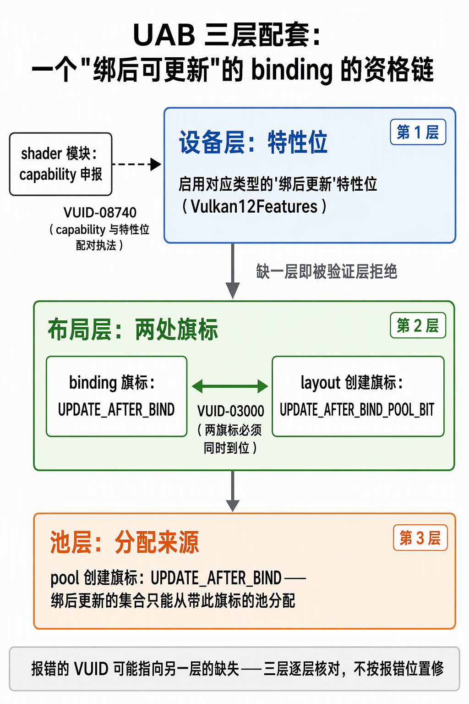
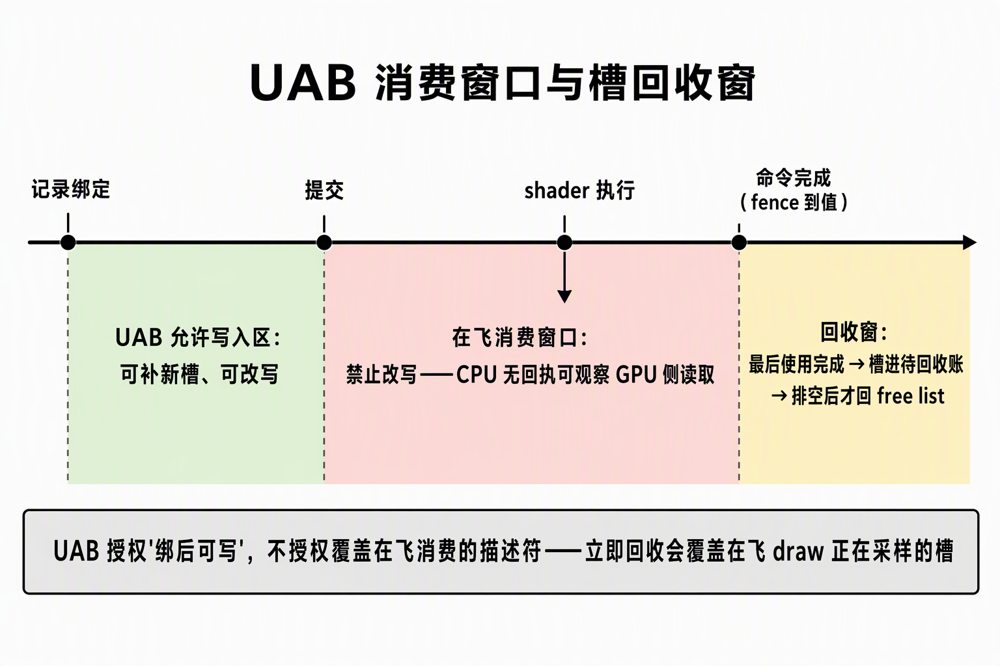
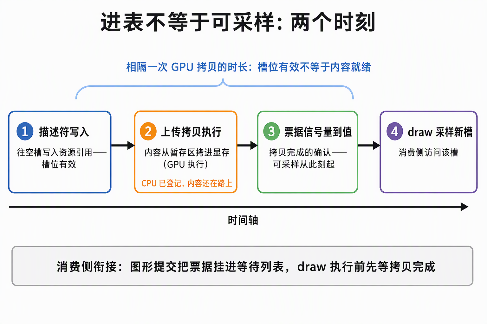

# bindless 描述符语义：判定线、UAB 三层配套与消费窗口

> 描述符索引（descriptor indexing，俗称 bindless）把"每 draw 换一次描述符集"换成"一张常驻大数组 + shader 内动态下标"。它不是"关掉安全校验"：能力类开关是纯表达力，契约类开关（UPDATE_AFTER_BIND、PARTIALLY_BOUND）是换契约——验证层对旗标配套、capability↔feature 一致性的执法全程照收，真正松动的是时序安全，防它的不再是 API 默认而是应用自己的槽位纪律。缩写全称见[术语速查](术语速查.md)。

## 0. 判定线

- **本质换位：资源选择权从 command buffer 的绑定状态（每 draw 换 set）搬进着色器输入数据（一个 u32 槽号）；代价是把资源有效性问题从绑定时刻挪到执行时刻。** 默认契约下"提交的 set 里描述符全部有效且内容不变"由 API 保证；bindless 之后"这个下标此刻是否有效、内容是否就绪、会不会被覆盖"全落在 shader 执行时刻，由应用的槽位纪律回答。
- **UAB 的授权边界：绑后可写，不等于在飞可覆盖。** 真实消费窗口 = 提交 → shader 执行 → 命令完成；命令在飞期间描述符不得改写、set 不得释放。由此推出：槽回收必须等最后使用完成，不能立即回 free list。
- **进表 ≠ 可采样**：描述符写入生效与图像内容就绪相隔一次 GPU 拷贝，消费侧靠票据信号量衔接。
- **空槽访问是 UB 且验证层不保证能抓**；PARTIALLY_BOUND 的合法性条件只有一句"不访问就不违规"。
- **UAB 限额不在普通 Limits 里**：住 Properties2 扩展结构，与普通轨双轨记账；SAMPLER 型 UAB 不需要特性位。

## 1. 默认契约：冻结保证与它的解除方式

默认模型里 `vkCmdBindDescriptorSets` 绑定即生效，驱动按"内容冻结"自由优化——描述符解析提前、按 set 缓存。传统逐 draw 换 set 的成本就出在这里：画 100 个不同的东西换 100 次，每次都是一次重新布置。bindless 打破冻结：表启动时建一次，运行中随时塞新槽，驱动因此失去冻结保证，只能走另一条更保守的解析路径。

Vulkan 的处理方式是不替你选：两条路径都给，走哪条由 feature bit 在 device 创建时一次性声明。device 不可变，事后不能补签，想开只剩重建一条路——这也决定了施工次序：layout 的 UAB 旗标会回头查 feature，特性启用必须排在建 layout 之前。

按类别分清两组开关的分工：能力类（`runtimeDescriptorArray` 无长度数组、NonUniform 按类型位）不启用就根本无法表达，与安全无关；契约类（UAB、PARTIALLY_BOUND）不是关校验，是换契约——UAB 把"绑定即冻结"换成"应用自负时序责任"，PARTIALLY_BOUND 把"全部有效"收缩为"不访问就不违规"。

## 2. UAB 三层配套：各层执法哪条 VUID

feature bit 只是三层中的第一层。一个"绑后可改写"的 binding 要合法，三层的旗标必须同时到位，缺一层验证层就开抓：

| 层 | 要求什么 | 执法 |
|---|---|---|
| device 层 | 特性结构里对应类型的 `…UpdateAfterBind` 位 | SPIR-V capability ↔ feature 配对由 VUID-08740 执法：模块声明 capability 而特性未启用 → 建 shader 模块被拒 |
| layout 层 | binding 旗标 `UPDATE_AFTER_BIND`（经 binding flags 扩展结构挂入）+ layout 创建旗标 `UPDATE_AFTER_BIND_POOL_BIT` | VUID-03000：binding 带 UAB 旗标则 layout 创建旗标必须跟上 |
| pool 层 | pool 创建旗标 `UPDATE_AFTER_BIND` | UAB set 必须从带此旗标的 pool 分配 |

shader 层是 device 层执法的另一面：runtime 无长度数组要求 SPIR-V 声明 `RuntimeDescriptorArray` capability（VUID-04680），capability 与 feature 位的配对归 VUID-08740——device 层的特性启用同时是 shader 模块的合法性前提，两个检查点（spirv-val、验证层内嵌校验）执法同一条款。

PARTIALLY_BOUND 同构：feature 位 + binding 旗标 + 同一个 layout 创建旗标；pool 层不要求——partially bound 不涉及 pool 的绑后分配语义。

排查要点：**报错的 VUID 指向的可能是另一层的缺失。**漏掉 device 层特性位，报错出现在 shader 模块创建（08740）；漏掉 layout 创建旗标，报错落在 layout 创建（03000）。某一层报错不等于病根在那一层——三层逐层核对，不按报错位置修。



## 3. UAB 的真实消费窗口：提交 → 命令完成

UAB 解除的只有"记录绑定后内容冻结"；它**不**授权覆盖仍被未完成命令消费的描述符。规范在描述符集更新条款里划的线是：命令缓冲提交后处于在飞（pending）状态期间，其中引用的描述符不得改写，set 不得 free 或 reset。完整窗口：

```
记录绑定（UAB 允许写入区开始）→ 提交 → shader 执行 → 命令完成
                                  ├──── 在飞消费窗口：禁止改写 ────┤
```

"GPU 正在使用也可以覆盖"为什么不成立：GPU 侧何时真正采样一个描述符，CPU 没有任何回执可观察——指令可能还在队列里、可能在执行中、执行顺序也可能被重排；CPU 能等到的唯一边界信号就是命令完成（fence / 时间线）。规范把禁止窗口划到"命令完成"，正是为了盖住这个不可观察区间。

由此直接推出槽回收纪律：**最后使用完成的命令尚未结束之前，槽不能进 free list**——立即回收意味着下一个发布可能覆盖一个在飞 draw 正在采样的槽。工程形状是延迟回收账本：退场槽先进待回收账，排空点等两个条件（图形最后使用 = 帧槽 fence；上传拷贝完成 = 票据时间线信号量），取最大值一次等待，之后才归还 free list。

另有一条按场景的授权容易与 UAB 混淆：`descriptorBindingUpdateUnusedWhilePending` 允许改写"可证明未被在飞命令使用"的描述符——它作用于**没带** UAB 旗标的 binding，证明"未使用"的责任在应用；UAB 的区别在于授权面覆盖绑后分配与补槽，但同样不触及在飞消费窗口。



## 4. PARTIALLY_BOUND：空槽是 UB

| | 默认（fully bound） | PARTIALLY_BOUND |
|---|---|---|
| set 提交时的合法性条件 | 全部描述符有效 | 未写入的槽允许存在 |
| 访问未写入槽 | 形状上不可能 | **未定义行为**，验证层不保证能抓 |

UAB 与 PARTIALLY_BOUND 各管一件事、常被混为一谈：UAB 管"绑着的 set 还能不能写"（时序契约），PARTIALLY_BOUND 管"从未写入的槽允不允许存在"（完整性契约）。常驻表的形状两个都要：槽位陆续填靠 UAB，大部分槽长期空着靠 PARTIALLY_BOUND 兜着。

空槽里是垃圾还是留空是实现相关——读它可能"看起来正常"，这正是验证层抓不住的原因。PARTIALLY_BOUND 由此把"不访问空槽"从 API 保证降级为应用纪律，配套两条：①常驻 fallback 有效槽兜底，任何 draw 引到未发布下标也落在有效资源上；②槽号只认分配器的返回值，不手工推算。

取舍的判据是表形状：要"先建大、再流式填"（容量在布局里定死、启动只占个别槽），没有 PARTIALLY_BOUND 这个形状直接非法——要么把全部槽填上有效描述符，要么放弃常驻大表。换来的是一条自负责任：未发布的槽一旦被下标命中就是 UB。

## 5. 限额双轨：UAB 限额住 Properties2

描述符限额是双轨制：普通轨（`maxPerStageDescriptorSampledImages` 等）与 UAB 轨（`maxPerStageDescriptorUpdateAfterBindSampledImages` 等）分开记账、互不挪用；带 UAB 旗标的 set 只查 UAB 轨，哪怕 UAB 轨限额更小也不许越界。

**UAB 轨限额不在 `VkPhysicalDeviceLimits` 里**，在扩展结构 `VkPhysicalDeviceDescriptorIndexingProperties`，查询走 `VkPhysicalDeviceProperties2` + `push_next` 扩展链——与用 `Features2` 查特性支持同一形状。规律：**特性专属限额也在特性专属结构里**，普通 Limits 查不到就换结构，不是不存在。

对账三要点：①数组容量按元素计（1024 个纹理槽 = 1024 个描述符，不是 1 个 binding）；②每阶段与每 set 是两道独立闸，容量须同时 ≤ 两者；③全池总额（`maxUpdateAfterBindDescriptorsInAllPools`）是第三道闸。普通轨的实测值不能当 UAB 轨证据，必须另查。

SAMPLER 类型的 UAB 不需要特性位：UAB 特性位按描述符类型逐位授权，六位清单（SAMPLED_IMAGE、STORAGE_IMAGE、UNIFORM_BUFFER、STORAGE_BUFFER、两类 TEXEL_BUFFER）里没有 SAMPLER——建带 UAB 旗标的 sampler binding 规范层面无单独门槛（清单缺位推得，并经验证层实测收账）。

限额是"支持"之后的第三级门槛：特性位查到支持只是能力存在，device 创建时还要显式启用（不启用，用了即被拒），启用后容量还要过 UAB 轨限额对账——三级各查各的，跳过任何一级都在后面某处爆。

## 6. 进表 ≠ 可采样：两个时刻

描述符写入（往槽里写引用）与内容就绪是两个时刻：写入生效只说明"槽位有效"——描述符解析能落到一个合法的 image view；图像内容要等上传拷贝在 GPU 上执行完才可采样，两个时刻之间隔着一次 GPU 拷贝的时长。

**槽位有效 ≠ 内容就绪**，消费侧的衔接手段是票据信号量：上传批次提交时领取时间线信号量票据，图形提交把对应票据挂进 wait 列表，draw 执行前先等拷贝完成。CPU 侧的登记在提交成功后即可写，GPU 侧的可采样性由信号量单独把关——两个时刻各有一条独立的确认线。

按此展开，一个槽位有三个可分辨的时刻：**进表**（描述符写入，槽位有效）→ **可采样**（拷贝完成，票据到值）→ **最后使用完成**（回收前提，§3 窗口的右端）。三个时刻各有各的等待物：第一个不需要等，第二个等票据，第三个等帧 fence + 票据。两个"完成"也是两个判据：拷贝完成管可采样，最后使用完成管回收——拿前者当后者的证据会把还在飞的内容销毁掉。



## 7. pool 回收粒度：整体回收与按槽的代价

pool 旗标不带 `FREE_DESCRIPTOR_SET` 位时不得逐 set free（VUID-00312），只能整体 reset 或销毁。常驻表路线下 set 本来就与表同寿——建一次、退出整体拆——逐 set 释放没有需求场景，整体回收即唯一出口。

描述符槽在 pool 层面没有"释放单个槽"的操作：按槽回收完全是应用层账本。分配走 free list（回收栈 + bump 游标），回收走待回收账 + 排空点（§3 的双条件），两段账本衔接才构成槽位循环。代价记两笔：①换内容走"新槽发布 + 旧槽延迟回收"，槽占用随重传次数暂时增长，容量预算要按峰值同时驻留规划；②运行期没有"把容量还给 pool"这回事，容量顶是硬顶——超了要么受控扩容（重建 layout/pool），要么淘汰腾槽。

## 8. NonUniform：同 draw 内逐线程下标不同才需要

GPU shader 的一批线程默认"齐步走"：数组下标要求整组一致。合法性按三级分界：

| 下标形态 | 要求 | 特性位 |
|---|---|---|
| 编译期常量 | 无 | 无 |
| 动态但全组一致（push 常量里的槽号） | 采样图像、UBO、SSBO 等多数类型默认允许 | 无 |
| 逐线程不同（实例数据、vertex attribute、从 buffer 读出的槽号） | 按描述符类型逐位授权 | 对应 `…NonUniformIndexing` 位 + SPIR-V `NonUniform` 装饰 |

NonUniform 的授权按描述符类型逐位给出，且源语言侧纹理数组与采样器数组共用同一枚 capability——授权粒度是"这个类型数组允许逐线程下标"，不是"全 shader 允许"。

push 常量下标是整 draw 一致的值，走第二级，不需要 NonUniform。NonUniform 修饰的语义是向驱动声明"同一次 draw 内不同线程可能拿不同下标"——驱动因此放弃"整批同槽"的激进解析优化，这是它的全部代价。SPIR-V 侧的 `NonUniform` 装饰由编译器的 uniformity 分析自动发射（源语言无需手写标记），连带声明 `ShaderNonUniform` capability；capability 与 feature 位的配对由 VUID-08740 执法。

## 来源

- [描述符索引特性族：能力位全景、三层配套与限额双轨](../../开发步骤/3-静态取数链路/3.3-贴图与bindless描述符/描述符索引特性族：能力位全景、三层配套与限额双轨.md)
- [3.3.2-3.3.4-描述符与槽位：特性解禁、常驻描述符表与发布链路](../../开发步骤/3-静态取数链路/3.3-贴图与bindless描述符/3.3.2-3.3.4-描述符与槽位：特性解禁、常驻描述符表与发布链路.md)
- [bindless描述符表原理篇：flag、容量、生命周期](../../开发步骤/3-静态取数链路/3.3-贴图与bindless描述符/3.3.5-配套原理篇：bindless描述符表的flag、容量与生命周期（通俗版）.md)
- [前置闸门施工记录：naga小样例与set-binding表冻结](../../开发步骤/3-静态取数链路/3.3-贴图与bindless描述符/前置闸门施工记录：naga小样例与set-binding表冻结.md)
- [4.5.1-4.5.6-缺陷修复施工记录：待修复清单转正与判定线验证](../../开发步骤/4-可靠增量链路/4.5-缺陷修复/4.5.1-4.5.6-缺陷修复施工记录：待修复清单转正与判定线验证.md)
- [GPU寿命与失败恢复流程：从资产变更到安全销毁的各级账面](../../开发步骤/4-可靠增量链路/4.5-缺陷修复/GPU寿命与失败恢复流程：从资产变更到安全销毁的各级账面.md)
