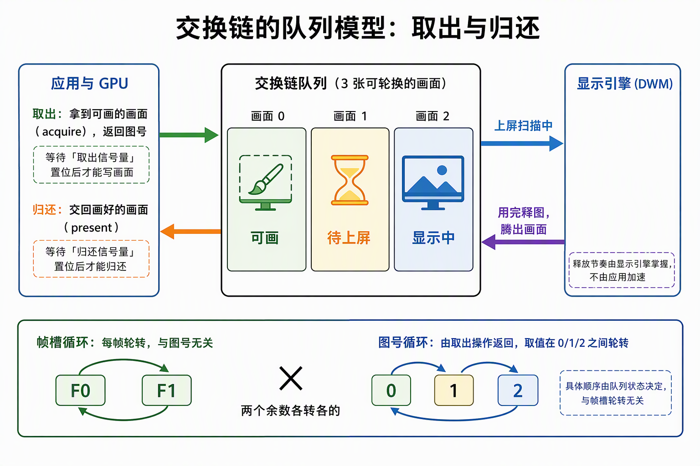
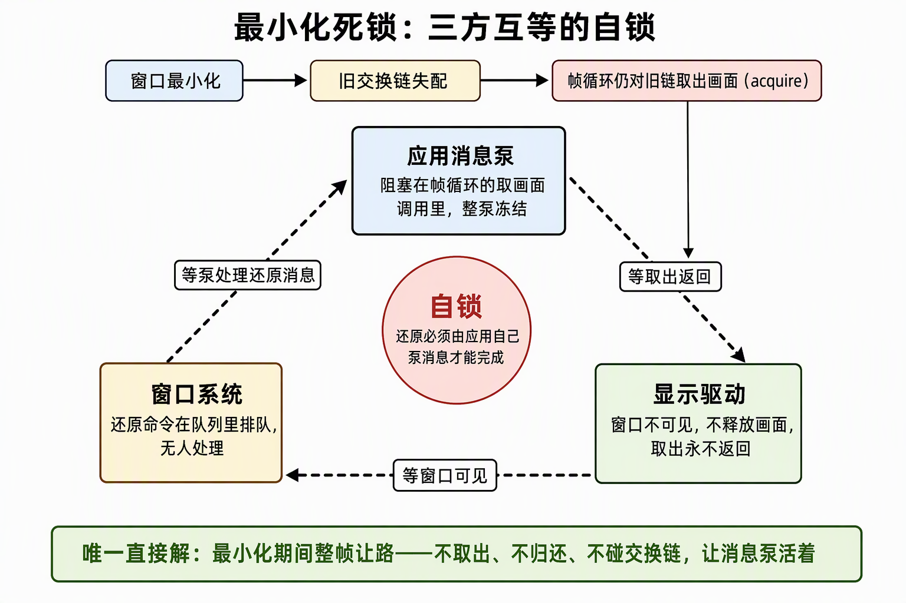
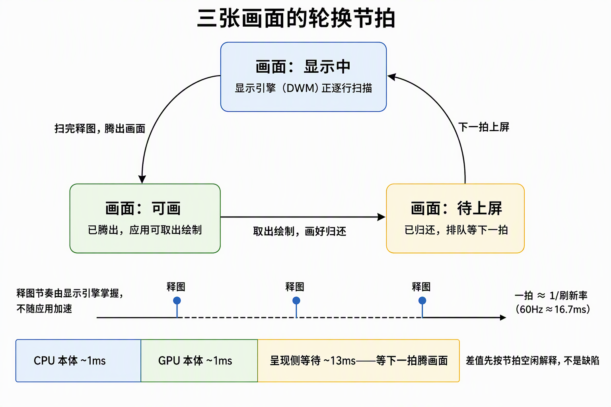

# 交换链与呈现：队列模型、重建铁律与节拍判读

> 交换链是渲染结果到屏幕的队列：image 是队列槽位，acquire 是取出、present 是归还；每帧的两枚信号量分别对应这两次队列操作，而它们的复用依据不同——一个跟帧槽走、一个必须跟 image index 走。本篇收 swapchain/present 侧的机制钉子：队列模型、重建顺序、信号量归属、present mode 口径、失配死锁、resize 成本与节拍判读、输出编码落点。

## 0. 判定线

- **交换链是"渲染结果到屏幕的队列"。** image 是队列里的槽位，acquire 是从队列取出一张可画的、present 是把画好的归还回去；呈现引擎（Windows 上是 DWM 合成器）决定槽位什么时候腾出来。它不是"一块屏幕缓冲"，也不是 D3D 那个由运行时隐式管理的黑盒——租几张、怎么轮换、怎么重建全部显式协商。
- **每帧两枚信号量各管半圈，复用依据不同。** acquire 信号量管"这张 image 可以画了"，present 完成信号量管"呈现引擎已结束对这张 image 的等待"；前者按帧槽轮转合法，后者必须按 image index 配对（§3）。
- **Win32 上同一 hwnd 同时只能挂一个交换链。** 重建必须先拆旧再建新；半建失败泄漏的对象会占住 hwnd，之后每次重建都报 `NATIVE_WINDOW_IN_USE`（§2）。
- **失配的交换链上没有可偷懒的中间态。** 窗口最小化或尺寸变化后，对旧交换链的任何 acquire/present 都可能无限阻塞驱动——不存在"继续 present 旧尺寸帧"的合法中间态，唯一的中间态是"不碰 Vulkan"（§4、§5）。
- **同步证据分强弱：结构上不可能 > 时序上必然。** 槽位隔离这种静态事实，强于"重新 acquire 推理出前次已完成"这种跨呈现引擎的动态推理链（§3）。

## 1. 队列模型：acquire 与 present 是取出与归还

交换链是与呈现引擎签的一份数量合同："按某格式、某尺寸，租 N 张可轮换画布"。显示器逐行扫描第 i 张画面的同时，GPU 在画第 i+1 张——不能画正被扫描的那张，这就是为什么至少两张；三张（三缓冲）意味着读 N、画 N+1、还备着 N+1，等待更少、延迟略高。image 归租约所有：交换链销毁时它们一起没了，销毁时只拆交换链本体、绝不动这些 image。

每帧两个信号量把队列的两端接起来：

- **acquire（取出）**：交换链交出一张"显示引擎已用完、可以画"的 image，返回它的 **image index**；同时置位一枚信号量，渲染命令的提交里在颜色输出阶段等待它——拿到 index 不等于能写，写要等信号量。
- **present（归还）**：渲染命令的提交置位另一枚信号量，present 等它到位后把 image 交还呈现引擎。

两个循环计数是独立的：帧游标按帧槽轮转（两槽，MOD 2），image index 由 acquire 返回（三张 image，MOD 3）——**两个余数各转各的，绝不互相推导**。帧级资源（命令缓冲、帧 fence、acquire 信号量）跟帧槽走，跨交换链重建原地复用；交换链重建换一轮 image，帧槽一根毫毛不动。



## 2. 重建铁律：先拆旧再建新

同 hwnd 单交换链的约束，把重建顺序钉死：**重查 surface 能力 → 等待设备空闲（在飞帧还引用旧 image）→ 显式销毁旧链（image view 先于 swapchain，销毁方法幂等）→ 创建新链**。这条链上三处省不得：不等空闲是在飞 use-after-destroy；不先拆旧是下一行要讲的 IN_USE；view 不先拆是悬空引用。

Rust 赋值语义的一个反直觉点：`*self = Self::new()` 看似优雅——右侧先求值、旧值在赋值时触发 Drop。但求值顺序决定了这是**先建新、后拆旧**，Win32 上当场 `NATIVE_WINDOW_IN_USE`，且旧链还活着，每帧重试每帧失败。**"旧值 Drop 时机"是求值顺序的产物；凡是销毁有时序要求的，把销毁写成显式方法**，销毁顺序（views → swapchain）是代码事实，不是求值顺序的副作用。

失败路径同样要守铁律：**半建失败泄漏的对象会永久占住 hwnd**。交换链本体建成、views 建到一半失败——泄漏的 view 和 swapchain 持续占着窗口，之后每次重建都 `NATIVE_WINDOW_IN_USE`，重试永远失败。修法是构建全有或全无：任何一步失败就地逆序销毁已建对象，失败后 self 是空壳，下一帧 resize 消息触发重试。重建失败本身不是致命错误——"交换链过时"是控制流分支（重建后重试），不是错误。

## 3. present 完成信号量按 image index 分配，不按帧槽

**帧提交的 fence 置位证明渲染提交已执行完；它不证明呈现引擎已结束对 present 信号量的 wait。** CPU 从 present 调用返回、命令执行完、画面已上屏，是三个不同事件。因此两帧轮转 + 帧 fence 不构成 present 信号量可复用的证明：帧 0 槽的 present 信号量在第二圈被复用时，上一次 present 可能仍在等它——错误复用不需要每次本机复现才构成设计缺口。

正确的复用依据是 **image index**：present 完成信号量按每张 swapchain image 一个分配，渲染帧按 acquire 返回的 index 取用。规范保证重新 acquire 到 image N 时，上一次对 image N 的 present 已消费完其信号量——配对关系天然闭合。交换链重建时这批信号量随新 image 集合整体换血，不跨重建复用。

同一个"证据强弱"分级，两个方向各有归属：

| 同步对象 | 跟谁走 | 依据 | 证据类型 |
|---|---|---|---|
| present 完成信号量 | **image index** | 消费方是呈现引擎，fence 够不着；同 image 两次 present 被 acquire 天然隔开 | 归属配对（规范保证） |
| 深度附件 | **帧槽** | 消费方是自己的渲染命令，帧 fence + 槽位隔离直接证明无并发引用 | 结构隔离（代码内可见） |

选深度附件按帧槽，不是因为 image index 推理错，而是那条链的每一步都要靠"相信呈现引擎的某句话"成立；信号量按 image 配对则相反——它的复用依据本来就住在规范对 acquire/present 配对的条款里。**判据是：完成证明的材料在哪个原语里，对象就跟哪边走。**

## 4. present mode 的准确口径

- **FIFO**：先进先出队列，语义即垂直同步；规范唯一保证可用的模式，是所有查询结果的兜底。
- **MAILBOX**：单槽信箱——present 把还没上屏的帧直接替换，不排队；副作用是呈现引擎不构成背压，帧循环可全速跑（§6 路 B 的根源）。

**准确口径：MAILBOX 的"acquire 永不阻塞"是行为描述，不是规范保证条款。** 它是驱动的实现表现，不能写进不变量；把"MAILBOX 下 acquire 永不阻塞"当成规范许可，与把"驱动没报错"当成用法合法，是同一类错误。

更要紧的一条：**失配的交换链上，任何 present mode 的任何 acquire/present 都可能阻塞驱动。** 试图偷懒——窗口尺寸已变却继续 present 旧尺寸帧——实测挂死。失配后能做的只有两件事：立刻重建，或整帧让路不碰 Vulkan。

## 5. 最小化死锁：三方互等的自锁

死锁链条五步，每步都有实测坐实：

```
最小化 → current_extent 变 0 → 能力检查判"无有效尺寸"，重建跳过但旧交换链保留
    → 帧循环继续，对 stale 交换链 acquire
    → 驱动对不可见 surface 的 acquire 无限阻塞（呈现引擎不释图，acquire 永等）
    → 阻塞点在消息泵内（帧循环住应用主循环）
    → 还原所需的窗口消息（WM_SYSCOMMAND 还原命令）永远轮不到处理
```

**死锁是自锁：驱动等窗口可见，窗口等消息泵，消息泵等 acquire。** 还原必须由应用自己泵消息才能完成——所以任何"绕过去"的方案都不存在，唯一的直接解是让 acquire 不发生：最小化作为失配特例，**整帧让路**——不 acquire、不 present、不碰 Vulkan，画面由呈现引擎持有的最后一帧顶住，消息泵活着；脱离最小化后闸门重开、按需重建。让路期间连加载照常（transfer 提交不依赖交换链），只是图形帧不出。



## 6. resize 的三条路

拖拽 resize（窗口尺寸连续变化）面前有三条路，成本实测如下：

**路 A：每步同步重建。** 重建链各相位实测：等待设备空闲 ≈32ms（约两个 vsync，排干在途 present）+ 销毁 ≈6ms + 创建 ≈22ms（驱动侧与 DWM 同步）≈ 60ms/次。25 步拖拽全程 ~12fps，肉眼可见顿挫。

**路 B：裸奔。** 拖拽期间 DWM 不提供 vsync 背压，acquire 不再阻塞，帧循环以更新逻辑速度裸奔（每帧 3~5ms），徒然烧 CPU（实测空闲占用翻数倍）——同步重建的卡顿之上又叠一层空转。

**路 C（终案）：帧首按需重建 + 官方节流。** resize 事件只打 pending 标记，帧首检查到标记才重建（幂等，每步恰好一次）；节流交给官方旋钮——update 循环按 1/刷新率 wait，事件仍即时唤醒。acquire 永远落在新交换链上，失配阻塞消失，CPU 占用回到节拍水平。

取舍声明钉死：**宁要渲染卡顿，不要冻结**。每步重建 28~60ms 的顿挫仍按"接受卡顿、消灭冻结"处理；重建函数的成本契约（≈60ms/次，调用方必须去抖）写进文档。与 D3D 对照：`ResizeBuffers` 无需销毁重建整条链、DXGI 还有 occluded 状态可查询；Vulkan WSI 的"失配即阻塞"只能靠应用层闸门——闸门就是 Vulkan 世界的 occluded 处理位。

## 7. 60Hz 节拍下的合法空闲

现象：关掉帧循环节流（聚焦档改全速）后，帧率稳定在 ~74fps 而非理论上的数百；分段账显示 CPU 本体 ~1ms、GPU 本体 ~1ms，**残余 ~13ms 在 present/acquire 侧**。

机制：3-image 交换链 + DWM 按刷新率释图的节奏决定了上限——一张在显示、一张已 present 待上屏、一张可画；DWM 不会比 60Hz 更快地腾出 image，acquire 等空位、present 等提交的等待就是节拍本身，不是卡顿。关掉节流只是解开了 CPU 侧的 update 等待，解不开呈现引擎的释图节奏。

**判读顺序立成规矩：frame wall 与 CPU 分段和的差值，先按节拍空闲解释，再考虑机制缺口。** 动作是先核对分段账（CPU 本体 / GPU 本体 / 呈现侧残余），呈现侧残余与 1/刷新率同量级时归节拍；账对不上再立案。



## 8. 输出编码恰一次：UNORM 底板 + SRGB view 别名

输出编码（线性 → sRGB）恰好发生一次，位置在交换链图像的 **ROP 写入**：image 本体是 UNORM 格式，渲染时给同一张 image 套一个 SRGB 格式的 image view 作为颜色附件，写入时硬件自动编码；present 读 image 本体原样上屏。采样端对称：资产贴图以 SRGB 格式驻留，采样时硬件自动解码。两头都是格式声明驱动，着色器全程拿线性值做光照——**着色器里看不到任何 gamma 代码，恰是"恰一次"的正面证据**；中间任何一处手工 pow 都是重复编码。

view 换格式不是免费的，合法性要三样凑齐：

1. **设备扩展**：swapchain 可变格式扩展（`VK_KHR_swapchain_mutable_format`），不支持就显式报错退出；
2. **创建时格式清单**：声明"这张 image 允许被这些格式 view 别名"，且清单必须包含交换链自身格式（VUID-07781）；清单结构挂 pNext，必须活到创建调用返回；
3. **交换链旗标** `MUTABLE_FORMAT`（缺它验证层收 VUID-01977）。

底板格式选 UNORM 不静默降级：交换链格式是管线配方的常量（管线创建时按同一常量声明颜色附件格式），surface 不支持就报错退出——静默退回别的格式，代价是整条受光链路的输出隐性偏暗。

## 来源

- [窗口闸门：最小化死锁与resize卡顿的实测与修复](../../开发步骤/2-宿主壳/材料/窗口闸门：最小化死锁与resize卡顿的实测与修复.md)——§1 死锁链、§2 返工三版、§5 闸门落点、§6 三条路实测
- [Context与Swapchain分家：按生命周期拆分](../../开发步骤/2-宿主壳/材料/Context与Swapchain分家：按生命周期拆分.md)——§2 先拆后建、帧槽与 image index 双循环
- [VulkanContext字段释义：从Entry到Swapchain](../../开发步骤/2-宿主壳/材料/VulkanContext字段释义：从Entry到Swapchain.md)——§1 数量合同与三缓冲、租约所有权
- [已实现缺陷与修复验收](../../开发步骤/3-静态取数链路/3.2-buffer侧上传/已实现缺陷与修复验收.md)——D2 fence 时序、D3 信号量按 image 分配
- [3.4.1-3.4.5-管线与绘制施工记录](../../开发步骤/3-静态取数链路/3.4-管线与绘制/3.4.1-3.4.5-管线与绘制施工记录：正式着色器、图形管线与DrawList同帧消费.md)——§3 证据强弱分级、§8 输出编码三件套
- [7.6.1-7.6.3-帧率同步施工记录](../../开发步骤/7-大型正式场景/7.6-帧率与刷新率同步/7.6.1-7.6.3-帧率同步施工记录：底座、监控窗口增补与BRP通道.md)——§7 节拍残余归因、vsync 语义
- [GPU寿命与失败恢复流程](../../开发步骤/4-可靠增量链路/4.5-缺陷修复/GPU寿命与失败恢复流程：从资产变更到安全销毁的各级账面.md)——§2 半建失败占 hwnd、失配期 transfer 照常
