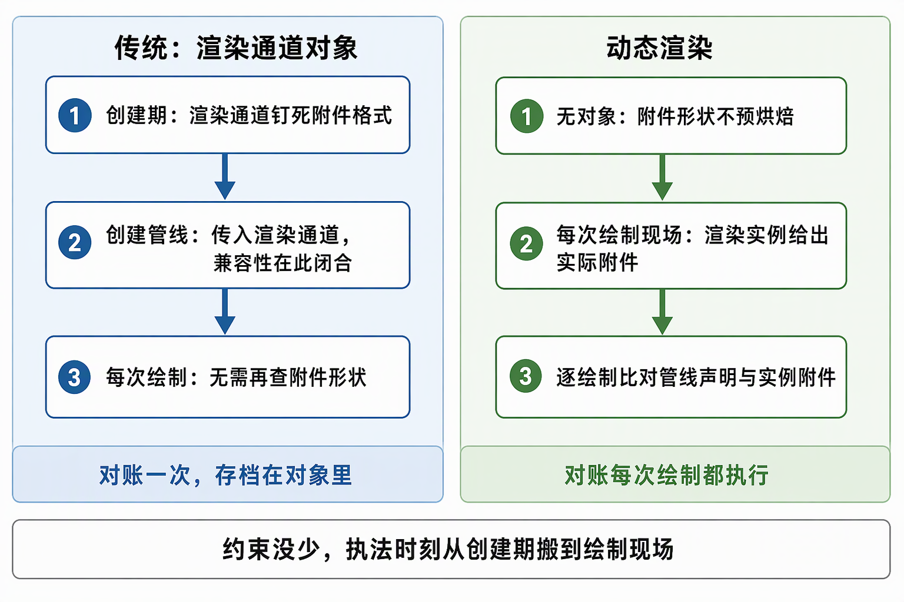
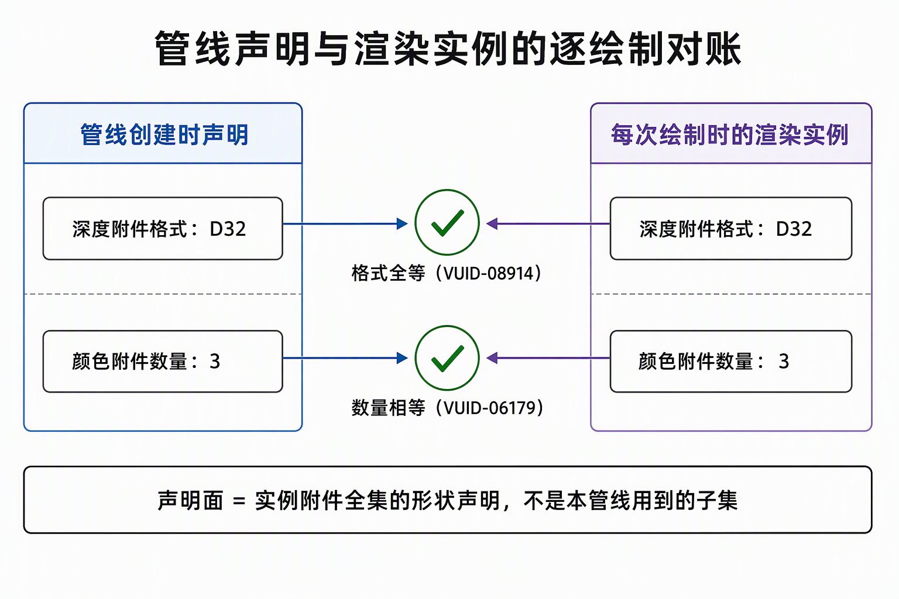
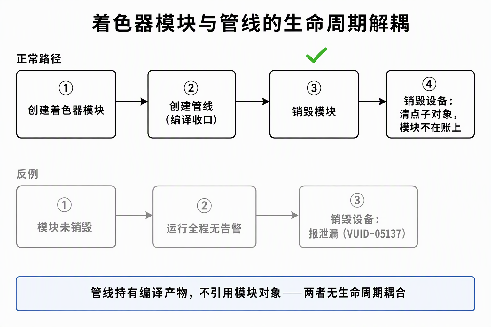

# 动态渲染下的管线声明契约：从对象兼容性到逐绘制对账

Vulkan 1.3 的动态渲染（dynamic rendering）用 `vkCmdBeginRendering` 的临时附件引用取代了 RenderPass 与 Framebuffer 两个对象：附件视图、清屏值、load/store 行为都在渲染实例（render pass instance）开始时现场给出，格式随图像视图自带。删掉对象没有删掉约束——"管线必须与渲染目标兼容"原样存在，只是执法点从创建期的对象兼容规则搬到每一次 draw：验证层在 draw 时刻把管线创建时声明的附件形状，与当前渲染实例实际绑定的附件逐项对账。本篇收这条对账面上各字段的判定线；VUID 的读法见[术语速查](术语速查.md)。

## 0. 判定线

- **管线声明面 = 它将用于的渲染实例附件全集的形状声明，不是"本管线用到的子集"。**声明与实例双向对账：深度格式必须全等（VUID-08914），颜色附件数量必须双向相等（VUID-06179）——实例侧少挂附件与管线侧少声明附件，同样违规。
- **"本管线不用"不是不声明的理由。**未启用 `dynamicRenderingUnusedAttachments` 时，不读不写深度的管线也须声明与实例相同的深度格式；合法表达是"声明同格式 + 深度测试/写入全关"——形状照实声明，行为显式关闭。
- **"空"的合法表达是空结构体，不是空指针。**无顶点输入的管线也要让 `pVertexInputState` 指向零绑定、零属性的顶点输入结构（VUID-pStages-02097）。
- **声明的布局必须是资源恒处的事实。**描述符里的 `imageLayout` 与 draw 时刻图像实际布局全等（VUID-00344）；恒绑定集合的成员必须恒合法，布局迁移屏障恒录（VUID-09600）。
- **shader module 与 pipeline 无生命周期耦合。**管线创建成功即可销毁 module；不销毁不立即报错，泄漏账挂在拆 Device 时刻（VUID-05137）。

## 1. 校验时刻的搬家

传统路径把附件形状烘焙进对象：创建 renderPass 时钉死子通道的附件格式，创建管线时传入 renderPass，此后每次 draw 的合法性由"管线所持 renderPass 与实际 renderPass 兼容"这一静态关系保证——对账在创建期完成一次，对象就是那次对账的存档。兼容关系按子通道兼容规则在对象之间传递，签名相同即可复用管线于另一 renderPass。

动态渲染删掉的是对象，不是对账。渲染实例的附件形状每次现场给出，同一条管线可能先后用于形状各异的实例，"是否兼容"随之改在每次 draw 判定。两处推论：

- **一条管线想服务多种实例形状，其声明必须是这些实例形状的公共交集**——这就是"全集的形状声明"的含义；声明收不拢就按形状分管线（放宽出口见 §8）。
- 这些 VUID 由验证层执法，驱动不保证拒绝违规用法——省略对账不构成合法，只是暂未被执法。

附件面的对账清单（答案的集合）：

| 对账项 | 管线声明侧 | 渲染实例侧 | 执法 VUID |
|---|---|---|---|
| 深度附件格式 | `depthAttachmentFormat` | 实例深度附件视图的格式 | 08914 |
| 颜色附件数量 | `colorAttachmentCount` | attachments 数组长度 | 06179 |
| 逐槽位颜色格式 | color 声明数组逐项 | attachments 数组逐项 | 08914 同族 |
| 附件样本数 | 光栅化采样数 | 附件视图的样本数 | 样本数对账同族 |
| 顶点输入状态 | `pVertexInputState` 必填 | —（结构性要求，无实例侧） | pStages-02097 |

布局面是另一族声明：对账对象是"资源当时所处的布局"而非实例附件，见 §5/§6。

还有一条面界要钉清：渲染实例侧的字段（attachments 数组、depthAttachment/stencilAttachment，各槽的 loadOp/storeOp/clearValue）里，**loadOp/storeOp/clearValue 是实例侧的行为，不进管线声明**。声明面只管形状——格式、数量、样本数；行为面（清不清、保不保）由实例表达，管线状态面（测不测、写不写、混不混）由管线自己表达。把"行为关掉"当成"形状可以不声明"，正是 §2 那族误判的来源。

## 2. 深度声明：VUID-08914

- 未启用 `dynamicRenderingUnusedAttachments` 时，管线的 `depthAttachmentFormat` 必须与渲染实例深度附件的格式**相等**，否则每次 draw 报错。
- "这条管线不读不写深度，声明 UNDEFINED 即可"不成立：对账面是实例附件全集，验证层不看管线是否消费这个附件。
- 反向同样成立：实例没挂深度附件时，管线 `depthAttachmentFormat` 须声明 UNDEFINED——"全等"在"两边都没有"上也成立，对账没有管线单方面的豁免方向。
- 合法表达：声明与实例相同的格式（如 D32），同时 `depthTestEnable` 与 `depthWriteEnable` 全关。管线编译需要知道每个挂载附件的格式才能选定后端路径，深度半边即使全关也把格式留给驱动——"声明它的形状，关掉它的行为"是把一条不用但挂着的附件写诚实的唯一表达（官方 egui 后端对 overlay 管线同此形状）。

## 3. 颜色计数与 depth-only 形状：VUID-06179

- 管线的 `colorAttachmentCount` 必须与渲染实例的 `colorAttachmentCount`（attachments 数组长度）相等，且这是**双向**对账：任一侧缺位都在 draw 时刻报形如 `pipeline colorAttachmentCount (3) != RenderingInfo colorAttachmentCount (2)` 的错误。
- 由此，给渲染实例新增一个 color 附件是一道四点随行清单：实例的 attachments 数组、进场屏障、收口转只读屏障、管线 color 格式声明——少补任何一点，即计数或格式对账失败。
- depth-only 管线的声明形状：`colorAttachmentCount = 0`、`depthAttachmentFormat = D32`。无色不是免声明的理由——深度半边照 §2 与实例全等声明；反过来，实例侧 colorAttachmentCount 也必须是 0，双向对账在"零"上同样成立。
- 计数还牵动管线内部数组：逐附件 blend 状态数组的长度必须等于 `colorAttachmentCount`——计数不是孤立数字，是管线内一组逐附件声明的长度，扩列时数组与计数要同动。

## 4. 无顶点输入：VUID-pStages-02097

全屏三角形这类不含顶点缓冲的管线，"无顶点输入"的结构表达是让 `pVertexInputState` 指向 `vertexBindingDescriptionCount = 0`、`vertexAttributeDescriptionCount = 0` 的 `VkPipelineVertexInputStateCreateInfo`。传 `NULL` 违反 VUID-pStages-02097：动态渲染没有把顶点输入状态改成可选——空指针的含义是"未提供该状态"，而合法语义只有"提供了一个空的顶点输入面"。空结构配合顶点着色器里由顶点索引推导位置（如全屏三角的 NDC 展开），就是无几何数据管线的完整声明。

执法时刻也值得分清：这条在 `vkCreateGraphicsPipelines` 创建期即报，不依赖任何 draw——而 §2/§3 的附件对账在管线创建时无从执行（实例还不存在），只能逐 draw 执法。同一份"声明契约"，执法时刻因对账对象是否已存在而不同。

## 5. 采样深度的布局声明：VUID-00344

- shader 采样深度图时，描述符写入声明的 `imageLayout` 必须与 draw 时刻该图像的实际布局**全等**——布局枚举逐位比对，语义相近不算匹配。
- 深度附件转可采样的目标布局是 `DEPTH_STENCIL_READ_ONLY_OPTIMAL`（名字里的 STENCIL 是枚举名的一部分，不是"必须连模板一起只读"的额外条件），于是三处必须钉在同一枚举上：帧尾把深度从 ATTACHMENT 迁往可采样布局的屏障、描述符声明、shader 消费假设。
- 描述符写 `SHADER_READ_ONLY_OPTIMAL`、屏障落到深度只读布局，两边都"只读"也照报——防漂移的做法是布局常量单点定义、描述符与屏障共享。
- 深度只读布局族存在的意义：它们是少数允许图像**同时作为附件挂载且被采样**的布局——透明层把上一 pass 的深度以只读布局重挂回实例（loadOp LOAD 只测不写）就是这条性质的用法；普通 `ATTACHMENT_OPTIMAL` 下的深度不可采样，取数要么走只读布局，要么另立拷贝目标。

## 6. 恒绑定集合的恒合法布局：VUID-09600

- 描述符 set 绑定在管线上、shader 静态引用其中资源的时刻起，成员资源的布局就必须**恒**合法——与本帧是否真的执行到采样分支无关。"静态引用"指 shader 代码里真实读写该绑定，与运行时数据分支无关：shader 访问它，验证层就要求它随时合法。
- 空场（无可绘制对象）、功能开关关闭的帧也在集内，所以布局迁移屏障必须恒录："本帧没用到就跳过这次迁移"的省略会把整集拖进非法布局，报错点在下一个 draw 而非屏障缺席处。
- `UNDEFINED` 作 oldLayout 是"恒录"能落地的结构前提：它声明"不关心图像从哪个布局来"，从任意终态（包括首次使用的未初始化状态）进入本次迁移都合法。
- 进出形状固定为 UNDEFINED→ATTACHMENT（进场渲染）、ATTACHMENT→可采样布局（收口发布）时，屏障序列与帧内容完全解耦——恒录不需要对"上一帧走到了哪"做任何推断，这正是消费端描述符可以恒绑定（空场也挂全集）的配套条件。

## 7. shader module 与 pipeline 解耦：VUID-05137

- 管线创建成功后，shader module 即可销毁：管线对象持有的是编译收口后的内部产物，不引用 module，两者没有生命周期耦合。标准形状是"创建 module → 创建管线 → 立即销毁 module"，成功路径不留句柄。
- 要延长 module 寿命的场景只有"一个 module 批量创建多条管线"——批量建完统一销毁即可；"销毁后再拿该 module 建新管线"才是唯一禁止的动作。
- 反面账目：module 不销毁不会立刻报错——它是 Device 的子对象，泄漏在 `vkDestroyDevice` 时刻被整账清点（VUID-vkDestroyDevice-device-05137：Device 存在未销毁的子对象）。运行期帧循环零告警与子对象泄漏可以并存，这条账只能靠"退出路径也开着验证层"闭合。
- 失败路径须兜底销毁 module，否则管线创建中途失败会另漏一个。

## 8. dynamicRenderingUnusedAttachments：放宽与代价

- **启用条件**：独立的设备 feature 位（扩展 `VK_EXT_dynamic_rendering_unused_attachments` 引入），需查询支持并在设备创建时显式启用；动态渲染本体随 Vulkan 1.3 核心开启，但不包含这个放宽位。
- **放宽了什么**：管线"不用"的附件不再要求与实例对账——不消费的 color 槽位、不用的深度半边可声明 `UNDEFINED`，一条管线得以服务附件格式不同的多个渲染实例，省掉按附件组合展开的管线排列。
- **付出什么**：被豁免的附件在管线侧成为未知格式，驱动失去按具体格式做编译期特化的输入，只能按通用路径处理；可用性随设备而异，不能当无条件前提写进架构。默认维持全等声明、确有跨形状复用需求再开这个位，是把选择权留在编译期的稳妥顺序。
- **判定例**：一条 overlay 管线要先后服务"挂深度"与"不挂深度"两种实例——实例形状固定时维持全等声明（各建一条或按形状收拢）；实例形状真会变，才是这个 feature 的适用场景。

## 来源

- [3.7.4-回归收官](../../开发步骤/3-静态取数链路/3.7-egui调试GUI/3.7.4-回归收官：判定线全量、ppp双域订正与输入排查链.md)——VUID-08914 首抓与"声明同格式 + 全关"修法
- [8.1.1-施工记录](../../开发步骤/8-完整延迟渲染管线/8.1-G-buffer与不透明几何/8.1.1-施工记录：render迁移与G-buffer多pass首跑.md)——VUID-pStages-02097 与 VUID-00344 实抓
- [8.1.2-施工记录](../../开发步骤/8-完整延迟渲染管线/8.1-G-buffer与不透明几何/8.1.2-施工记录：深度反投影重建世界位置.md) / [8.1.3-施工记录](../../开发步骤/8-完整延迟渲染管线/8.1-G-buffer与不透明几何/8.1.3-施工记录：透明ClusteredForward层.md)——G-buffer 采样面与透明层深度附件重绑的随行面
- [8.2.1-施工记录](../../开发步骤/8-完整延迟渲染管线/8.2-FilamentBRDF与多光源/8.2.1-施工记录：材质参数面扩容.md)——VUID-06179 计数对账
- [8.3.1-施工记录](../../开发步骤/8-完整延迟渲染管线/8.3-CSM与PCSS级联阴影/8.3.1-施工记录：CSM级联底座.md) / [8.3.2-施工记录](../../开发步骤/8-完整延迟渲染管线/8.3-CSM与PCSS级联阴影/8.3.2-施工记录：shadow标记、命令与depthpass.md)——depth-only 声明面与恒绑定屏障恒录（VUID-09600）
- [3.2-已实现缺陷与修复验收](../../开发步骤/3-静态取数链路/3.2-buffer侧上传/已实现缺陷与修复验收.md)——D7：VUID-05137 与 module/pipeline 生命周期解耦
- [写文档纪律](../写文档纪律.md)——本文体例依据
