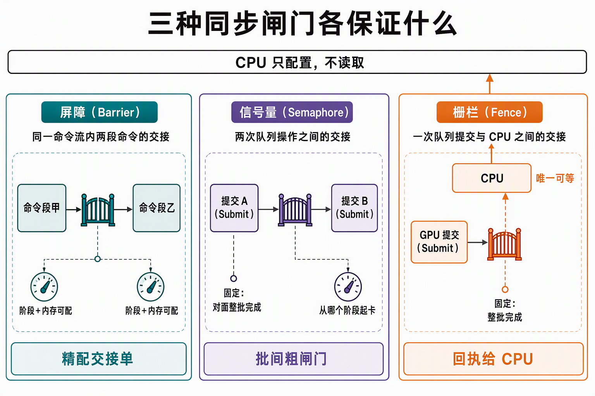
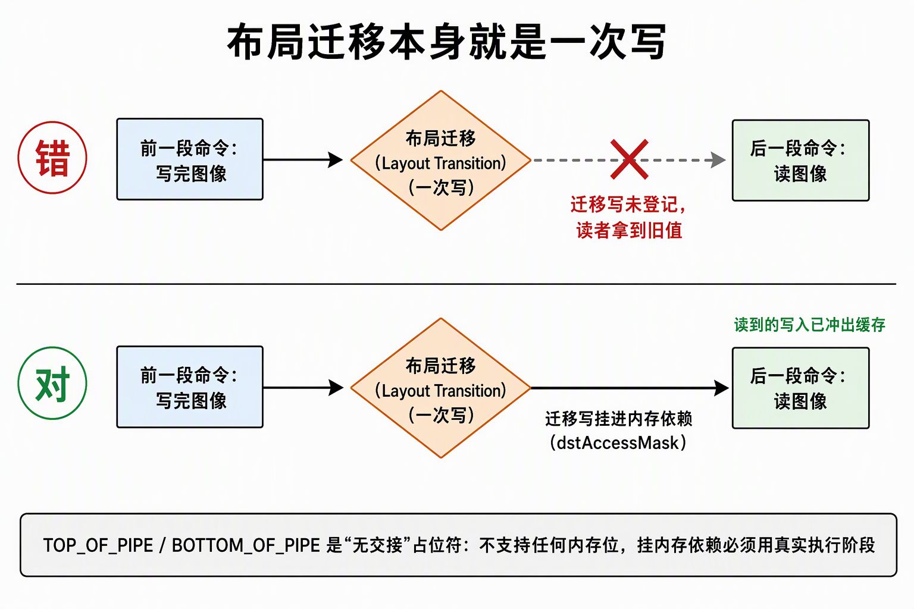
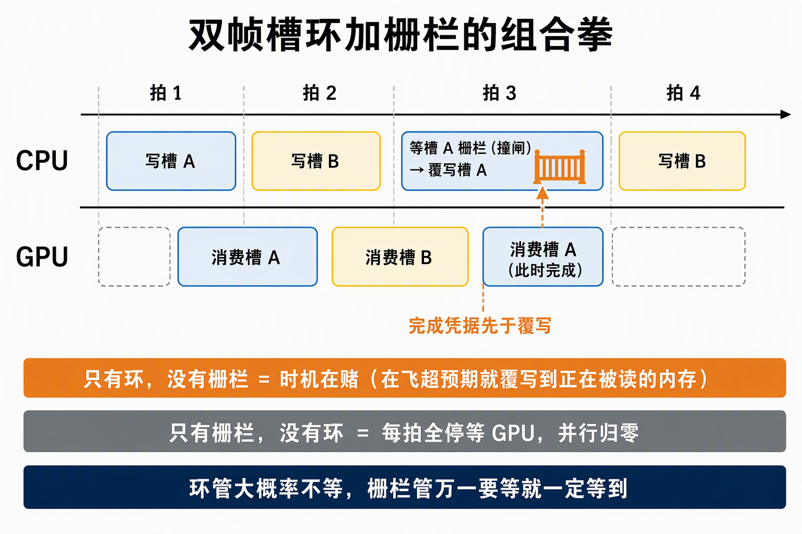

# 同步模型：执行依赖、内存依赖与三种闸门

GPU 是流水线机器：命令按提交顺序录制，但**默认没有任何执行或内存依赖**——同一队列上，后录命令的顶点台站可以和先录命令的写颜色台站同时跑；跨队列连提交顺序都不共有。Vulkan 同步模型要回答两个问题：**谁等谁**（执行依赖）和**哪个字节能被读到**（内存依赖）。回答的工具是三种闸门——屏障管同一命令流内两段命令之间的交接，信号量管队列操作之间的交接，栅栏（fence）是唯一等令方能是 CPU 的对象。一切闸门都用流水线阶段当地址：stage 掩码管"何时"，access 掩码管"什么数据"。

## 0. 判定线

- **执行依赖 ≠ 内存依赖。**"src 阶段跑完"只保证计算结束，不保证结果已冲出写缓存落到显存；dst 阶段哪怕启动更晚，读到的仍可能是旧值。stage 掩码排时间表，access 掩码立缓存纪律——**stage 配对了而 access 空着，是不报错、只出脏数据的经典事故**（本工程落点见来源 A/B）。
- **CPU 只配置、不读取。**CPU 对屏障与信号量只在提交瞬间"登记班次"（从哪个阶段前等谁、执行完置位谁），此后不参与、不查询、无法感知信号量状态；置位与等待都发生在 GPU 时间线上。唯一能被 CPU 等待的对象是栅栏（本工程落点见来源 B）。
- **闸门双方在哪，决定用哪种闸门**：同一命令流内部 → 屏障；队列操作之间 → 信号量；等令方是 CPU → 栅栏。

## 1. 三种闸门各保证什么

| 闸门 | 焊在哪 | 等谁（左） | 放行谁（右） | 内存语义 |
|---|---|---|---|---|
| 屏障 | 命令流内的一条命令 | 可选：阶段 × 访问 | 可选：阶段 × 访问 | 自己声明，可精可空 |
| 信号量 | 队列操作之间 | 固定：对面整批全部执行完 | 一个旋钮：从哪个阶段起卡 | 隐含全量，免配 |
| 栅栏 | 提交与 CPU 之间 | 固定：整批全部执行完 | CPU 的等待调用 | 隐含全量，唯一可达 CPU |

信号量的结构不对称：**等令侧有旋钮**（`wait_dst_stage_mask`，和屏障的 dstStage 是同一个东西），**发令侧没有**——固定"对面整批全部执行完"才置位，且内存隐含全量，所以跨批交接不需要任何补充屏障。信号量二值一发一收，不可查询、不可计数；要带数值的接力（CPU 可查的完成票据）用 timeline 信号量。栅栏在 GPU 时间线上排不了两批工作的序——它只为 CPU 存在。

三个闸门共享同一份地址表：**流水线阶段不属于某条命令，是所有命令共用的"流水线上的位置"**——同步双方各报各的阶段（屏障的 src/dst、信号量等待的 dst），闸门才挂得上去。等待是"卡在某个阶段"，不是整批冻结：`wait_dst_stage_mask` 钉在写颜色，意味着写颜色之前的顶点处理照常开跑、与等图重叠——这是性能旋钮，拧成"进管道前"就全批冻结；但拧出等待作用域之外就是正确性事故（§2）。

| Vulkan | D3D12 / Unity 对应 | 差异要点 |
|---|---|---|
| PipelineStage | 无对应暴露 | D3D12 藏起阶段，冲刷时机由运行时按资源状态推断；Unity 全托管 |
| ImageMemoryBarrier | ResourceBarrier（状态转移） | D3D12 一维"前后状态"；Vulkan 拆成布局 + 阶段 + 访问三个维度，细但啰嗦 |
| 信号量（批间） | 跨队列 fence（Queue Signal/Wait） | D3D12 同一 fence 对象兼管 CPU/GPU 两种等待；Vulkan 按等令方拆成两种对象 |
| `wait_dst_stage_mask` | 无（运行时打包） | "等图只卡用图阶段"这层控制在 D3D 里看不见 |

托管不是不存在，是保守化：Unity/D3D12 运行时替你按资源状态推断屏障位置，裸 Vulkan 把旋钮全露出来，省掉保守选择的开销，代价是掩码自己配。

*读图：三条泳道各自独立；屏障两端旋钮都在流内，信号量只有 dst 一个旋钮、发令侧焊死"整批完成"，栅栏是唯一一根连回 CPU 的线。*

## 2. layout transition 是一次写

图像布局迁移不是元数据翻页，**它本身是对图像的一次写操作**。两条推论（本工程落点见来源 D/E）：

1. **transition 的写必须被接住**：跨提交的 transition→read 依赖，要把这次写挂进屏障 dstAccessMask；空 dstAccessMask = 这次写对读者不可见 = READ_AFTER_WRITE。同族 CONCURRENT 共享不豁免这一点。
2. **srcStage 必须盖住上一段的写，dstAccessMask 每一位都要被 dstStageMask 支持**：如 SHADER_READ 必须配 FRAGMENT_SHADER 这类真实执行阶段；BOTTOM_OF_PIPE 不支持任何 access 位（配了直接违规）——它是"流内没有消费者"时的 dst 占位符，TOP_OF_PIPE 同理是"前面没有必须等完的"时的 src 占位符。真想一网打尽用 ALL_COMMANDS，更安全也更粗。

这条判定线和信号量耦合在**等待作用域**上：提交等待的 dst 阶段不只挡命令，它圈出一个作用域——被挡住之前，作用域内的写不得执行。进场屏障把布局从 acquire 拿回的不定状态迁到可写，这次迁移写若钉在 TOP_OF_PIPE，就落在到图信号量等待作用域（`wait_dst_stage_mask` = COLOR_ATTACHMENT_OUTPUT）**之外**：提交一执行、不等图到手，迁移先跑，与呈现引擎对该图的最后一次读相撞。修法是把迁移写钉进"写颜色"台站，落进等待作用域——**acquire 信号量的等待挂 COLOR_ATTACHMENT_OUTPUT 不是性能偏好，是给布局迁移写画作用域的必要条件**（本工程落点见来源 C §3.3）。

*读图：迁移写是两次使用之间真实存在的一个写节点；左分支（空 dstAccessMask）该写悬空、读者拿到旧值，右分支把迁移写挂进 dstAccessMask 才闭合依赖。*

## 3. 屏障挡的是派发，不是认知——读卡员模型

**Barrier 不是"认知边界"。** cmb 完整躺在内存里，命令处理器想看后面随时能看；barrier 拦的从来不是读取，是**派发**——dst stage 的工作在依赖满足前不进引擎。最小参考实现"读到 barrier 整体停住、放行后无脑继续"完全符合规范；预取、预解析后续命令全是优化，不影响语义。并行边界由**执行中读到的 barrier 指令**画出，不存在提交时的预先切分（读卡员模型全貌见[cmb状态机与命令快照](cmb状态机与命令快照.md) §4）。

## 4. 内存屏障改变了什么：可见性状态跃迁，零字节写入

"内存屏障不执行任何操作"只对一层成立。三层分开账：

| 层 | 内存屏障前后 |
|---|---|
| 内存内容 | ❌ 一个字节不变（与布局屏障的本质区别） |
| 可见性状态 | ✓ 变了：src 的写在屏障前可能赖在缓存/在途，屏障后对 dst 声明的 access **保证可见**——抽象机器状态真实迁移 |
| 硬件动作 | ✓ 真实发生：流水线排空（等在途落地）+ 缓存维护（src flush 到一致点、dst 侧 invalidate 陈旧行）——屏障有成本的原因 |

严格说法是 **release–acquire 配对**：src scope 是 release（"这些写全部落地到一致点"），dst scope 是 acquire（"读之前先把陈旧行作废"）。两种屏障对照定案：**内存屏障 = 纯检查点卡**（卡上不载内存写，但执行时真干排空+缓存维护两件事）；**布局屏障 = 同一套机器 + 卡上多载一件真活**（迁移，一次真实的元数据写，排 src 完成后、dst 放行前）。

**缓存拓扑的边界**：L1 着色器缓存互不一致，L2 是全 GPU 一致点——一致性问题的真实形状是"写赖在 L1 没到 L2，读者从陈旧行取值"。三个层次别混：L2 一致点是**平台性质**，不用 barrier 维持；同引擎同 L2 路径的交接，release/acquire 可能很轻甚至空转；**跨引擎跨缓存域**（compute→graphics、transfer→采样、跨队列）才是 flush/invalidate 全套真正做工的场景——本工程票据等待 @ALL_COMMANDS 兼管 transfer 写跨队列可见性（Q1 拷贝引擎→Q0 图形引擎，无隐含可见性，CONCURRENT 只免所有权转移、缓存维护一次不少），就是这条的工程落点。

## 5. 信号量与 image index：两套循环两本账

帧槽（在飞帧数，MOD 2）与 swapchain image（MOD 3）是两个独立循环。**present 完成信号量按 image index 分配，不按帧槽**——帧栅栏只证明"渲染提交执行完成"，不证明 presentation engine 已结束对该信号量的 wait/使用；presentation engine 消费它的时长不被帧栅栏覆盖。重新 acquire 同一 image 并正确等待其获取依赖，才构成前次 present wait 完成的凭据。image_available、命令缓冲、帧栅栏仍可按帧槽管理——不是所有同步对象都要搬进 swapchain，只有生命周期跟着 image 走的要跟（本工程落点见来源 C §3）。

**fence 提前重置的死锁分支**：帧首"先等 fence 再立即 reset"，把重置提前到 acquire 之前——若 acquire 报 OUT_OF_DATE、本帧提前返回，这一帧没有产生任何提交，该 fence 再无人置位；下一帧等待同一 unsignaled fence，永久阻塞。纪律：reset 挪到"确将提交"的前一刻；reset 之后任何失败分支不得直接返回继续等它，要么恢复同步状态、要么转退出（本工程落点见来源 C §2）。

## 6. 所有权转移按"对"生效

EXCLUSIVE 资源跨队列使用时，所有权按队列族**对**转移：release 声明"从族 X 让渡给族 Y"，acquire 必须声明**同一对** X→Y——两个半场各自一条屏障，族号对不匹配就没有转移发生。不对称的细节：release 侧的 dstStageMask/dstAccessMask 被规范忽略（旧式掩码非零条款用占位值满足）；acquire 侧第一作用域为空，srcStage 填 ALL_COMMANDS 引入 happens-before，dst 才是真实访问声明。

CONCURRENT 在创建时钉死共享族集合，运行期豁免让渡屏障——代价有三：参与族创建时钉死（后加队列要重建资源）；**可见性仍要显式内存依赖，不能"改成 CONCURRENT 就只删屏障"**；屏障上的显式族号一律填 IGNORED（CONCURRENT 下显式族号本身违规）。一句话：所有权转移是"对"上的运行时交接，CONCURRENT 是把这对在创建时登记、把交接簿免了，内存依赖一笔都省不掉（本工程落点见来源 F）。

## 7. 宿主写不在任何执法点内：环 + fence 组合拳

persistent map 的宿主写发生在 CPU 地址空间里，**不经过任何队列操作**——同步验证层只看 GPU 侧的提交记录，对宿主写的时机全盲。"GPU 不在读这段"只能由提交侧纪律自证：完成票据（fence / timeline 值）证明在飞消费已结束，之后才能覆写。但每帧都等票据就把并行折回串行，工程形状是环 + fence 两件套（本工程落点见来源 B §4）：

- **环（帧槽轮转）**：同一槽位至少隔 N 帧才被复用，给在飞消费留时间窗——但"隔 N 帧够"只是时机假设，没有任何凭据。
- **fence（帧槽栅栏）**：覆写槽位前等本槽栅栏，把时机假设换成完成凭据。

只有环没 fence：GPU 停顿、节流变化或任何在飞超预期时，覆写落进仍在被读的内存——时机在赌。只有 fence 没环：每次写都全停等 GPU，CPU 陪跑，并行归零。环负责"大概率无需等待"，fence 负责"万一需要等就一定等到"，组合把停顿压成统计罕见事件。

*读图：两个帧槽轮转，CPU 永远比 GPU 执行领先一拍；第三个单位时间撞上槽 A 的栅栏——覆写被挡到 GPU 执行完。栅栏是安全带不是油门。*

## 8. 非 coherent 内存的 flush/invalidate：atom 舍入

无 HOST_COHERENT 的宿主可见内存，宿主写后须 flush、GPU 写后宿主读前须 invalidate，范围以 `nonCoherentAtomSize`（2 的幂，规范上限 256B）为单位舍入（本工程落点见来源 G）：

- **offset 无条件恒为 atom 整数倍**——空范围也受此约束，len 为 0 直接不送 API；
- **size 须为 atom 整数倍，或延伸到 memory 末尾**；
- **实操舍入：起点向最近 atom 边界向下取整、终点向上取整**——hazard 保证必须覆盖舍入后的完整范围，而不是请求范围。

"只有宿主写过的 atom 才可 flush"的条款为什么天然满足：连续写区向两端舍入只波及**含写入字节的两个边界 atom**，中间不存在未写的洞；只有把无关整段盲 flush 进来才踩它。

## 9. 销毁与退出排空

**等待先于一切 GPU 资源销毁。**反序拆除解决对象依赖（先拆依赖方），等待解决异步使用——两者都要满足：拆 fence 的条款要求引用它的提交已执行完，拆命令池要求池内命令缓冲不在 pending；排在最后一步的全量等待无法追溯保护已被拆掉的对象（本工程落点见来源 C §4）。

**fence 只证"提交完成"，多队列下每个队列各需凭据。**帧栅栏覆盖图形提交，独立 transfer 队列的上传要有第二凭据（timeline 票据）——没有图形提交的窗口（如最小化期间只跑上传）里帧栅栏不动而 transfer 照样在飞，"帧完成"不蕴含"上传完成"。销毁凭据 = 帧栅栏与上传票据两账取最大、一次等待（本工程落点见来源 H）。

同一原则的 GPU 侧版本是 UAB 的真实消费窗口：无边界数组只授权"提交前后可更新、可观察"，不授权覆盖仍被未完成命令消费的描述符——描述符的真实消费窗口 = 提交 → 命令完成，内容重传的安全做法是新槽发布 + 旧条目带票据延迟回收，而不是原槽重写（本工程落点见来源 H）。"完成"永远要问是哪一级完成：提交返回、命令执行完、presentation engine 用完，是三个不同事件。

## 自测四问

1. 只配 stage 不配 access 的屏障，为什么静默翻车？哪两种屏障形状允许 access 全空、凭据各是什么？
2. 进场布局迁移屏障钉在 TOP_OF_PIPE 会与哪道闸门的哪个作用域相撞？修法的本质动作是什么？
3. present 完成信号量按帧槽复用缺了哪段证明？帧栅栏证明的是哪个事件？
4. 内存屏障"不执行任何操作"对哪层成立、对哪层不成立？它和布局屏障在"卡上载活"上的差别是什么？

## 来源

- A. [GPU同步策略：以record_frame为例](../../开发步骤/3-静态取数链路/3.4-管线与绘制/GPU同步策略：以record_frame为例——进场屏障、提交等待与流水线阶段.md)——执行依赖 vs 内存依赖、一帧闸门全景、等待作用域
- A2. [cmb状态机与命令快照](cmb状态机与命令快照.md)——读卡员模型全貌（队列存提交不存命令、命令处理器按序消费）、两条时间线
- A3. [信号量设计缘由](信号量设计缘由.md)——为什么要有队列间接力这档机制、与 OS 信号量的差别、全工程三只清点
- B. [PipelineStage：屏障与信号量的共同语言](../../开发步骤/2-宿主壳/材料/PipelineStage：屏障与信号量的共同语言.md)——stage/access 分工、三闸门对照表
- C. [帧流程：一帧之内各Vulkan对象如何接力](../../开发步骤/2-宿主壳/材料/帧流程：一帧之内各Vulkan对象如何接力.md)——CPU 只配置不读取、两帧在飞
- D. [5.4 常驻大场景组织施工记录](../../开发步骤/5-GPU驱动与常驻大场景/5.4-常驻大场景组织/5.4.1-5.4.5-常驻大场景组织施工记录：生成器、chunk组织与mip链.md)——layout transition 是一次写、VUID-02820
- E. [8.1.3 透明层施工记录](../../开发步骤/8-完整延迟渲染管线/8.1-G-buffer与不透明几何/8.1.3-施工记录：透明ClusteredForward层.md)——重绑屏障 srcAccess 须含写访问位
- F. [3.2.4 flush_uploads](../../开发步骤/3-静态取数链路/3.2-buffer侧上传/3.2.4-flush_uploads：合批提交、timeline票据与跨族依赖.md)——成对 release/acquire 与 CONCURRENT 定案
- G. [3.2.2.1 内存契约](../../开发步骤/3-静态取数链路/3.2-buffer侧上传/3.2.2.1-内存契约：memory%20type、usage、绑定与对齐.md)——atom 舍入三细则
- H. [GPU寿命与失败恢复流程](../../开发步骤/4-可靠增量链路/4.5-缺陷修复/GPU寿命与失败恢复流程：从资产变更到安全销毁的各级账面.md)——UAB 消费窗口、销毁双凭据
- I. [已实现缺陷与修复验收](../../开发步骤/3-静态取数链路/3.2-buffer侧上传/已实现缺陷与修复验收.md)——fence 提前重置、present 信号量按 image index、退出排空
