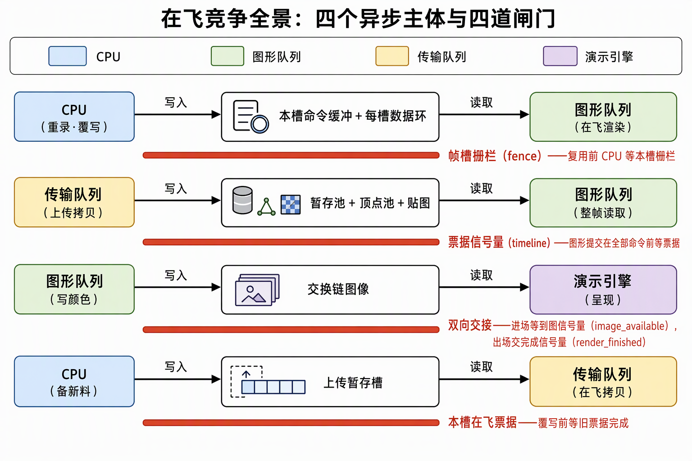
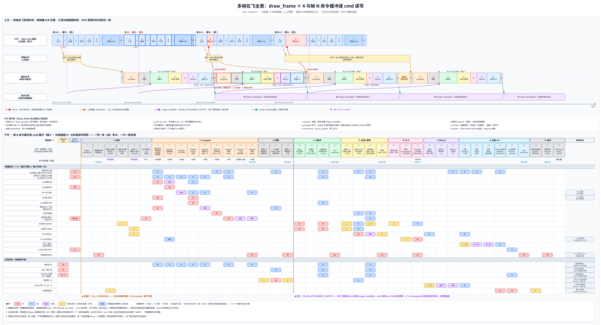

# 多帧在飞竞争：四个主体、三套轮转、四道闸门

同一时刻，本工程有四个异步主体在动：**CPU**（备料、录命令、提交）、**graphics 队列**（执行渲染提交）、**transfer 队列**（执行上传批）、**presentation engine**（持有 swapchain image 展示）。它们各自持有独立的轮转账本——帧槽 2 组（MOD 2）、swapchain image 3 张（MOD 3）、上传 staging 2 槽（MOD 2）——三套账本互不整除、互不同步，**错拍就是竞争的来源**。竞争判定式：两个异步主体 × 同一资源 × 至少一方是写。四个主体两两组合，落到真实资源上恰好四对，每对一道闸门，不多也不少。

## 0. 判定线

- **同队列只有可见性问题，跨主体才有顺序问题。** 同一队列的提交按序执行，同队列先写后读的竞争被提交顺序排除，剩下的只是缓存可见性——归命令流内屏障管；跨队列、跨子系统连执行顺序都不共有，必须上闸门。
- **闸门按"闸门双方在哪"选**：双方都在命令流内 → 屏障；队列操作之间 → 信号量（要带数值接力 → timeline）；等令方是 CPU → fence；对手是 presentation engine → 只能挂 acquire/present 的信号量——它不等令也不受令，只做所有权交接。
- **一个竞争对一道闸门，一道闸门管住同类全部资源。** 帧槽 fence 一道就同时管住该槽命令缓冲、每槽 UBO/UI 顶点环/实例环、深度附件的全部宿主复用——它们生命周期相同（跟帧槽走），不需要各配各的证据。
- **轮转是时机假设，闸门是完成凭据。** 环保证"大概率不用等"（同槽隔 N 帧才复用），fence/票据保证"万一要等就一定等到"；只有环没有凭据，时机在赌。

## 1. 三套轮转账本

| 账本 | 周期 | 货物 | 附着同步对象 | 生命周期跟谁走 |
|---|---|---|---|---|
| 帧槽 | 2 | 命令缓冲、image_available、in_flight fence、深度附件、每槽 UBO/实例/UI 环 | 每槽 fence + image_available | 跟帧走，swapchain 重建时原地不动 |
| swapchain image | 3（min+1，MAILBOX 抬到 3） | image 本体 + render_finished | render_finished 按 image 配 | 跟 image 走，随重建换新 |
| 上传槽 | 2 | staging 槽 + 在飞票据 | 每槽 `Option<Ticket>` | 跟上传器走，全局 timeline 信号量只有一根 |

三个周期两两错拍：2 与 3 互素，"同一帧槽 × 同一 image"的组合最长 6 帧才重合——错拍不是缺陷，是并行余量：CPU 永远领先 GPU 一帧在跑另一组资源。**生命周期跟谁走**是对象落位判定线：只有生命周期跟着 image 的对象（render_finished）住进 Swapchain 随重建换新；帧级对象跨重建复用，不陪葬。

## 2. 四个竞争对，四道闸门

*读图：每行一个竞争对，色块是异步主体，中间是争夺的资源，横杆是闸门。第一、四行闸门面向 CPU（fence / 票据等待），第二行闸门面向图形提交（timeline 等待值），第三行是进出场两道信号量的双向交接。*

| # | 竞争资源 | 写方 | 读方 | 闸门 | 卡点 |
|---|---|---|---|---|---|
| A | 本槽命令缓冲 + 每槽 UBO/UI 顶点环/实例环 + 深度附件 | CPU（重录/覆写） | GPU 在飞渲染 | 每槽 in_flight fence | `wait_for_slot`，只等不重置 |
| B | staging 池与上传目标（顶点/索引池、贴图） | transfer 队列 | graphics 队列整帧 | timeline 票据 | 图形提交在 ALL_COMMANDS 等待值 |
| C | swapchain image | graphics（SMAA+UI 写出） | presentation engine | image_available 进 + render_finished 出 | 进：COLOR_ATTACHMENT_OUTPUT；出按 image 配 |
| D | 上传 staging 槽 | CPU 备新料 | transfer 队列在飞拷贝 | 本槽在飞票据 | `submit_batch` 复用槽位前 `wait_until` 本槽旧票据 |

**A. 帧槽宿主复用。** CPU 领先 GPU 写东西的每一处都压在这一道 fence 上：重录命令缓冲、覆写本帧槽 UBO、写 UI 顶点环、实例表奇偶脏集。同槽两次使用之间隔 `wait_for_slot`，fence 把"隔 2 帧够"的时机假设换成"上一轮执行完"的凭据。

**B. 跨队列上传。** transfer 队列与 graphics 队列连提交顺序都不共有，而工程里两队列族 CONCURRENT 共享、无所有权屏障——这道 timeline 等待是 transfer→graphics **唯一**的同步点，执行序和内存可见性一肩挑。等待钉在 ALL_COMMANDS 是自愿的粗档（顶点池其实只有顶点输入台站读），粗而正确：拆细的收益配不上账本复杂度。

**C. swapchain image 双向交接。** 它是全帧唯一双向竞争的资源：graphics 写、演示引擎读。进场等 image_available（acquire 发令，卡在 COLOR_ATTACHMENT_OUTPUT）。这个阶段拦的是本批次**所有**写颜色的命令，不只是写交换链的那几条——全帧第一个写颜色附件的是 ④ G-buffer，① 里交换链与 G-buffer 的进场屏障 src 也是 COLOR_ATTACHMENT_OUTPUT，顺链一起等。真正与等图重叠的只有 ② compute 和 ③ 阴影深度（只走深度测试阶段，不经过写颜色）；出场由提交 signal render_finished，present 拿它去呈现。出场信号量**按 image 分配不按帧槽**——理由见 §4。

**D. 上传槽复用。** staging 槽也是环：CPU 备新料覆写槽位前，等本槽上一批票据完成。上传器自己的"环 + 票据"组合拳，和帧槽的环+fence 同构。

## 3. 多帧在飞时序与逐 cmd 读写

*读图：上半是 GPU 受限稳态下的一段时间窗，时间向右——高亮四帧 N-1~N+2 从 CPU 备料到 GPU 执行、呈现全程在窗内，两端淡色是相邻帧。CPU 每帧都在 b 段等 fence，被 GPU 拉到同一节拍；图形队列积压一帧（虚线排队条）；帧 N+2 的大上传批让下一份命令缓冲整批冻结在票据门，这段延迟顺着 fence 传回两帧后的 CPU。紫色 ▼ 是每帧的图门卡点（④ 起点）。下半把帧 N 的命令缓冲按录制顺序逐列展开（c1~c41），每行一类资源，格子标读/写/布局迁移；两条竖虚线是两道 GPU 门，最右列写跨帧去向。图由 `tools/gen_frame_cmd_timeline.py` 按源码登记生成，录制顺序变了要同步改脚本。*

逐事件走一遍帧 N（帧槽 A、image i）：

1. **CPU**：`wait_for_slot` 等槽 A 的 fence（上上帧的提交已执行完）→ 写本槽 UBO/环、图集整传发 upload 批 → 录制 → `queue_submit`：等待列表两项（image_available @ COLOR_ATTACHMENT_OUTPUT、票据 @ ALL_COMMANDS），signal render_finished[i] 与槽 A fence；
2. **transfer 队列**：收到批、拷贝进池/贴图、signal 票据值——与 graphics 全程无交互，只在提交等待列表里"被等"；
3. **graphics**：先过票据门——票据等在 ALL_COMMANDS，上传没完成时整批一条都不开跑（含 compute）；过门后 ② compute（剔除/遮挡/LOD/indirect/阴影组装/分簇/透明）与 ③ 阴影深度照跑，不受等图约束；到 ④ G-buffer 第一次写颜色时卡 image_available；
4. **presentation engine**：等 render_finished[i] → 呈现 → image 归还（归还的凭据不是 fence，是下一次 acquire）；
5. **CPU（帧 N+1）**：换帧槽 B、image i+1，与第 3~4 步并行——这就是"在飞"的含义：任意时刻 GPU 上至少有一帧的提交在执行，CPU 在准备下一帧。

## 4. 错拍陷阱两则

**fence 只证"提交完成"，不证"present 完成"。** 帧栅栏置位时 presentation engine 可能还在读 image。所以 render_finished 按 image 分配：同槽 fence 置位就复用信号量会撞上演示引擎还没消费完的上一轮。"演示引擎用完了"的凭据 = 同一 image 被再次 acquire——三个完成事件（提交返回、命令执行完、present 用完）是三本账。

**最小化期间图形停、上传照飞。** 无图形提交的窗口里帧栅栏不动而 transfer 照样在飞，"帧完成"不蕴含"上传完成"。销毁 GPU 资源要帧栅栏与上传票据两账取最大、一次等待——"完成"永远要问是哪一级完成。

## 自测三问

1. 为什么帧槽 fence 一道就够，不用给 UBO、UI 顶点环、深度附件各配凭据？
2. 票据等待为什么不拆到"顶点输入等池、片段等贴图"两个具体阶段？
3. render_finished 若按帧槽分配，会在什么时序下被误复用？

## 来源

- [同步模型](同步模型.md)——三种闸门的分工、等待作用域、环+fence 组合拳、销毁双凭据
- [交换链与呈现](交换链与呈现.md)——present 信号量按 image index、重建时序
- [GPU同步策略：以record_frame为例](../../开发步骤/3-静态取数链路/3.4-管线与绘制/GPU同步策略：以record_frame为例——进场屏障、提交等待与流水线阶段.md)——提交等待列表逐项、CAO vs ALL_COMMANDS 两处依据
- [帧流程：一帧之内各Vulkan对象如何接力](../../开发步骤/2-宿主壳/材料/帧流程：一帧之内各Vulkan对象如何接力.md)——两帧在飞、CPU 只配置不读取
- 工程代码：`frame_pool.rs` 模块注释（帧槽货物清单与复用安全）、`swapchain.rs`（image 数与 render_finished 落位）、`uploader.rs`（票据发放与 staging 槽复用等待）
