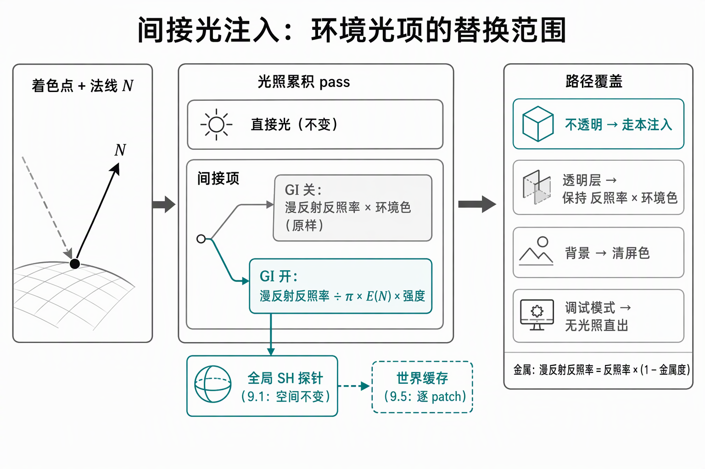

# SCGI 的间接光注入端：谁的环境光被替换

9.1 做完之后，环境光并不是"所有材质统一改成 Global SH"。准确的替换面只有一条：**不透明物体的延迟光照累积 pass 里的间接漫反射项**。这篇把注入端的公式、覆盖范围和数据来源演进钉清楚；Unity 侧的缓存结构见[Unity SCGI 实现](Unity%20SCGI%20实现.md)，本工程 9.1 的施工口径见[施工计划：间接光注入与SH查询](../../开发步骤/9-表面缓存全局光照/9.1-间接光注入与SH查询/施工计划：间接光注入与SH查询.md)。

## 一句话

**GI 开：不透明像素的 `albedo × ambient` 换成 `diffuseColor/π × E(N) × intensity`；透明层、背景、调试模式不换；GI 关原样；9.1 的 E(N) 来自空间不变的全局 L1 探针，9.5 才换成世界缓存的空间变化版本。**

## 1. 注入点与公式

在延迟光照累积 pass（`gbuffer_composite`）里，直接光（方向光 + 点光/聚光 + 阴影）先累加，最后一项是环境光：

```
GI 关：shaded = 直接光 + albedo · ambient_color
GI 开：shaded = 直接光 + diffuseColor · (1/π) · E(N) · intensity
```

- `diffuseColor = albedo · (1 − metallic)`，`1/π` 复用 `Fd_Lambert()`，与直接光漫反射 lobe 同口径；
- `E(N) = l0 + l1·N`，系数是"折叠基函数后的辐照度多项式"（与 Unity 的 `RGBL1` 只差一次 `Y0/Y1` 折叠）；
- 探针与直接光同域（pre-exposure），pass 末尾统一乘 `EXPOSURE`；
- GI 关分支保留原表达式，保证与步骤 8 逐像素一致。

## 2. 覆盖范围



| 路径 | GI 开 | GI 关 | 原因 |
|---|---|---|---|
| 不透明（deferred 合成） | `diffuseColor/π · E(N) · intensity` | `albedo · ambient` | 唯一有 G-buffer 法线与材质参数的路径 |
| 透明（forward） | `albedo · ambient`（不换） | 同左 | 透明层不写 G-buffer，不接 GI；Unity 是退回环境探针，本工程退回常量环境项，9.5 后仍如此 |
| 背景 / 清屏 | 清屏色 | 清屏色 | 无表面 |
| 调试模式（unlit/normal/…） | 无光照直出 | 同左 | 调试仪器旁路 |

所以"所有材质"要拆成"所有不透明材质"；透明层不在其中。

## 3. "全局"不等于"所有材质同一个值"

9.1 的探针在空间上是一个常量函数，但：

- **求值用每个像素的法线**：同一套系数，朝上的地板与朝下的天花板拿到不同的 E；
- **再乘各自的 diffuseColor**：不同材质的环境项仍随 albedo 变化；
- **金属不接漫反射间接**：metallic = 1 时 `diffuseColor = 0`；旧环境项乘的是原始 albedo，所以 GI 开后金属的漫反射环境项消失是预期行为；
- **AO 暂不乘**：与旧环境项同口径，9.6 再裁决；
- **默认 GI 关**：开而没设探针时 `l0 = π·ambient`、`l1 = 0`，介电体表面与旧环境项视觉同形（非逐位同）。

## 4. 数据来源的演进

| 阶段 | E(N) 的来源 | 空间变化 | 成本 |
|---|---|---|---|
| 9.1 | 单个全局 L1 探针（帧 UBO，BRP 可写） | 无（只随 N 变） | 零射线、零新 pass |
| 9.5 | 1/4 分辨率查世界缓存（cell → patch）→ 空间/时域滤波 → 上采样 | 有（逐 patch） | 随分辨率，不随实例数 |

全局探针在 9.5 之后仍然保留，但职责收窄为**体积外兜底**（Unity 的 `DistanceFallback`）：只有查询点在 Volume 外才查它；Volume 内没 patch 返回无效值，不查全局探针。Unity 的 `GlobalProbe` 是 16 方向桶 × `RGBL1`（768B），9.1 的单探针是它的退化形式（没有体积、没有环境 cubemap，先钉住注入链）。

### 概念边界：Cell/patch 与 GlobalProbe 是两套东西

这篇讲的是**注入端**（谁的环境光被替换、从哪取 E(N)），不展开缓存结构；两套存储不要混：

- **Cell/patch**：体积内的世界空间缓存；每个体素 16 个**表面类别槽** → 共享 patch 池；解决体积内逐位置/逐表面；9.3/9.5 的内容。
- **GlobalProbe**：一个全局环境按 16 个**法线类别**拆成的 LUT（768B）；全局一份、没有位置变化；只作体积外 `DistanceFallback`。

两者的"16"都来自同一套 4×4 八面体桶，但一个是逐体素的表面类别槽，一个是全局的法线类别条目。图和详细对照见[SH 与光照探针](SH与光照探针.md)。

## 5. 本工程锚点

- 现状（步骤 8）：`shaders/scene/gbuffer/gbuffer_composite.wgsl` 的环境项、`shaders/scene/transparent/transparent_forward.wgsl` 的透明环境项；
- 9.1 计划落点（文件开工时才建）：帧 UBO 扩 `gi_enabled` / `gi_intensity` / `gi_probe`（`src/render/resident/tables/frame_uniform_table.rs`）、`shaders/common/gi.wgsl`、`src/render/passes/gi/mod.rs`——以[9.1 施工计划](../../开发步骤/9-表面缓存全局光照/9.1-间接光注入与SH查询/施工计划：间接光注入与SH查询.md)为准。
