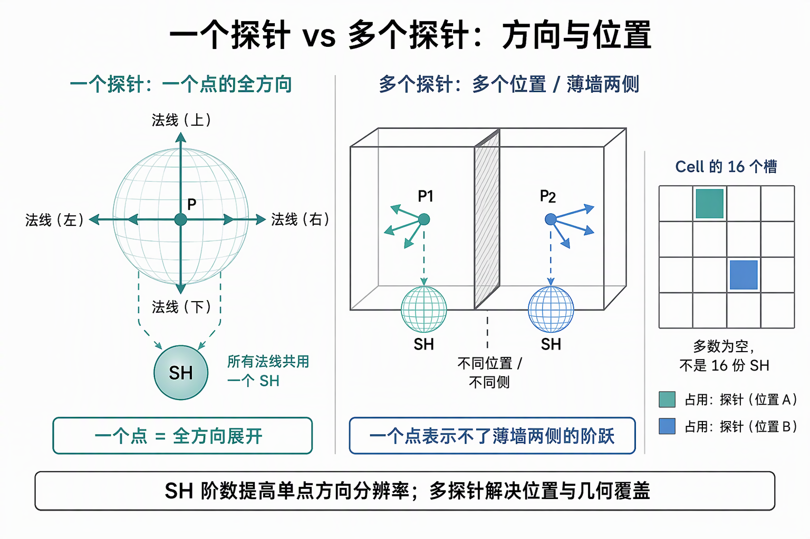
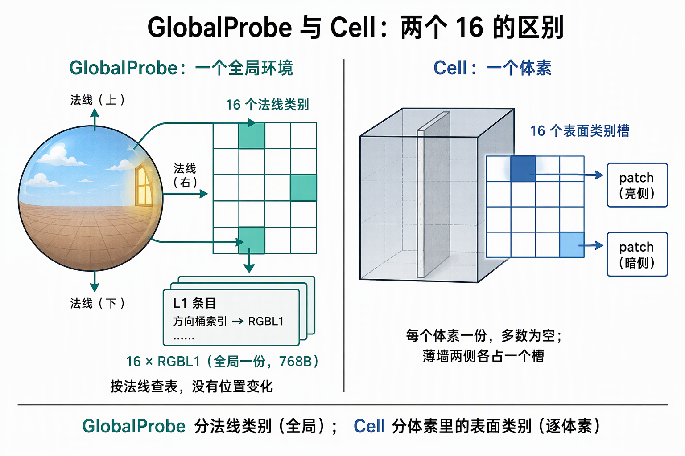

# SH 与光照探针：一个探针到底存了什么

> **一个 SH 探针表示的是"一个点上的全方向光照"，不是"一个方向的光照"。** "一个探针能表示所有方向"是对的；"一个 cell 一个探针就够"不对——cell 是体素，不是点。SCGI 的 16 个方向桶不是同一个点的 16 份方向数据，而是 16 个"法线类别/代表点"的槽位。相关缓存结构见[Unity SCGI 实现](Unity%20SCGI%20实现.md)。

## 1. 光照场是 5 维的，探针只固定了其中 3 维

入射光是一个关于**位置和方向**的函数：

```
L_i(P, ω)     P ∈ R³（位置），ω ∈ S²（方向）
```

一个探针把 **P 固定**，只存 ω 方向的展开：

```
探针(P) ≈ L_i(P, ω) 的球谐系数
```

所以：

- **一个探针能表示该点所有方向的入射光**——这是"探针表示所有方向"的正确含义；
- **一个探针不能表示不同位置**——位置维度被它固定掉了；
- 要覆盖一个空间范围，就需要多个探针（规则网格、四面体插值、或 SCGI 的表面代表点）。

## 2. 一个探针里到底存了什么

以 L1 为例，每个颜色通道 4 个系数（L0 一个 + L1 三个），RGB 共 12 个 float：

```
L_i(ω) ≈ c0·Y0 + c1x·Y1·ω.x + c1y·Y1·ω.y + c1z·Y1·ω.z
```

经余弦卷积后直接得到辐照度（本工程用折叠形式）：

```
E(n) = l0 + l1·n          // n 是接收面法线
```

注意这里的自变量是 **n（法线）**，不是出射方向。漫反射出射是 Lambertian：

```
L_o = albedo/π · E(n)
```

出射侧没有额外的方向分布要存。**SH 展开的是"入射光对各个法线方向的贡献"，不是"出射光往各个方向发多少"。**

## 3. 为什么需要多个探针

因为真实场景里，位置一变，局部环境就变：

- 同一面墙，靠近窗户的一段和角落的一段，接收到的光不同；
- 一张桌子，桌面朝上、桌底朝下，局部半球可见性完全不同；
- 薄墙两侧，位置几乎相同，但一侧看亮室、一侧看暗室——这是**可见性阶跃**，不是同一个点上的方向细节。

一个点探针只能看到它所在位置的那一份环境。要让缓存覆盖一个体素里的不同表面，就需要在这个体素里放多个"代表点探针"。



## 4. 两个 16：Cell 的表面类别槽与 GlobalProbe 的法线类别 LUT

SCGI 的 cell 里不是"16 个 Probe"，而是 **16 个 patch 索引槽**：

```
CellPatchIndices[cell][16]  → 每个槽一个 uint patch 索引或 invalid
```

- 每个槽对应一个**法线朝向类别**（八面体展开的 4×4 网格）；
- 槽里有 patch 时，patch 存的是**该类别代表表面点**的 RGBL1、位置、法线和统计量；
- 一个平坦地面 cell 通常只用 1 个槽，其余 15 个是 `InvalidPatchIndex`——**不是每格都真的有 16 份 SH**；
- patch 池是全局共享的定长 65536 条，SH 负载只为占用的槽分配；
- 16× 的显存成本主要落在 **cell 索引表**（Res 32 / 4 级联：单张 8 MiB；两张 16 MiB），不是 16× 的 SH 数据。

所以在光滑区域，"多个桶的数据高度相关"确实存在——这是为薄墙/双面几何付的固定预算。缓存无法预知哪里光滑、哪里不连续，只能给每个体素留 16 个类别槽；Kajiya 不用方向桶、靠法线偏置省掉这份内存，代价是薄几何更容易漏光。

**别和 GlobalProbe 的 16 混了。** GlobalProbe 是"一个全局环境探针"按 16 个方向桶拆开（每个桶存该方向半球内的 L1），用于体积外兜底；cell 的 16 是"一个体素内 16 个法线类别槽"。两者都用了 4×4 八面体桶，但一个是**方向域拆分**（同一个探针的更细方向分辨率），一个是**表面类别拆分**（同一个体素里不同朝向的表面各拿各的探针）。

### GlobalProbe 为什么要 16 个



- **一个 L1 只能表示 n 的线性函数**（一个亮暗梯度），无法同时表达"前面亮窗、后面暗墙、上方亮天空"这种多方向结构；只用一个全局 L1 兜底，远场会显得平，和体积内 patch 的方向分辨率也对不上。
- **16 个桶 = 把同一个全局环境按 4×4 八面体方向切开**：每个桶在该方向的半球内采 32 个方向，投影成一套 L1，再做余弦卷积。查询时按法线选桶，得到"该方向附近"的辐照度；方向对比度比单个 L1 高得多。
- **成本可忽略**：16 × 48B = 768B，只在环境变化时重算。

### GlobalProbe 的边界：它是兜底，不是求解器

SH 低阶辐照度近似有理论依据（自然光照的辐照度用 L2 九个系数就能以约 1% 的平均误差表示；L1 是更粗的低频截断），16 桶与缓存同构是明确的工程选择；但它是一组**显式假设下的近似**，假设不成立时会按已知方式退化：

- **没有遮挡**：远场墙后的物体也会被环境照亮；官方建议用 SSAO 伪造遮挡。
- **没有位置变化**：一个全局环境，局部几何、移动物体都不影响它；它只跟环境 cubemap/强度变化重算。
- **低频近似**：每个桶是半球采样的 L1，桶边界无插值；高频环境（小亮窗、复杂天空）可能出现条带/接缝。
- **Unity 自己把它当可选质量项**：`DistanceFallback` 在 Low/Medium 档关闭，High/Ultra 才开启。

所以它的目标不是"复杂环境也准"，而是"远场别太突兀、成本近零、数据形状和 patch 一致"。体积内的质量由 patch + 射线 + 屏幕 gather 负责；体积覆盖不够时，正确做法是加级联/扩体积，而不是指望 GlobalProbe 变准。复杂环境里如果 fallback 观感崩，优先考虑 SSAO 伪造遮挡或接受远场近似；提高桶数/阶数会破坏"和 patch 同构"的收益，要单独权衡。

### 16 桶 vs 单个 L2/L3

两者都在提高"法线维度"上的有效分辨率，但不是同一个机制；选择 16 桶主要是工程同构，不是数学上更优：

| | 单个 L1/L2/L3 | GlobalProbe 的 16 桶 |
|---|---|---|
| 数学形式 | 全局正交基，连续函数 `E(n)` | 16 个半球采样的 L1，按法线选桶的分段 LUT |
| 边界 | 无接缝；高阶可能振铃 | 桶边界硬切换、无插值，可能有接缝 |
| 系数/成本 | L1 4/通道（48B）；L2 9/通道（108B）；L3 16/通道（192B） | 16 × L1 = 64/通道（768B） |
| 与 patch 的关系 | 需要另开求值/转换路径 | 每桶直接输出 `RGBL1`，同类型、同 `GetDirectionIndex`、同压缩/滤波/上采样链路 |
| 对 cell 的 16 是否可替代 | 不能：cell 的 16 是空间/几何分离，不是角分辨率 | — |

所以：

- **GlobalProbe 的 16 桶**：理论上可以用单个 L2/L3 替代，甚至更省内存；但那样 fallback 和 patch 就不是同一种数据，屏幕侧要分叉。Unity 选 16 桶是为了"和缓存同构"，不是因为它更省或更精确。
- **Cell 的 16 桶**：不是角分辨率问题，不能和 L2/L3 类比。

## 5. 为什么提高 SH 阶数不能替代多个探针

| 手段 | 改的是哪个维度 | 能解决 | 不能解决 |
|---|---|---|---|
| 提高 SH 阶数（L1→L2/L3） | **单点**的方向分辨率 | 一个点周围光场的高频细节 | 位置变化、薄墙两侧的可见性阶跃 |
| 增加探针数量 | **位置/几何**覆盖 | 同一点附近不同位置、不同侧面的环境差 | 单点方向分布的细节（那是阶数的事） |

薄墙两侧的差异不是"同一个点的方向分布不够细"，而是"这两个表面根本不在同一个局部环境里"。L3 也救不了，因为问题在位置/可见性，不在角度。

## 6. 和 Unity LightProbes 的对照

| | Unity LightProbes | SCGI patch |
|---|---|---|
| 存什么 | 一组 SH 探针（烘焙或运行时） | 表面代表点的 RGBL1 |
| 探针位置 | 规则网格/艺术家布置的探针点 | cell + 方向桶选出的表面点 |
| 查询 | 按位置做四面体插值 | cell 查表 + 屏幕 gather 滤波 |
| 更新 | 烘焙或 LightProbeGroup | 每帧射线更新 |
| 用途 | 一般 GI（含镜面近似） | 只做 diffuse GI 缓存 |

两者都用 SH，但**探针位置的来源不同**：LightProbes 是空间中的一组点；SCGI 的"探针"贴在可见表面上，用 cell + 法线类别做索引。

## 7. 本工程锚点

- 9.1 先用**单个全局 L1 探针**（空间不变）把注入链接通；
- 9.3/9.5 换成 **world-space cache**：cell + 16 方向桶 → patch 池，屏幕侧 1/4 分辨率查表、滤波、上采样；
- 全局探针在 9.5 后仍保留，但只作**体积外兜底**（`DistanceFallback`），不再承担体积内的空间变化。
