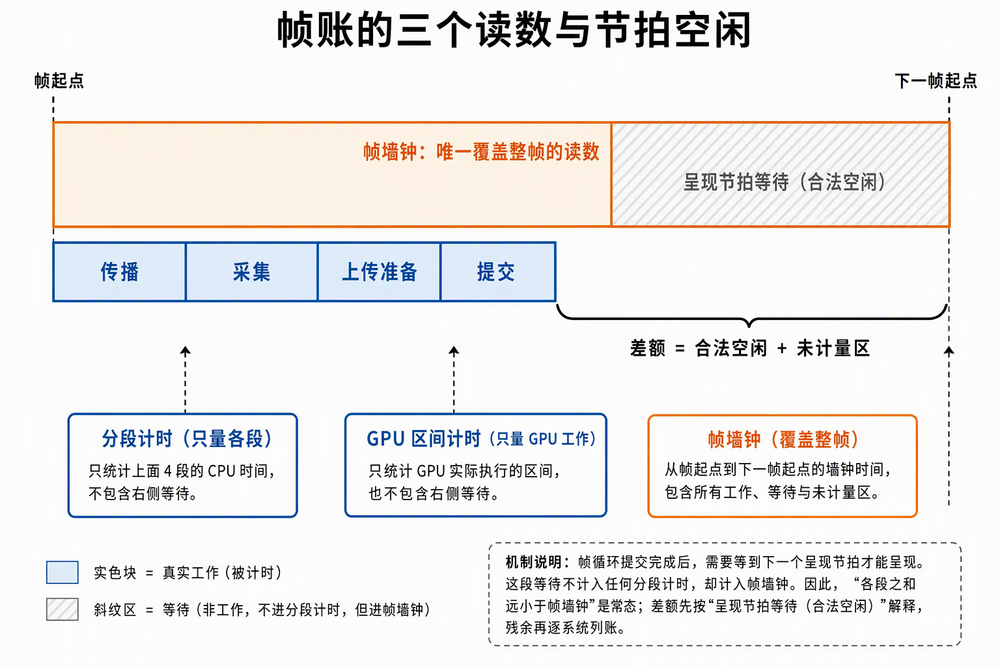
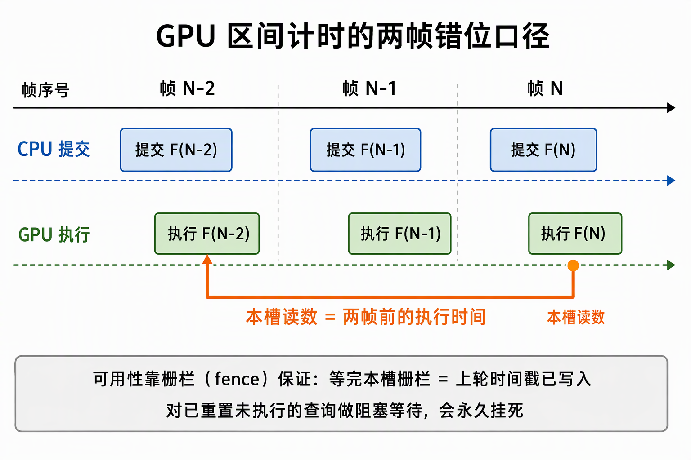
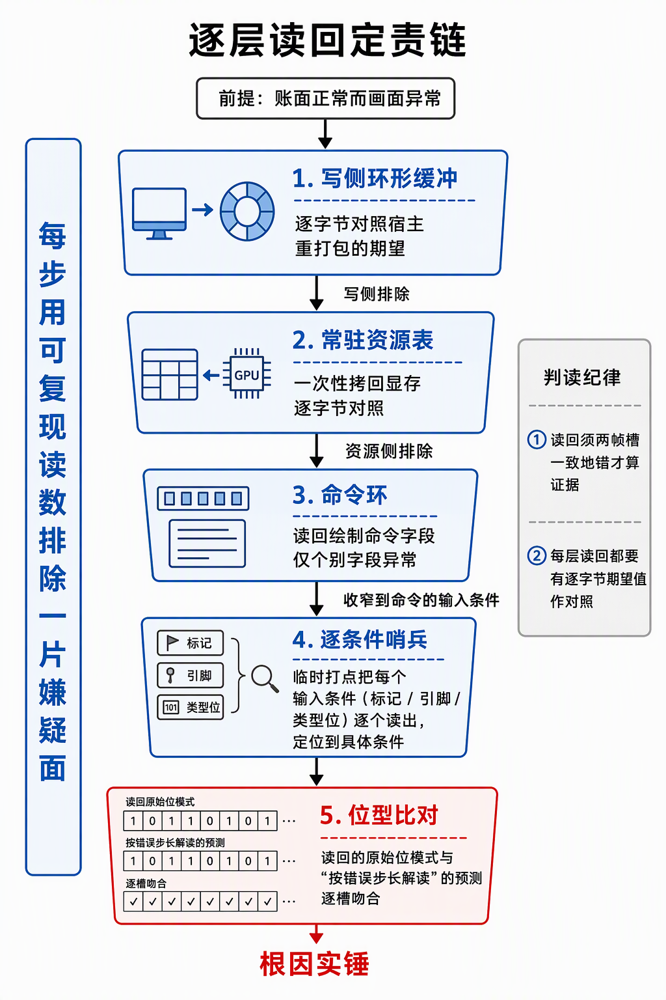

# 渲染性能归因方法：先出证据链，再动手治理

性能问题的治理成本由归因质量决定。这篇沉淀帧时间归因的可迁移方法：测试口径怎么立、帧账怎么读、每个读数的计量边界在哪、假设怎么证伪、画面缺陷怎么定责。方法论按通用语书写，每个方法配本仓库施工的一次实账作括号实例。

## 0. 判定线

- **归因先于治理**：性能修复的第一产出不是改动，是一条可复现的证据链——仪器读数、逐时刻对应、二分排除、修复前后对照。证据链闭合才动手；跳过归因的"优化"是把成本挪到看不见的地方。
- **帧墙钟与分段和的差值不是缺陷，先按合法空闲解释**：帧率节流下墙钟读数 ≈ 呈现周期（60Hz 即 ~17ms）而各段之和远小于它，差额大头是呈现节拍等待——等待不出现在任何分段计时里。先解释空闲，再对真实工作逐系统列账。
- **每个读数都有计量边界与口径**：只量渲染提交路径会漏掉宿主逻辑半边；GPU 区间读数带固定帧错位；trace 读数带仪器自身开销。脱离边界引用读数，结论必然漂移。
- **读数异常先怀疑取证工具，再怀疑引擎**：脚本没钉死的参数、信封取错字段、分位数跨形态混样，都会伪装成"引擎缺陷"；取证工具自身也要过定责流程。
- **账面正常而画面异常，直接上读回仪器**：CPU 侧对账只覆盖 CPU 两侧，不证明 GPU 执行结果；此时逐层读回是唯一通路，不要在账面里继续找。

## 1. 性能测试七条口径

性能报告的可比性靠口径，不靠跑得久。七条在开跑前钉死，每条防一类常见误读：

1. **计数分层**：实体总数、可渲染实例、唯一 mesh/material/贴图、可见实例、实际 draw 各是各的数；生成参数不代替实数（压测脚本要读对象表真值，不拿"生成了 N 个"当账）。
2. **条件固定**：提交版本、GPU/驱动、构建档、分辨率、材质/光照、present 模式、节流配置、随机种子、相机轨迹全部入条件记录单。默认节流下的帧率不是吞吐量；要把真实工作耗时与主动等待分开，不拿 present 返回当上屏完成。
3. **指标成组**：CPU 按传播/采集/上传准备/提交分段各自计时，GPU 按工作区间计时；报告分位数（p50/p95/p99）与尖峰、上传字节、提交次数、显存——单个平均数不构成证据。
4. **增长斜率**：至少三个规模档位 × 三种变化形态（零变化/少量变化/全动态）测斜率；静态场景仅移动相机不应重传，若仍有随规模线性增长的扫描必须如实报告而不是修掉再说。
5. **预算先写后测**：以帧预算线（16.7ms@60Hz）作初始阈值，开跑前钉死场景与通过标准；不以"肉眼流畅"替代数据，超预算就报超预算。
6. **等待统计有边界**：热路径不得逐资源/逐批全设备等待；显式重建、退出、容量维护类的必要等待单列，不隐去，也不把 fence 的必要复用等待误判为违规。
7. **A/B 控制变量**：与参照渲染器对照时，资产、画质、可见性策略任一不同就只能报告系统差异，不能直接归因到单一机制；单点收益优先在自己内部控制变量比较。

七条里最容易破的是第 2 条和第 3 条：条件没固定的两次测量之间可以差出一个量级而不自知；只报均值会把 p95 长尾（往往才是卡顿体感来源）藏平。条件记录单本身就是交付物——换人、换卡、换月复跑，靠它才能对上口径。

## 2. 帧账的三个读数

整帧时间由三类读数拼出，缺一不可：

- **分段计时**：CPU 侧各段（传播、采集、上传准备、提交……）各自计时，回答"每段花了多少"。
- **GPU 区间计时**：timestamp query 按工作区间（compute/graphics/全帧）取 GPU 侧耗时，回答"GPU 花了多少、卡在哪段"。
- **帧墙钟**：相邻两帧起点的墙钟差，是唯一覆盖整帧的读数——包括所有分段漏掉的时间。

三个读数缺任何一个，归因都会停在半路：只有分段会把节拍空闲误当缺陷，只有墙钟无法把毫秒归到系统，只有 GPU 区间看不见 CPU 半边。

三者的关系是归因的第一步：**分段和 ≠ 墙钟，差值先按合法空闲解释**。帧循环在提交完成后要等呈现节拍，这段等待不进任何分段，却全进墙钟（实例：稳态缺口约 20ms/帧，其中 ~17ms 即 60Hz 呈现节拍的合法空闲，真实调度工只剩 ~7-9ms）。判空闲合法后，残余才逐系统列账：按调度窗口把每毫秒归到具体系统，归不出主的项要么是未计量区（见 §3），要么是仪器开销（见 §5）。

逐系统列账的表形状是两维的：先按调度段分块（更新前/更新/更新后/收尾……），段内按系统的每帧均耗时排序，每个大项给一个归属裁决——本仓可治 / 引擎内部转出 / 机制成本留账。裁决不是修不修的判决书：可治项给治理实数，引擎内部项写明机制成因后如实转出，不在业务侧硬治（实例：转出项注明"进一步收敛需组件生命周期钩子化，归引擎侧议题"）。

列账之后的治理有一条优先级最高的捷径：**先查消费者，再谈优化**。归因定位到的每帧常驻成本，第一步是全仓检索它的输出有没有人读——零消费者的整块工作是纯浪费，正确治理是整块移除（装配面禁用插件、逐实体豁免组件），收益是数量级的；有消费者的才进入微观优化。移除类治理还附带一条正确性验证：确认传播链不依赖被移除的中间产物（写后读回一致 + 下游查询零回退），而不是只看帧时间降了。

## 3. 计量边界盲区

分段仪器量什么，就只看得见什么。盲区不是仪器故障，是分层的必然——任何分段仪器都有边界，问题只在于边界外发生的事没有任何读数。只量渲染提交路径时，宿主逻辑（UI、调度、面板重建）整半边是零计量区——帧时间劣化可以整块藏进去而不动任何一段读数（实例：分段恒定 ~1.1ms，墙钟却涨了 35ms，缺口全部落在未计量的 UI 段，真凶是一个每帧对越来越大的环形账全量排序的面板行）。

推论两条：

- **墙钟劣化而分段平稳，第一动作是补仪器不是改代码**：给墙钟增量定位去向（如给可疑 pass 加自计时），把零计量区照亮后再归因。
- **帧墙钟是唯一整帧读数**：任何"性能 OK"的结论若只基于分段和，都只是"被计量的部分 OK"；整帧口径必须回到墙钟。
- **仪器自身成本也要列账**：常开面板、trace 发射、读回通道都有固有开销，它们与被测工作共享同一帧预算；显账与记账分离（窗口隐藏不停止采样），取证通道按固定节奏无人值守连续落盘，修复前后用同一通道对照。

## 4. GPU timestamp 的混合口径

GPU 区间计时有一个必须如实标注的口径：**查询池按帧槽复用时，读出的时间戳是本槽上一次（两帧前）提交的 GPU 执行时间**——稳态下 workload 同构，读数可用；逐帧对齐时错位两帧，不能与当帧 CPU 分段做逐帧相关。归因报告只做稳态对照，不宣称逐帧同步。

GPU 帧计时的可用性保证靠 fence，不靠等待查询结果：对"已 reset 但尚未执行"的查询发起阻塞等待会永久挂死（查询结果在执行前不存在）。正确形状是先等本槽 fence（等完 = 上轮时间戳已写入）再取结果，未就绪归入"无读数"分支而非失败。

分位数读数还有一层采集口径：进程内环形账是跨形态混样的全量快照，慢帧档位下一个窗口会横跨多个压测形态——权威读数须按形态切片（形态稳定后记帧号 n0，扫掠结束后记 n1，导出 [n0, n1) 段离线汇总），不直接引用环窗全量分位数。

## 5. trace 仪器三纪律

逐系统归因首选引擎自带 trace 通道，而不是自写打点：特性开关构建、零代码侵入、每个系统自动获得命名 span，一份仪器可被多段归因复用。自写有序打点只在引擎不提供通道时才值得。用 trace 的三条纪律：

1. **调度窗口按精确显示名配对**：调度器 span 有正式与辅助两类名字，模糊匹配会把辅助 span 混进窗口计数（实例：`check schedule ticks` 辅助 span 混入使配对错位）；配对先于过滤——按起点先过滤会造成错位配对、配出负时长。
2. **系统 span 没有父链，调度归属靠构造**：每个系统的 span 在插件构建期创建、父链为空，"这个系统属于哪个调度"不在 span 数据里，要靠自建的调度窗口做包含归属（系统 span 时间戳中点落在哪个调度窗口就算谁的）。
3. **trace 自身开销失真绝对值**：每帧数百个 span 的发射开销带来毫秒级整体膨胀——归因结论只取系统间的相对量级与治理前后对照，绝对值引用时必须注明"带 trace 开销"口径。

trace 的原始输出是逐事件流（chrome JSON），聚合器是仪器的一部分：按线程栈配对、按显示名聚合、窗口过滤，全在聚合脚本里——聚合脚本自己也要过一遍 §7 的取证工具定责。

## 6. 压测设计四则

- **三档测斜率，不平坦才验成本形状**：规模档位间的读数差给出增长斜率；提交侧平坦、组装侧线性，斜率本身就是归因结论（实例：录制提交随规模平坦、DrawList 组装线性，瓶颈归属由此定）。
- **断言永远用基线差值，不用等号**：换场压测的行数期望是"基线 + 增量"，贴图实载可大于清单计数（复用展开）；等号断言必误报（实例：总行数含基线场，首跑差 103 行被误报 FAIL）。同理，段间基线要现读、不跨段复用——回收传播有滞后，独占换场后秒级读数含前场残行。
- **BRP/信封读数先验信封**：自定义协议返回值包在信封层里，取字段先取 `result` 再取业务字段；采集脚本取错层级会让清场静默失效，误差累积到撞容量上限才暴露（渲染器侧行为正确——容量硬校验按设计执法，缺陷在脚本）。
- **慢帧档位按形态切片采集**：GPU-bound 档位每帧几十毫秒，固定容量的环形窗横跨多个形态；分位数只在切片窗内算（见 §4）。

## 7. A/B 证伪纪律

**先证伪假设，再立案真问题。** 对任何"嫌疑 X 导致劣化"的假设，用最便宜的 A/B 翻转验证：编译期开关翻转嫌疑项，测劣化是否随之消失。翻转实验要保证 A/B 两面共享其余全部条件（同一构建、同场景、同采样通道），测完还原默认。翻转后劣化依旧，假设即证伪——此时不要硬凑次级解释，把原假设记为已排除，另立真问题并给它配仪器（实例：怀疑 UI 树窗拖慢帧率，编译期关窗后 fps 不变，假设证伪；真问题是帧时间缺口，随后以墙钟仪器立案）。

**读数异常先审取证工具。** 回归脚本误报"引擎缺陷"的常见根因在脚本自身：机位参数没钉死（后续步骤改了默认环绕中心，判定点移出视锥，遮挡判定"确定性失败"）、JSON 信封取错层、基线跨段复用。定责动作是把工具链的每条读数交叉核对到自洽（多条独立读数指向同一事实才采信），工具标定漂移的修复是钉参数，不是改引擎。

## 8. 受控对照法

对照"正确答案"定位画面缺陷，关键在把变量砍到只剩嫌疑项。适用时机是"画面不像"而各层账面读数都对——此时继续调参是无根据搜索，先找到外部正解（参考实现、官方渲染器、规范文档）作对照基准。三类做法按代价递增：

- **独立进程同屏对照**：与官方渲染器各起一个进程、同场景同机位并排出图，把画面差异拆成分项（几何/材质/光照/色调映射）逐项核对，不整图比对。
- **像素级对照配方**：同场景双渲染器对照要关环境光只比直射、太阳仰角对齐、同曝光同机位同米制缩放；官方工具的隐式行为要摸清并绕开（内置 IBL 会覆盖手动太阳、阴影开关可能不生效），否则对照引入了未控变量。
- **Shader 链移植反推**：画面异常而各层读数正常时，把着色/色调映射链移植成 Python 脚本，从最终像素反推 HDR 输入应是什么、实际是什么（实例：反推得"漫反射本色 + 一片均匀白"，而纯漫反射应输出饱和本色——白色在着色阶段混入，锁定高光项；再对照参考实现源码，找到漏抄的一行换算）。

## 9. 逐层读回定责链

账面正常而画面异常（或账面与画面矛盾）时，上读回仪器，沿数据流向逐层收窄，每步用可复现读数排除一片嫌疑面：

**写侧环 → 资源表 → 命令环 → 逐条件哨兵 → 位型比对。**

开收之前立两条判读口径：单帧槽读数异常不算证据——读回必须两帧槽一致地错才算定责证据（排除瞬时态）；每层读回都要有"期望值"作对照（宿主侧重打包的逐字节期望、或解析模型的逐槽预测），没有期望的读回只是搬运数据。

1. 先用确定性写读（移动受影响对象后截图哈希不变 = 对输出零贡献）把"渲染了但错"与"根本没渲染"分开；
2. 写侧环形缓冲逐字节对照宿主重打包期望——写侧排除；
3. 常驻资源表一次性 staging 读回逐字节对照——资源侧排除；
4. indirect 命令环读回，看哪几个字段异常（实例：仅 instance_count 为零）——嫌疑收窄到生成命令的那几个输入条件；
5. 临时哨兵把每个输入条件（标记/引脚/透明位）逐个读出，定位到具体条件；
6. 最后对可疑字段做位型比对：读回的原始位模式与"按错误步长解读"的预测逐槽吻合，即实锤根因（实例：三槽 alpha 位型分别对应宿主 64B 记录被按 80B 步长解读后各偏移处的值——跨端结构体步长错位定案）。

配套纪律：对账仪器有覆盖边界——增量组装对 CPU 全量参照的 verify 通过，不证明 GPU 光栅化正确；读回仪器要覆盖"判定所依赖的每一条 GPU 侧输入"。读回要求 buffer 预留拷贝源 usage，这是诊断权的一部分，建资源时就留。

读回实锤的根因，最后一步是把它转成防复发的闸门：读回能实锤"跨端结构体步长错位"这类布局错误，就该在构建期加双向互证（解析 shader 端记录布局，与宿主打包布局逐字段核对，不符即构建失败）——同类错误从此在编译期拦截，而不是等下一次画面异常再走一遍定责链。

## 10. 全静不等于输出不变

增量系统的闸门早退条件，必须覆盖**时间驱动的状态转移**。"相机没动 ∧ 账本无脏 ∧ 无挂起缺口"全静就早退，看似零浪费，实则漏一类可观测变化：**冷却/到期类账目会在没有任何输入变化的情况下到达期限并触发回流**（冷却到期 → 重新请求 → 资产重新驻留）——只看输入键全同就早退，会把这条合法的状态转移链饿死，且缺陷只在依赖回流的验收场景暴露。

设计口径：**"输出不变"才是早退的合法条件，"输入全静"不是。** 所有会产生时间驱动转移的走账（冷却表、重试计时、滞留淘汰、到期回流）必须每帧执行，或显式进入闸门键——把"表非空 / 未到期"当作闸门条件的一部分，与相机、账本脏信号同级看待。

给闸门写验收时，专门设计一条"全静输入 + 到期时钟"的用例，证明时钟驱动的转移仍会发生；这条用例在输入维度上完全静止，恰好只考时间这一件事。

## 来源

- [学习目标实现步骤 §统一验收与性能口径](../../开发步骤/学习目标实现步骤.md)——七条口径的原始出处
- [7.5 施工记录：监控仪表、FPS 恶化取证与无界账修复](../../开发步骤/7-大型正式场景/7.5-持续监控与性能修复/7.5.1-7.5.4-持续监控与性能修复施工记录：监控仪表、FPS恶化取证与无界账修复.md)——计量边界盲区与逐窗二分取证
- [7.4 施工记录：机制复验与步骤收官](../../开发步骤/7-大型正式场景/7.4-机制复验与步骤收官/7.4.1-7.4.4-机制复验与步骤收官施工记录：相机卫兵、观察项裁决与回归总跑.md)——A/B 证伪与真问题立案
- [5.5 施工记录：矩阵钉死、GPU 计时底座与三档读数](../../开发步骤/5-GPU驱动与常驻大场景/5.5-分档压测/5.5.1-5.5.5-分档压测施工记录：矩阵钉死、GPU计时底座与三档读数.md)——GPU timestamp 混合口径、fence 可用性与分位数切片
- [7.10 施工记录：trace 归因仪器、可见性集群豁免与候选计数治理](../../开发步骤/7-大型正式场景/7.10-PostUpdate传播块归因与治理/7.10.1-7.10.3-PostUpdate传播块归因与治理施工记录：trace归因仪器、可见性集群豁免与候选计数治理.md)——trace 三纪律与逐系统列账
- [7.11 施工记录：缺口列账、零消费者插件禁用与 F26 裁决](../../开发步骤/7-大型正式场景/7.11-帧残余区归因收账/7.11.1-7.11.3-帧残余区归因收账施工记录：缺口列账、零消费者插件禁用与F26裁决.md)——帧账三读数与合法空闲结论
- [7.9 施工记录：账本侧组装缓存、全静闸门与对照模式](../../开发步骤/7-大型正式场景/7.9-DrawList组装与双环增量/7.9.1-7.9.4-DrawList组装与双环增量施工记录：账本侧组装缓存、全静闸门与对照模式.md)——全静不等于输出不变
- [7.2 施工记录：BRP load_world、五百 MB 进场与预算流送](../../开发步骤/7-大型正式场景/7.2-zero_day规模担当/7.2.1-7.2.6-zero_day规模压测施工记录：BRPload_world、五百MB进场与预算流送.md)——基线差值断言与信封口径
- [8.2.5 施工记录：判定线总验收与计量](../../开发步骤/8-完整延迟渲染管线/8.2-FilamentBRDF与多光源/8.2.5-施工记录：判定线总验收与计量.md)——回归脚本标定漂移定责
- [8.2.6 施工记录：spawn 增量链缺陷修复](../../开发步骤/8-完整延迟渲染管线/8.2-FilamentBRDF与多光源/8.2.6-施工记录：spawn增量链缺陷修复.md)——逐层读回定责链全程
- [8.6 施工记录：还原 Filament 完整 ACES 与曝光重校](../../开发步骤/8-完整延迟渲染管线/8.6-还原FilamentACES/8.6-施工记录：还原Filament完整ACES与曝光重校.md)——双渲染器受控对照与 Python 反推 HDR 输入
