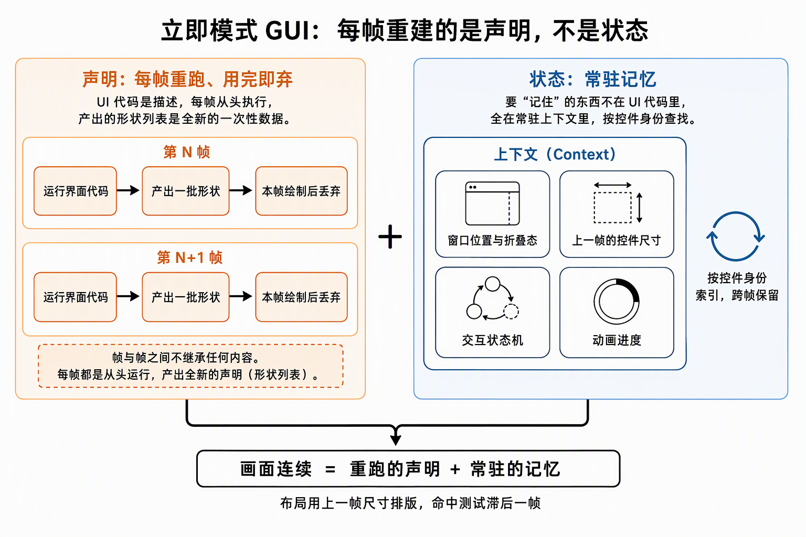
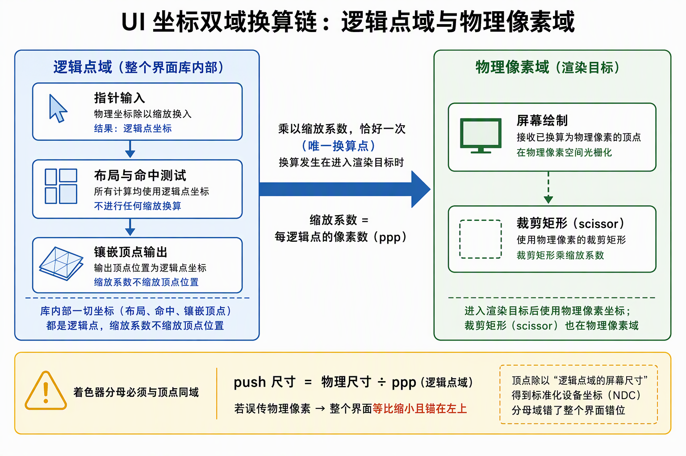
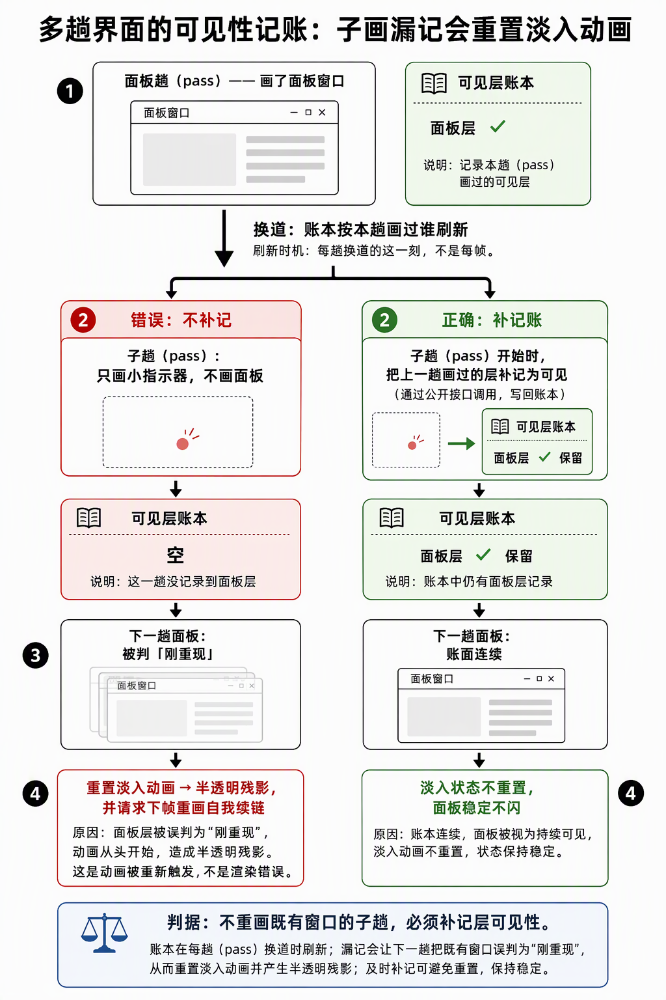

# egui 立即模式与裸 GPU 集成：声明每帧重跑、Context 常驻记忆与裸接后端的簿记契约

egui 是立即模式 GUI：widget 代码每帧重跑、每帧产出全新的 shapes，跨帧要记住的一切（窗口位置、布局尺寸、交互状态机、动画）由 Context 按 widget Id 常驻保管。把它接进自研渲染器时，官方生态拆成三件的活——输入桥（egui-winit）、本体驱动（Context 的 pass）、GPU 后端（egui-wgpu）——在不经 wgpu 的宿主上件件都要自己写。本篇钉三块知识：立即模式的声明/状态模型与每帧真实成本、镶嵌顶点域与 DPI 双域换算链、裸集成（`begin_pass`/`end_pass` 直驱）区别于官方闭包 API 的簿记契约。文中 egui 0.36 行为均已标注"版本相关"。

## §0 判定线

- **立即模式每帧重建的是"声明"不是"状态"**：UI 代码是每帧重跑的描述，Context 按 widget Id 常驻记忆——布局用上帧尺寸排版、命中测试有一帧滞后；每帧真实成本只有 pass 求值、tessellate、顶点上传三样（字体图集是驻留缓存，不在其中）。
- **`tessellate` 输出顶点在 points 域，ppp 从不缩放顶点位置**。ppp 只进字形栅格化密度、像素取整、圆盘半径三处；着色器分母 `push.screen_size` 必须与顶点同域 = 物理尺寸 ÷ ppp。权威判据 = 官方渲染器同位字段名（egui-wgpu 的 `screen_size_in_points`），不是推断。
- **DPI 是三段换算链**：逻辑点 →（×ppp）→ 物理像素 → client rect。测量/注入脚本不声明 DPI 感知时，坐标读写被系统同比例虚拟化，两把虚拟尺子错误互相抵消——验证全绿而真人全偏。
- **pass 是 egui 的节拍单位而非"帧"**，同一帧多对 begin/end 合法；但子 pass 不重画既有窗口时必须补记层可见性，否则窗口被判"刚重现"而重触发淡入动画（半透明残影的根因）。
- **裸 `begin_pass`/`end_pass` 不驱动默认插件的生命周期钩子**（它们只在 `run_ui` 闭包 API 里被驱动）——裸集成要照 `run_ui_dyn` 的形状补跑，否则插件状态（如文字选区）置位后永不清零。
- **wants_pointer 类查询在裸集成下不可靠**（恒真或随执行序漂移）；输入仲裁定案读最近一次 pass 的 `layer_id_at(光标)`。指针按住拖出窗口的 Release 会丢，输入桥必须记欠账补报。
- **`textures_delta` 增量折进 CPU 镜像后就地 clear**，不跨系统存放；delta 带 Drop 审查，不消费即 panic。
- **blend 契约照官方后端钉死**：egui 顶点色已预乘 → `ONE / ONE_MINUS_SRC_ALPHA`；Dear ImGui 顶点色非预乘 → `SRC_ALPHA / ONE_MINUS_SRC_ALPHA`——顶点色契约差半格，blend 公式就差半格，不通用。
- **"控件值域 + 每帧快照回写"的组合，先问这个量的表示是否多分支**：欧拉角跨 ±90°/±180° 边界时另两位翻转，按住期间必须冻结单一表示分支。
- **逐帧无条件写资源会污染 `Changed` 触发集**：按需重绘的触发源里不能有每帧写入的系统。

## 1. 立即模式模型：声明每帧重跑，记忆常驻 Context

每帧的一轮对话是 `ctx.begin_pass(RawInput)` → UI 构建代码 → `ctx.end_pass() -> FullOutput`。pass 外不能查 widget；pass 产出的 `FullOutput` 里 `shapes` 是**未镶嵌**的 `ClippedShape` 列表（镶嵌是 GPU 后端的活），外加 `textures_delta`（图集增量）与 `pixels_per_point`。

"每帧重建"重建的只是声明。视觉连续性来自**重跑的声明 + 常驻的记忆**两层叠加。Context 里按 widget Id 记着：

- 窗口拖动后的位置、折叠态——业务代码里没有任何自己存的状态，全是 Context 记的；
- 每个 widget 上一帧的量测尺寸——**布局用上帧尺寸排版**，尺寸变化一帧收敛；命中测试基于上帧布局，**有一帧滞后**；
- 交互状态机：按住的起点位置、click/drag 判定用的计时与位移；
- 动画状态：窗口淡入淡出。

widget 消失后记忆延迟若干帧才回收（版本相关）。

每帧的真实重复成本因此只有三样：**pass 求值（UI 代码重跑）、镶嵌（`tessellate` 产顶点）、顶点上传（每帧整换写入环）**。字体图集是"用到才长、长完就定"的驻留资源（§7），与每帧成本无关。

## 2. tessellate 顶点域：points，ppp 只进三处

`ctx.tessellate(shapes, ppp)` 输出的顶点位置就是布局域原值——**ppp 在镶嵌里只进三处**（epaint 0.36.2 tessellator.rs，版本相关）：字形 galley 的栅格化密度（ppp 不一致才重栅格）、像素栅格取整（round_to_pixels）、圆盘半径缩放。没有任何一处把顶点位置乘 ppp。

于是着色器 `pos * 2.0 / screen_size - 1.0` 的分母必须与顶点同域：**`screen_size = 物理尺寸 ÷ ppp`（points 域）**。权威判据是官方渲染器同位字段：egui-wgpu 的 uniform 就叫 `screen_size_in_points`，取值 `size_in_pixels / ppp`——这类"上游库把谁换算成谁"的问题，判据优先级是官方渲染器同位字段名 → 库源码通读 → 自建探针实测，推断不足定案。

域失配只有两种错法、方向相反：

| push 值（ppp=1.25） | 渲染位置 | 症状 |
|---|---|---|
| points（= 物理尺寸 ÷ ppp） | pt × 1.25 | 正确 |
| 物理像素（= extent） | pt × 1.0 = 正确位置 × 0.8 | UI 整体等比缩小、锚左上；命中区不动，点击须落在绘制区右下 ×ppp 处 |
| points ÷ ppp | pt × ppp² | ×1.5625 放大越界（方向相反的错法，别混） |

三个尺寸域各喂各的，谁都不许替谁换算：**egui 布局/命中域**（`screen_rect`、命中测试，points；真实鼠标进 egui 恒 = 物理像素 ÷ ppp）、**镶嵌输出**（顶点，points）、**渲染目标域**（swapchain extent、viewport、scissor，物理像素——"points 换像素"落在 push 的分母与 `clip × ppp` 的 scissor 两处）。修复后的对账恒等式：`screen_pt = extent ÷ ppp`，顶点 ÷ screen_pt = NDC，恰好把 points 铺满物理屏幕一次。

## 3. DPI 双域换算链与测量假阳性

完整换算链：**逻辑点（egui 全程）→ ×ppp → 物理像素（swapchain/viewport/scissor）→ client rect（窗口客户区原点，含非客户区偏移的 Win32 层换算）**。输入半边天然自洽：宿主喂给 egui 的指针坐标恒为物理 ÷ ppp，与布局同域。

假阳性机制出在测量/注入脚本一侧：**不声明 DPI 感知的进程里，`SetCursorPos` 入参、`GetCursorPos` 回读、`GetClientRect`、`PrintWindow` 全被系统按同一比例虚拟化**（如 125% 时 ÷1.25）。注入"目标 (x,y)"被换算到偏 ×ppp 的真实位置，截图读数也缩了同一比例——两把尺子同向同比例错，验证闭环内错误互相抵消，注入"看似命中"而真实用户全偏。对策是脚本开头先 `SetProcessDpiAwareness(2)`，尺寸读数注明来源（PrintWindow 尺寸 vs swapchain 尺寸）；用"已知 pt 矩形的探针色块"直接量出 pt→像素实际缩放，比读控件位置可靠一个量级。

## 4. 裸集成的三件活与插件生命周期差

裸集成 = 三件全自己写：**输入桥**（窗口系统事件 → `RawInput`）、**本体驱动**（pass）、**GPU 后端**（镶嵌 → 画）。输入桥的要点：

- egui 根本不碰窗口系统，只认 `RawInput.events` 单流；宿主把事件拆进按类独立缓冲时，桥要按类近似重建序——**指针先于按键**，让按下事件带上本帧新位置（否则用上帧旧位置，首帧更是整条丢弃）；
- 修饰键走快照 + 变化时补发 `ModifiersChanged`（0.36 的 `RawInput` 无顶层 modifiers 字段，只随各事件携带，版本相关）；
- ppp 不进 `RawInput`，走 `ctx.set_pixels_per_point`（每帧 pass 前设）；`screen_rect` 用窗口逻辑尺寸（points 域）。

**裸 `begin_pass`/`end_pass` 与 `run_ui` 闭包 API 有一处实质差**：egui 默认插件（CallbackPlugin、LabelSelectionState、DragAndDrop 等，0.36 版本相关）的 `on_begin_pass`/`on_end_pass` 逐帧账本，只在 `run_ui` 闭包 API（`run_ui_dyn`）尾部被驱动，裸集成不会执行。漏跑的实害：`LabelSelectionState.is_dragging` 首次拖选置位后唯一清零点在 `on_end_pass`，于是永不清零，悬停重投影选区永远带电（"松开仍跟随"）。补跑形状：照 `run_ui_dyn` 同款，用空 root Ui 作钩子宿主，公开 API `Context::plugin_opt` + `Plugin` trait，begin 钩子在窗口构建前、end 钩子在 `end_pass` 前——不 vendor、不改上游。

## 5. 多 pass 可见性簿记：pass 是节拍不是帧

egui 0.36 的 begin/end pass 每趟独立（`viewport_stack` 成对进出、`cumulative_pass_nr` 逐 pass 递增），**同一帧连续多对合法**——多 pass 集成（如"面板 pass + gizmo 子 pass"两层节拍）由此成立。子 pass 只喂 `screen_rect/time` 空事件，指针/按键状态由 egui 跨 pass 自持，事件不重复消费。

但 egui 的窗口可见性按"**上一个 pass 画过谁**"记账：每次 pass 换道刷新 `visible_areas_last_frame`。子 pass 不画任何窗口时，面板层从账面蒸发，随后：

1. 下个面板 pass 里 `Area::begin` 判 `!visible_last_frame` → 重置"变得可见的时刻"；
2. `Area::content_ui` 套**淡入动画**（约 0.08s，0.36 版本相关），该帧 shapes 带低 alpha 进下游缓存；
3. 淡入分支的 repaint 请求让面板 pass 自我续链——每帧重跑、每帧重新淡入，面板全程半透明；停下后连续面板 pass 攒过淡入时长才恢复。

移动中面板只剩半透明残影、停下后恢复，就是这条链。

修复是纯记账：面板 pass 出口记下本 pass 画过的层（`visible_layer_ids`），子 pass begin 后用公开 API `Areas::move_to_top` 把这些层补记为"本 pass 可见"，换道后账面保留、淡入不再重置。**判据句式：任何不重画既有窗口的子 pass，都必须补记层可见性。**

## 6. 输入仲裁与 Release 欠账

"这个拖拽归 egui 还是归场景"需要一个仲裁门。`wants_pointer` 类查询在裸集成下两败（0.36 版本相关）：`is_pointer_over_egui` 对 Background 层的判定依赖只在 `run_ui` API 里写入的字段，裸集成恒走兜底分支**恒返回 true**；`wants_pointer_input` 类的值则随本系统与 pass 的执行序漂移（同在 Update、无显式序）。定案是公开 API `ctx.layer_id_at(光标)`——直接问"这个点上最顶层是谁"，非 Background 层 = 悬在浮动层上就让给 UI；它读最近一次 pass 的层序，最多滞后一帧，调试 UI 场景可接受。

**Release 丢失与欠账模型**：指针按住拖出窗口时，winit 依客户区矩形照发 Leave（不看是否持有 capture，版本相关），而输入桥只在指针位置有效时转发按键事件——Release 被整条丢弃。egui 侧接不住这个洞：`PointerGone` 事件**故意不清按键状态**（源码注释明说拖 slider 出视口要继续拖），失焦路径同理收不到 Release，egui 从此永久"按住"。修复是让桥记欠账：

- 已向 egui 报过按下的键，其 Release 必须补报；
- 指针离窗时用最后记住的指针位置补落点（CursorLeft 不清空簿记）；
- 失焦时统一兑清全部欠账按键。

## 7. 图集与 TexturesDelta：增量就地消费

字体图集驻留在 Context 的 TextureManager（CPU 侧），**只在有新字形需求时才变**（首次渲染某字符、或图集满触发增长重排，0.36 版本相关），变化以 `textures_delta` 报出：dirty-rect 局部补丁（`pos: Some`）或整图（增长重排，`pos: None`）。稳态下所有字形进缓存后 delta 每帧为空，零上传。

消化纪律：**在 pass 出口把增量折进 CPU 侧图集镜像，然后就地 `clear`，不跨系统存放**。两个理由：`TexturesDelta` 带 Drop 审查，增量不被消费即 panic；最小化等让路帧里 pass（Update 侧）照跑而绘制半边整帧让路，增量若攒在跨帧资源里会被下一帧覆写丢失（恢复后镜像缺字形、静默花屏）。GPU 侧按"镜像代数领先已传代数"判整图重传，dirty-rect 与整图对 GPU 侧无差别。

## 8. blend 契约：顶点色预乘差半格

egui 顶点色是 **sRGBA 预乘**（gamma 域），官方 wgpu 后端的混合状态为 color `ONE / ONE_MINUS_SRC_ALPHA`、alpha `ONE_MINUS_DST_ALPHA / ONE`（0.36.2 源码，版本相关）；Dear ImGui 顶点色**非预乘**，官方 Vulkan 后端用 `SRC_ALPHA / ONE_MINUS_SRC_ALPHA`。两家公式都对，差半格的根源在顶点色契约——**blend 判据必须照所接 GUI 库官方后端的源码钉死，公式不能凭感觉通用**。图集纹理对应 `R8G8B8A8_UNORM` + LINEAR（非 sRGB-aware）；sRGB 转换目标侧，官方路径是 shader 里做 gamma→linear、blend 落线性域、ROP 编码恰好一次。

## 9. 控件值域 + 每帧回写：多分支表示陷阱

属性面板的通用形状是"控件值域 + 每帧快照回写"：拖拽期间每帧写回 = 快照值 + 被拖框的控件累加值。欧拉角是**多分支表示**——快照的四元数经 `to_euler` 取的是一个分支，被拖分量的控件累加域钉在按下帧的分支；拖拽跨过 ±90°/±180° 分解边界时，`to_euler` 会翻转另两位（±180°），下一帧回写把"旧分支的拖拽值"与"新分支的快照"混合，合成错误旋转，再分解、再混写形成振荡 = 闪烁，与拖拽反馈耦合时还会跑飞（显示 48° 实际 132°）。

修复的通用形状：**按住期间冻结单一表示分支**（按下帧缓存整组欧拉，控件只改被拖的那位，松手作废缓存重建）。正确性依据：同分支三元 + 单分量替换恒为合法分解，混分支则否。判定句式：任何"控件值域 + 每帧回写"组合都要问一句"**这个量是否多分支表示**"——欧拉角是，四元数/平移/缩放不是。

## 10. 按需重绘门控

面板内容不必逐帧重求值。触发集的每项都对应一个真实刷新需求：

- 首帧；快照到期（如 0.5s 节拍的 fps 读数）；窗口尺寸/ppp 变化；
- egui 自身请求立即重绘——pass 出口读 `repaint_delay` 为 0 即置强制位，动画/悬停渐变/光标闪烁靠它续帧，egui 自管动画不因节拍化冻结；
- 相关资源 `Changed`（点选、开关等写点在别的系统，下一 pass 生效）；
- 面板相关输入事件——**指针移动只在"悬于 UI 层（`layer_id_at` 仲裁同式）或拖拽始于 UI"时才算触发**，纯场景上的移动（环视漫游）不重跑面板。

跳过帧的事件攒进积压账，下次 pass 旧事件在前一次性喂入，连续移动折叠成最新一条，门控翻转帧补发当前位置（悬停高亮不冻结在旧形状）。

两枚配套钉子：其一，**逐帧无条件写资源会污染 `Changed` 触发集**——某系统每帧 `insert` 同值资源，把该资源列进触发源的 pass 就被逐帧拉起，按需失效；每帧必须推进的底座（快照 tick、采样账）要移出门控路径每帧执行，pass 只读快照。其二，镶嵌复用按 **shapes 代数**判等（`ClippedShape` 直持 `Shape` 非 Arc，深拷贝补齐每帧要付 MB 级 memcpy——版本相关），代数未变的帧直接复用镶嵌产物；egui 官方在 `tessellate` 注释里自注逐形状比较不值得做（占一半成本），按代数判等零比较成本。

## 来源

- [egui裸接ash讲解：输入桥、pass与GPU后端](../../开发步骤/3-静态取数链路/3.7-egui调试GUI/egui裸接ash讲解：输入桥、pass与GPU后端（兼frenderer-Dear-ImGui对照）.md)（三件活、pass 模型、图集驻留、blend/Dear ImGui 对照）
- [UI点击偏移订正讲解：tessellate顶点域、push尺寸域与DPI测量假阳性](../../开发步骤/3-静态取数链路/3.7-egui调试GUI/UI点击偏移订正讲解：tessellate顶点域、push尺寸域与DPI测量假阳性.md)（points 域判定、三版本账、两把虚拟尺子）
- [3.7-施工计划：输入桥、图集镜像与overlay管线](../../开发步骤/3-静态取数链路/3.7-egui调试GUI/3.7-施工计划：输入桥、图集镜像与overlay管线.md)（API 契约表、blend 判据、图集镜像设计）
- [3.9.1-3.9.2-鼠标摄像机控制施工记录](../../开发步骤/3-静态取数链路/3.9-鼠标摄像机控制/3.9.1-3.9.2-鼠标摄像机控制施工记录：左键环绕、滚轮推拉与egui层仲裁门.md)（wants 类查询失效与 layer_id_at 定案）
- [3.10.1-实体层级树施工记录](../../开发步骤/3-静态取数链路/3.10-egui实体层级树/3.10.1-实体层级树施工记录：独立窗口struct、总控窗口与相关实体过滤.md)（Release 欠账、插件生命周期补跑）
- [7.8.1-7.8.3-egui按需求值施工记录](../../开发步骤/7-大型正式场景/7.8-egui按需求值/7.8.1-7.8.3-egui按需求值施工记录：基线取证、两层节拍化与交互零回退.md)（多 pass 可见性簿记、触发集与积压语义）
- [4.6.1-4.6.2-实测缺陷修复施工记录](../../开发步骤/4-可靠增量链路/4.6-实测缺陷修复/4.6.1-4.6.2-实测缺陷修复施工记录：注释清扫与拖拽旋转闪烁.md)（DragValue 欧拉分支冻结）
