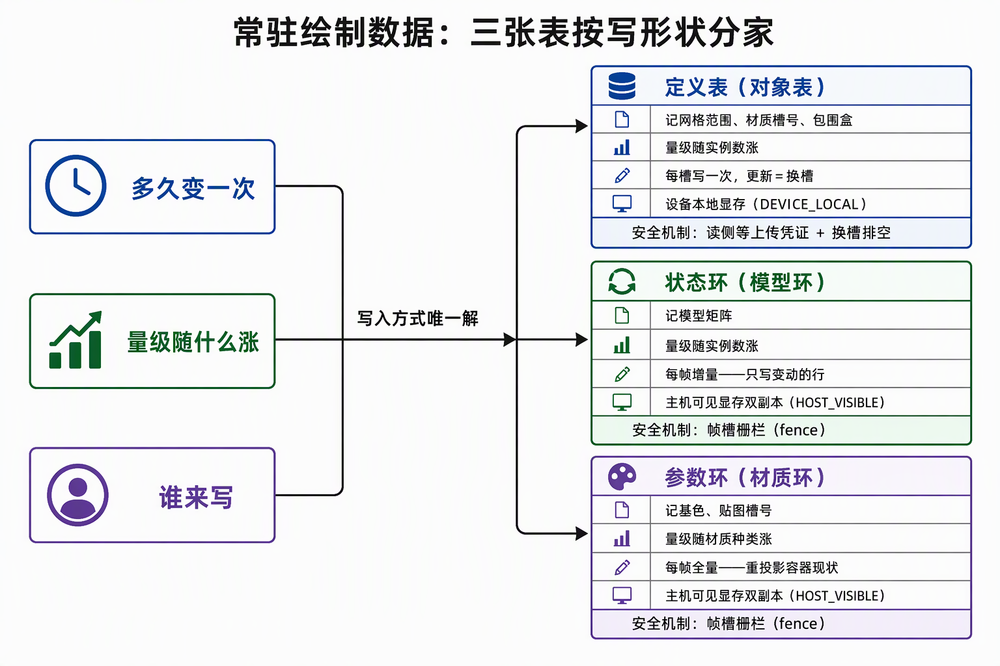
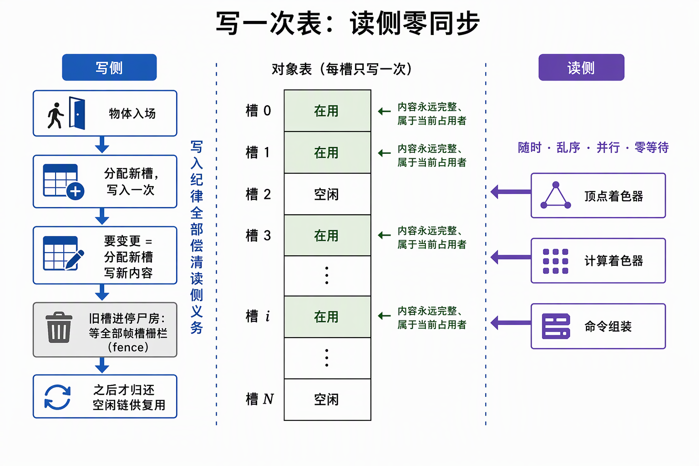
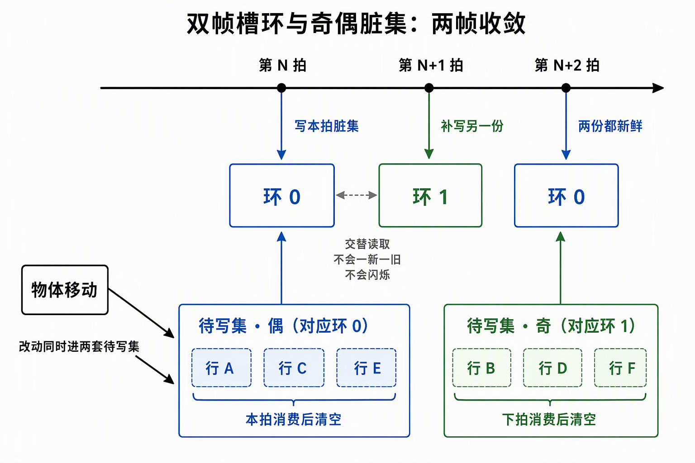

# 常驻绘制数据：三张表，按"多久变一次"定写法

GPU 画一个物体，需要它的全部参数：模型矩阵（在哪，64 字节）、网格区间（几何是哪一段）、材质（什么颜色贴图）。老办法是 CPU 每帧把参数一份份塞给 GPU（每物体 96 字节），物体越多塞得越多。新办法是把参数表提前放进显存**常驻**（一直留着不撤），GPU 自己查表，CPU 每帧只递一个 4 字节编号。

本篇回答：这份参数表分几张、各自谁来写、写入时怎么保证不干扰 GPU 正在读的部分。

全文用一个具体场景举例：**1 万个物体、5 种材质、每帧约 2000 个在动。**

## 三张表

| 表 | 记什么 | 写谁 | 怎么写 |
|---|---|---|---|
| 对象表 | 每个物体怎么画：网格区间、用哪个材质、包围盒 | GPU 拷贝命令 | 写一次，改 = 换行 |
| 模型环 | 每个物体现在在哪：模型矩阵 | CPU 直接写显存 | 只写动了的那 2000 条 |
| 材质环 | 每种材质长什么样：颜色、贴图 | CPU 直接写显存 | 每帧 5 条全部重写 |

为什么是这三张：一份"每帧变不变 × 数据量跟着什么涨 × 谁来写"的账，每种组合只有一种合适写法。变一次的东西经得起"写一次"；每帧都变的只配"反复写"，反复写里又按数据量分增量（模型 1 万条，只写动的）和全量（材质 5 条，全写也不贵）。

## 对象表：写一次，改 = 换行

网格区间、材质引用、包围盒只在物体入场、删除、换绑时变。所以定死一条规则：**入场写一行，之后永不原地改；要改就新写一行、换用新编号，旧行等确认没有任何绘制命令在读之后回收。**

回报：GPU 侧任何时刻读任何一行，读到的都是完整数据。着色器、剔除计算读表**零等待、零检查**——因为没人会改它。代价：改动要走"新行 + 回收"的手续，只适合低频变化。

两个例子：

- **新物体入场**：CPU 备好网格和参数 → GPU 拷贝命令往对象表的空行写一条记录 → 从此每帧画它只递编号。
- **物体换网格**（数据重传）：分配新行写新内容、换用新编号，旧行等两帧在飞都结束后回收。

## 模型环：只写动的，防止一帧新一帧旧

模型矩阵每帧都可能变（2000 个在动），放对象表会撞上两条死路：

1. **原地改**：上一帧的绘制命令可能还在 GPU 里读这一行，写和读之间没有同步，Vulkan 规范判未定义行为。
2. **学对象表换行**：每帧 1 万次换行，旧行回收（等两帧在飞清空）永远追不上，流水线每帧停一拍。

所以单独放"环"里：显存放**两份**（对应同时在飞的两帧），CPU 直接写内存。

写法：帧 N 动了的物体，矩阵**当帧**写进本帧那份环（本帧画出来就是新位置），**下一帧**再补写进另一份。两帧后两份都是新的；中间任何一帧读到的要么是新值、要么是录制绘制命令时改动还没发生的合法旧值——**不会一帧新、一帧旧地闪**。

为此要记两份"谁动了"清单，按帧序号的奇偶（0、1 轮流）各一套：帧 N 消费本帧奇偶那套、写完清掉，另一套留给帧 N+1 补另一份。新入场的物体也两套都记，保证两份环各就位一次。

在飞帧数改成 3 时：环三份、清单三套、一个改动三帧写满三份——机制不变，数字跟着走。

## 材质环：条数少就每帧全重写

反复写有两条路：

- **增量**：只写变了的。省字节数，但要维护"谁动了"清单——接线、按帧分套、漏记就出错。
- **全量**：每帧全部重写。字节多一点，零维护；而且环内容永远等于材质容器的现状——改参数、换贴图、热重载自动下一帧生效，不用通知谁。

判据就一笔账：清单维护成本 vs 多写的字节。材质只有 5 条（每条 32 字节，全量每帧 160 字节），维护清单不划算 → 全量。模型矩阵 1 万条、只动 2000 → 增量。

全量还砍断一条连锁：如果材质也走"写一次 + 换行"，改一张贴图 = 5 条材质换行 = **1 万条对象表记录跟着换行**（它们都记着材质编号）。全量重写只动这 5 条，对象表一行不动。

条件反转时策略对调：材质上千 → 材质环改增量；几乎全场景静止 → 模型环改全量。环容器不变，只换写法。

## CPU 直接写显存，怎么保证不出错

CPU 写映射内存不是 GPU 命令，屏障（GPU 命令间的同步工具）、信号量、验证层都管不到它——写错了也没有任何报错。安全只能靠两件事，**缺一不可**：

- **空间错开**：环有两份，写第 0 份时 GPU 正在读第 1 份。
- **时机证明**：写第 0 份之前，先等它的 fence——CPU 手里"GPU 已用完这一份"的凭证。GPU 满载时 CPU 会顶到在飞上限，不等凭证就会稳定撞上 GPU 正在读的时刻。

不等凭证的后果比崩溃隐蔽：矩阵写到一半被读走 = 一半新一半旧（几何扭曲）；写完整了但时机撞上 = 已定格的画面被篡改（物体瞬移）。另外两件事别混：**可见性**（写完立即可见，由 HOST_COHERENT 保证）和**并发安全**（fence）。

这个定式通用：相机/灯光常量、UI 顶点、模型矩阵、材质参数，全是"两份轮转 + 同一条 fence 纪律"，差别只在填充策略。

## 两个容易写错的细节

- **判断"要不要重写一条对象表记录"必须比内容版本号**，不能只比物体编号：物体还是那个物体，但数据重传过（换了网格文件），只比编号会漏更新，物体从此按旧几何画。
- **对象表存局部包围盒，不存世界包围盒**：世界包围盒跟着移动每帧变，会破坏写一次；局部包围盒是几何固有属性，终身不变。要用世界包围盒时，拿当帧矩阵现场算。

## 编号递到哪里为止

CPU 递编号的通道逐步退役：最初走 push constant（CPU 每画一个物体单独塞参数的通道，每 draw 4 字节）；indirect 闭环（GPU 自己组装绘制命令）后，编号直接写进命令的 `firstInstance` 字段，push 归零——**96B → 4B → 0**。

能这么做是因为 Vulkan 的 `InstanceIndex` 从 `firstInstance` 起算，而每条命令只画 1 个实例，所以 `InstanceIndex == firstInstance == 物体编号`，着色器拿它直接查对象表。用 `gl_DrawID`（命令序号）直读不行：编号经回收复用后是稀疏的，命令序号对不上编号，还得补一层映射，比 4 字节更贵。

命令环本身的账（drawCount/instanceCount）见[《indirect 命令环》](indirect%20命令环.md)；全工程内存分配点盘点见[《工程内存落位总表》](工程内存落位总表.md)；GPU-driven 的决策权归属见[《GPU-Driven 本质》](GPU-Driven%20本质.md)。

## 来源

- [三张表的设计决策：更新频率、写入方式与备选方案对照](../../开发步骤/5-GPU驱动与常驻大场景/5.1-常驻绘制数据/三张表的设计决策：更新频率、写入方式与备选方案对照.md)——三问框架、备选方案对打、翻面条件
- [环机制：HostVisible数据的帧槽轮转与fence纪律](../../开发步骤/5-GPU驱动与常驻大场景/5.1-常驻绘制数据/环机制：HostVisible数据的帧槽轮转与fence纪律.md)——双奇偶脏集、宿主写盲区、可见性正交
- [对象表机制：GPU可见的场景名册——记录布局、set2与槽位生命周期](../../开发步骤/5-GPU驱动与常驻大场景/5.1-常驻绘制数据/对象表机制：GPU可见的场景名册——记录布局、set2与槽位生命周期.md)——记录布局、局部 AABB、身份三元组
- [GPU驱动第一课：从逐draw推参数到实例索引读表——新旧两套写法对照](../../开发步骤/5-GPU驱动与常驻大场景/5.1-常驻绘制数据/GPU驱动第一课：从逐draw推参数到实例索引读表——新旧两套写法对照.md)——新旧账单对照、槽位生死
- [5.1 施工记录：对象表、模型环与push退役](../../开发步骤/5-GPU驱动与常驻大场景/5.1-常驻绘制数据/5.1.1-5.1.6-常驻绘制数据施工记录：对象表、模型环与push退役.md)——gl_DrawID 否决、票据免重写判定
- [功能流程导读：GPU驱动闭环全景](../../开发步骤/5-GPU驱动与常驻大场景/功能流程导读：GPU驱动闭环全景.md)——链路全景与四类变更成本
- [5.3 施工记录：能力闸门、命令组装与图形消费](../../开发步骤/5-GPU驱动与常驻大场景/5.3-indirect闭环/5.3.1-5.3.5-indirect闭环施工记录：能力闸门、命令组装与图形消费.md)——firstInstance 语义与 push 退役
- 姊妹篇：[GPU-Driven 本质](GPU-Driven%20本质.md)、[indirect 命令环](indirect%20命令环.md)、[工程内存落位总表](工程内存落位总表.md)
