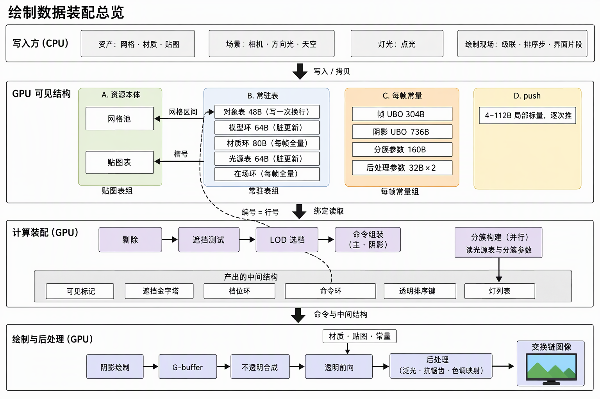
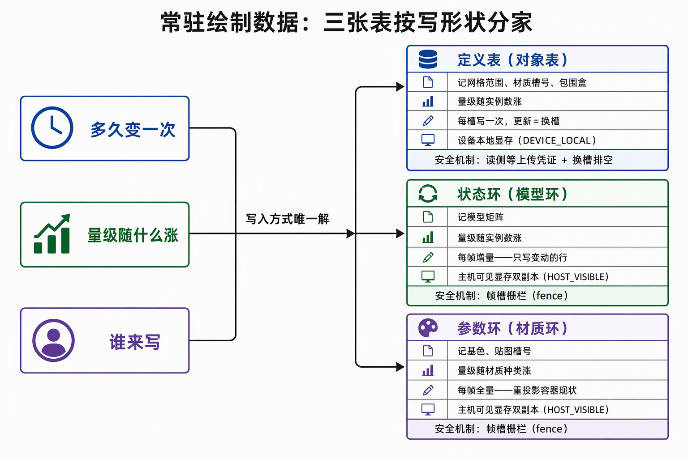
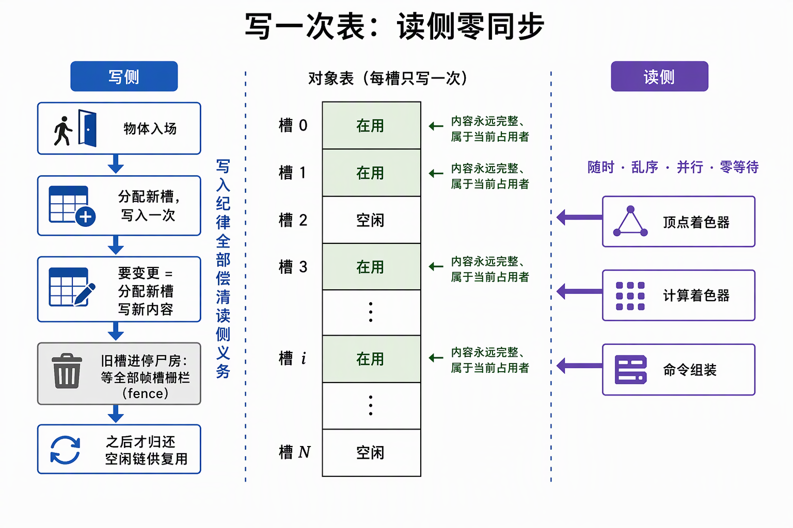
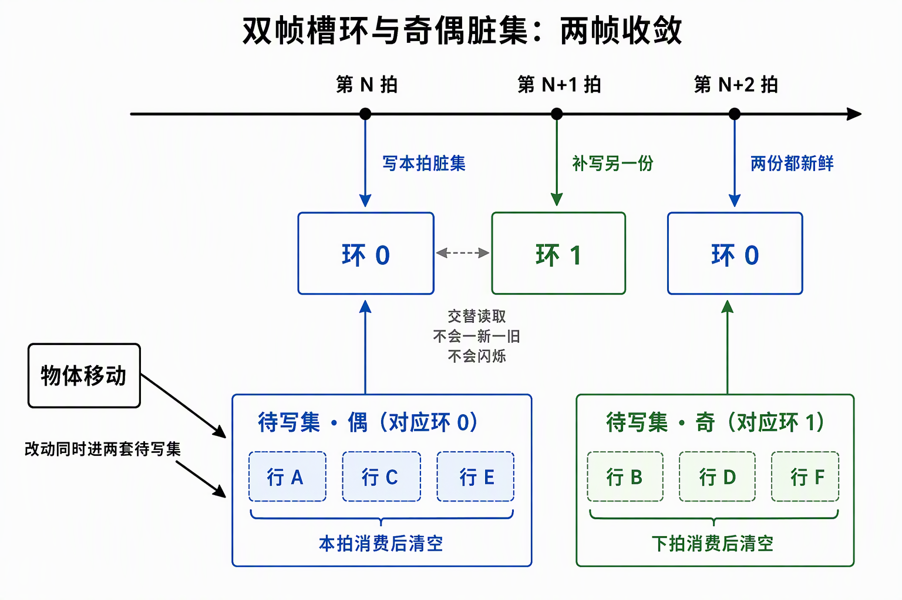

# 绘制数据落位：常驻表、每帧 UBO、push 通道

GPU 画一个物体，需要的数据可以分成五类：

- 它怎么画：网格区间（几何是哪一段）、用哪个材质、包围盒；
- 它现在在哪：模型矩阵（64 字节）；
- 它的材质长什么样：颜色、金属度、粗糙度、贴图槽；
- 整帧共享的环境：相机矩阵、方向光、环境光、相机位置、天空参数、着色模式，以及分簇用的视锥与网格参数；
- 本次绘制的局部标量：视锥平面、dispatch 上界、级联索引、排序步、UI 纹理槽。

老办法（历史路径）是 CPU 每帧把参数一份份塞给 GPU（每物体 96 字节），物体越多塞得越多。现在按"多久变一次、一次变多少、谁来写"把这些数据分到六个落点（其中光照环境拆成"每盏点光"与"全局共用"两块）：

| 落点 | 装什么 | 写谁 | 更新方式 | 数据何时变 |
|---|---|---|---|---|
| 对象表 | 每个物体怎么画：网格区间、材质编号、局部包围盒 | GPU 拷贝命令 | 写一次，改 = 换行 | 入场、换网格、换材质 |
| 模型环 | 每个物体现在在哪：模型矩阵 | CPU 直接写显存 | 脏更新（只写动了的行） | 每帧都可能有物体在动 |
| 材质环 | 每种材质长什么样：颜色、贴图槽 | CPU 直接写显存 | 每帧全量重写 | 每帧 |
| 光源表 | 每盏点光在哪、什么颜色、多大半径 | CPU 直接写显存 | 脏更新（只写脏行） | 灯增删、改参数时 |
| 每帧常量块 | set1 UBO（相机、方向光、天空、着色模式，304B）、阴影级联 UBO（736B）、分簇参数（160B）、bloom/SMAA 参数（各 32B） | CPU 直接写显存 | 每帧全量重写，按帧槽一份 | 每帧 |
| push | 本次 dispatch / 本次绘制的局部标量 | 录制命令时推进命令流 | 逐次推 | 一帧内多次 |

"数据何时变"和"更新方式"是两笔账：模型矩阵每帧都有变化，写入仍是脏更新，只写变了的行；材质每帧全量重写，是因为只有 5 条、全写比维护清单便宜，不是因为每条都变了。

六路合起来，回答的是"这次绘制怎么画"：GPU 从对象表拿到画哪段几何、用哪个材质，从模型环拿到世界变换，从材质环拿到材质内容，从光源表与每帧常量块拿到光照与阴影，从 push 拿到这次 dispatch 的边界和临时参数。编号（对象表的行号）是把"画谁"接进绘制命令的钥匙，见文末「编号递到哪里为止」。

它们装的是参数，不装被引用的资源本体：顶点与索引数据在网格池，贴图像素与采样器在 bindless 纹理表（set0），UI 顶点在单独的顶点/索引环；对象表与材质环里存的只是引用它们的编号。另有两类数据不在表里：一类是"这帧画哪些行"的遍历列表（在场环，每帧全量重写，indirect 组装、阴影组装、透明收集都按它走），一类是 GPU 自己产出的中间数据——可见标记、indirect 命令环、LOD 档位、Hi-Z 层级、透明排序键、分簇灯列表。它们各有专篇；全工程分配点在[工程内存落位总表](工程内存落位总表.md)里盘点。

下文仍用同一个场景举例：**1 万个物体、5 种材质、每帧约 2000 个在动。**

## 常驻表：跟着物体、材质或光源走的数据

四张表装的是按物体、材质或光源逐条记的部分。为什么拆成几张而不是一张：一份"每帧变不变 × 数据量跟着什么涨 × 谁来写"的账，每种组合只有一种合适写法。变一次的东西经得起"写一次"；每帧都变的只配"反复写"，反复写里又按条数分增量（模型 1 万条只写动的、光源通常没几盏在变）和全量（材质 5 条，全写也不贵）。

## 对象表：写一次，改 = 换行

网格区间、材质引用、包围盒只在物体入场、删除、换绑时变。所以定死一条规则：**入场写一行，之后永不原地改；要改就新写一行、换用新编号，旧行等确认没有任何绘制命令在读之后回收。**

回报：GPU 侧任何时刻读任何一行，读到的都是完整数据。着色器、剔除计算读表**零等待、零检查**——因为没人会改它。代价：改动要走"新行 + 回收"的手续，只适合低频变化。

两个例子：

- **新物体入场**：CPU 备好网格和参数 → GPU 拷贝命令往对象表的空行写一条记录 → 从此每帧画它只递编号。
- **物体换网格**（数据重传）：分配新行写新内容、换用新编号，旧行等两帧在飞都结束后回收。

## 模型环：只写动的，防止一帧新一帧旧

模型矩阵每帧都可能变（2000 个在动），放对象表会撞上两条死路：

1. **原地改**：上一帧的绘制命令可能还在 GPU 里读这一行，写和读之间没有同步，Vulkan 规范判未定义行为。
2. **学对象表换行**：每帧 1 万次换行，旧行回收（等两帧在飞清空）永远追不上，流水线每帧停一拍。

所以单独放"环"里：显存放**两份**（对应同时在飞的两帧），CPU 直接写内存。

写法：帧 N 动了的物体，矩阵**当帧**写进本帧那份环（本帧画出来就是新位置），**下一帧**再补写进另一份。两帧后两份都是新的；中间任何一帧读到的要么是新值、要么是录制绘制命令时改动还没发生的合法旧值——**不会一帧新、一帧旧地闪**。

为此要记两份"谁动了"清单，按帧序号的奇偶（0、1 轮流）各一套：帧 N 消费本帧奇偶那套、写完清掉，另一套留给帧 N+1 补另一份。新入场的物体也两套都记，保证两份环各就位一次。

在飞帧数改成 3 时：环三份、清单三套、一个改动三帧写满三份——机制不变，数字跟着走。

**光源表是同一做法的第二个用户。** 点光记录（位置与半径、颜色与强度、标志位，64 字节一条，容量 256）也按帧槽各一份、只写脏行。区别只在回收：实例表的槽要延迟回收，光源表的槽可以立即清零复用——灯通常不到百盏，旧的分簇列表最坏在一帧内引用到换了内容的槽，闪一下也不会读到无效数据，不值得再背一套延迟回收的手续。方向光不进表，它走每帧 UBO。

## 材质环：条数少就每帧全重写

反复写有两条路：

- **增量**：只写变了的。省字节数，但要维护"谁动了"清单——接线、按帧分套、漏记就出错。
- **全量**：每帧全部重写。字节多一点，零维护；而且环内容永远等于材质容器的现状——改参数、换贴图、热重载自动下一帧生效，不用通知谁。

判据就一笔账：清单维护成本 vs 多写的字节。材质只有 5 条（每条 80 字节，全量每帧 400 字节），维护清单不划算 → 全量。模型矩阵 1 万条、只动 2000 → 增量。

全量还砍断一条连锁：如果材质也走"写一次 + 换行"，改一张贴图 = 5 条材质换行 = **1 万条对象表记录跟着换行**（它们都记着材质编号）。全量重写只动这 5 条，对象表一行不动。

条件反转时策略对调：材质上千 → 材质环改增量；几乎全场景静止 → 模型环改全量。环容器不变，只换写法。

## 每帧 UBO：整帧一份的常量块家族

相机矩阵、逆矩阵、方向光方向与颜色、环境光、相机位置、天空六组大气参数、着色模式——这些对场景里每个物体都一样，整帧只有一份。放进对象表意味着 1 万行记同一个值；放进 push 又太大。落点是 set1 b0 的 uniform buffer：按帧槽各一份（同时在飞几帧就有几份），每帧把 `FrameUniformsData` 打包成 **304 字节**整块重写。

字段偏移由 `frame_uniform_table.rs` 的 `offset_of!` 断言钉死（0 / 64 / 80 / 96 / 112 / 128 / 192 / 208 / 224 / 240 / 256 / 272 / 288），WGSL 侧在 `shaders/common/frame.wgsl` 逐字段对照，改字段要三处一起改。写法与材质环同族：每帧全量、零维护——改相机、改灯光、改天空参数，下一帧自动生效，不用通知谁。区别只在"一份 vs 每条"：材质环每条材质一个记录，这份 UBO 整帧只有一个记录，所以它不需要"表"，只需要按帧槽轮转的那一份。写时机同样受帧槽 fence 管：写之前该帧槽上一轮提交已经执行完（见 `frame_uniform_table.rs` 头注），与各张环共享同一条纪律。

每帧常量块不止这一份，而是一族：阴影级联矩阵与视锥平面（736B）、分簇参数（160B）、bloom 参数与 SMAA 信息（各 32B）。写法完全一样——每帧一份、按帧槽轮转、全量重写。分成几块而不是塞进同一个 UBO，是因为读它们的管线组不同：主绘制不读 bloom 阈值，后处理也不读天空参数。分簇参数与后处理参数在描述符里是 storage buffer，名字不叫 UBO，落位判据不变。

为什么不是 push：这一族里 304、736、160 字节的块都超过 `maxPushConstantsSize` 的保证下限 128 字节；剩下 32 字节的两块虽然装得下，但每帧只变一次、被整条后处理链共享，没有理由在每个 dispatch 前重推一遍。

## push：一帧内会变的几个字节

push constant 是 CPU 录制命令时直接写进命令流的一小块参数：大小与阶段在管线 layout 里声明（`PushRange`），GPU 执行到那条命令时直接读走。它是这几类写法里唯一不常驻的——值跟着当帧的命令缓冲一起被提交，不需要"两份轮转"那套空间错开，也不存在 CPU 与 GPU 同时读同一块内存的问题。

现在工程里剩下的 push，全是"一帧内随录制推进而变、每次只带几个标量、只服务一条管线"的局部参数：

| 调用点 | 大小 | 内容 | 推送粒度 |
|---|---|---|---|
| cull compute | 112B | 六个视锥平面 + dispatch 上界 + 主视图剔除开关 | 每帧一次 |
| occlusion compute | 80B | view_proj + 屏幕尺寸 + dispatch 上界 | 每帧一次 |
| lod_select compute | 96B | view_proj + 屏幕尺寸 + dispatch 上界 + 阈值 + 迟滞 | 每帧一次 |
| build_indirect / shadow_build compute | 4B | 本帧在场行数 | 每帧一次 |
| shadow 深度绘制（两条管线） | 4B | 级联索引 | 每级联一次 |
| 透明 collect / gather | 4B | 在场行数 | 每帧一次 |
| 透明 sort | 8B | (k, j) 排序步 | 每次 dispatch |
| overlay UI | 16B | 屏幕尺寸 + 纹理槽 + 采样器槽 | 每 clip 一次 |

判据：一帧内要变多次、每次只带几个标量、只服务一条管线 → push。放进 UBO 会一帧内反复改同一个常量缓冲，没有同步机制保证不和 GPU 正在读的值撞上；放进常驻表又没人按行查，纯浪费绑定和显存。反过来说，一帧只变一次、被多条管线共用的（相机、方向光），就该像上一节那样进 UBO。

容量上限：Vulkan 规范保证 `maxPushConstantsSize ≥ 128` 字节，工程里最大的 cull 是 112 字节，正好卡在保证线内，所以代码不查询上限。超过就得拆成多段或换 UBO。

历史上唯一一种逐物体 push 是实例编号（每 draw 4 字节），indirect 闭环后退役，过程见文末「编号递到哪里为止」。UI 的 16B push 细节见[整帧录制流程](../命令与提交/整帧录制流程.md)，LOD 选档的 96B 字段见[GPU LOD与流送](../资源更新与流送/GPU%20LOD与流送.md)。

## CPU 直接写显存，怎么保证不出错

各张环、光源表与每帧常量块都是 CPU 直接写映射内存，共享同一条纪律；push 走命令流，不在这一节的范围。CPU 写映射内存不是 GPU 命令，屏障（GPU 命令间的同步工具）、信号量、验证层都管不到它——写错了也没有任何报错。安全只能靠两件事，**缺一不可**：

- **空间错开**：环与每帧常量块都按帧槽各有一份，写第 0 份时 GPU 正在读第 1 份。
- **时机证明**：写第 0 份之前，先等它的 fence——CPU 手里"GPU 已用完这一份"的凭证。GPU 满载时 CPU 会顶到在飞上限，不等凭证就会稳定撞上 GPU 正在读的时刻。

不等凭证的后果比崩溃隐蔽：矩阵写到一半被读走 = 一半新一半旧（几何扭曲）；写完整了但时机撞上 = 已定格的画面被篡改（物体瞬移）。另外两件事别混：**可见性**（coherent 内存写完即见；非 coherent 由 `GpuBuffer::write` 内 flush 保证）和**并发安全**（fence）。

这个定式通用：每帧常量（相机/灯光/阴影/后处理）、UI 顶点、模型矩阵、材质参数、光源记录，全是"两份轮转 + 同一条 fence 纪律"，差别只在填充策略。

## 两个容易写错的细节

- **判断"要不要重写一条对象表记录"必须比内容版本号**，不能只比物体编号：物体还是那个物体，但数据重传过（换了网格文件），只比编号会漏更新，物体从此按旧几何画。
- **对象表存局部包围盒，不存世界包围盒**：世界包围盒跟着移动每帧变，会破坏写一次；局部包围盒是几何固有属性，终身不变。要用世界包围盒时，拿当帧矩阵现场算。

## 编号递到哪里为止

CPU 递编号的通道逐步退役：最初走 push constant（CPU 每画一个物体单独塞参数的通道，每 draw 4 字节）；indirect 闭环（GPU 自己组装绘制命令）后，编号直接写进命令的 `firstInstance` 字段，push 归零——**96B → 4B → 0**（历史路径：当前代码已无逐物体 96B push）。

能这么做是因为 Vulkan 的 `InstanceIndex` 从 `firstInstance` 起算，而每条命令只画 1 个实例，所以 `InstanceIndex == firstInstance == 物体编号`，着色器拿它直接查对象表。用 `gl_DrawID`（命令序号）直读不行：编号经回收复用后是稀疏的，命令序号对不上编号，还得补一层映射，比 4 字节更贵。

命令环本身另有一笔 drawCount/instanceCount 的账，[indirect 命令环](../命令与提交/indirect%20命令环.md) 记的就是它。全工程的内存分配点在[工程内存落位总表](工程内存落位总表.md)里盘点。哪些决策交给 GPU、哪些留在 CPU，由[GPU-Driven 本质](../可见性与GPU驱动/GPU-Driven%20本质.md)回答。

## 来源

- [三张表的设计决策：更新频率、写入方式与备选方案对照](../../开发步骤/5-GPU驱动与常驻大场景/5.1-常驻绘制数据/三张表的设计决策：更新频率、写入方式与备选方案对照.md)——三问框架、备选方案对打、翻面条件
- [环机制：HostVisible数据的帧槽轮转与fence纪律](../../开发步骤/5-GPU驱动与常驻大场景/5.1-常驻绘制数据/环机制：HostVisible数据的帧槽轮转与fence纪律.md)——双奇偶脏集、宿主写盲区、可见性正交
- [对象表机制：GPU可见的场景名册——记录布局、set2与槽位生命周期](../../开发步骤/5-GPU驱动与常驻大场景/5.1-常驻绘制数据/对象表机制：GPU可见的场景名册——记录布局、set2与槽位生命周期.md)——记录布局、局部 AABB、身份三元组
- [GPU驱动第一课：从逐draw推参数到实例索引读表——新旧两套写法对照](../../开发步骤/5-GPU驱动与常驻大场景/5.1-常驻绘制数据/GPU驱动第一课：从逐draw推参数到实例索引读表——新旧两套写法对照.md)——新旧账单对照、槽位生死
- [5.1 施工记录：对象表、模型环与push退役](../../开发步骤/5-GPU驱动与常驻大场景/5.1-常驻绘制数据/5.1.1-5.1.6-常驻绘制数据施工记录：对象表、模型环与push退役.md)——gl_DrawID 否决、票据免重写判定
- [功能流程导读：GPU驱动闭环全景](../../开发步骤/5-GPU驱动与常驻大场景/功能流程导读：GPU驱动闭环全景.md)——链路全景与四类变更成本
- [5.3 施工记录：能力闸门、命令组装与图形消费](../../开发步骤/5-GPU驱动与常驻大场景/5.3-indirect闭环/5.3.1-5.3.5-indirect闭环施工记录：能力闸门、命令组装与图形消费.md)——firstInstance 语义与 push 退役
- [整帧录制流程](../命令与提交/整帧录制流程.md)——overlay 的 16B push（逐 clip 纹理槽）与录制段顺序
- [GPU LOD与流送](../资源更新与流送/GPU%20LOD与流送.md)——选档 96B push 的字段与偏移
- 代码正本：`ash_renderer/src/render/resident/tables/{frame_uniform_table,light_table,instance_table}.rs`（每帧 UBO、光源表、对象/模型/材质表）、`src/render/passes/visibility/{cull,occlusion,lod,indirect}.rs`（compute push 排布）、`src/render/passes/lighting/cluster.rs`（分簇参数 160B）、`shaders/common/frame.wgsl`（UBO 的 WGSL 镜像）
- 姊妹篇：[GPU-Driven 本质](../可见性与GPU驱动/GPU-Driven%20本质.md)、[indirect 命令环](../命令与提交/indirect%20命令环.md)、[工程内存落位总表](工程内存落位总表.md)
