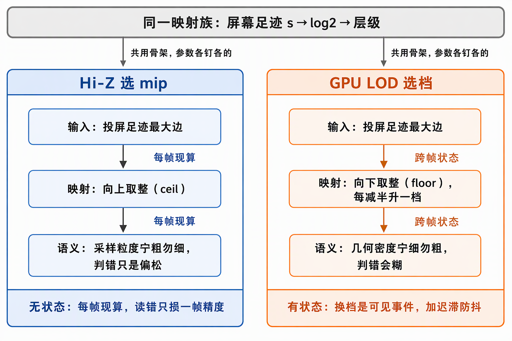
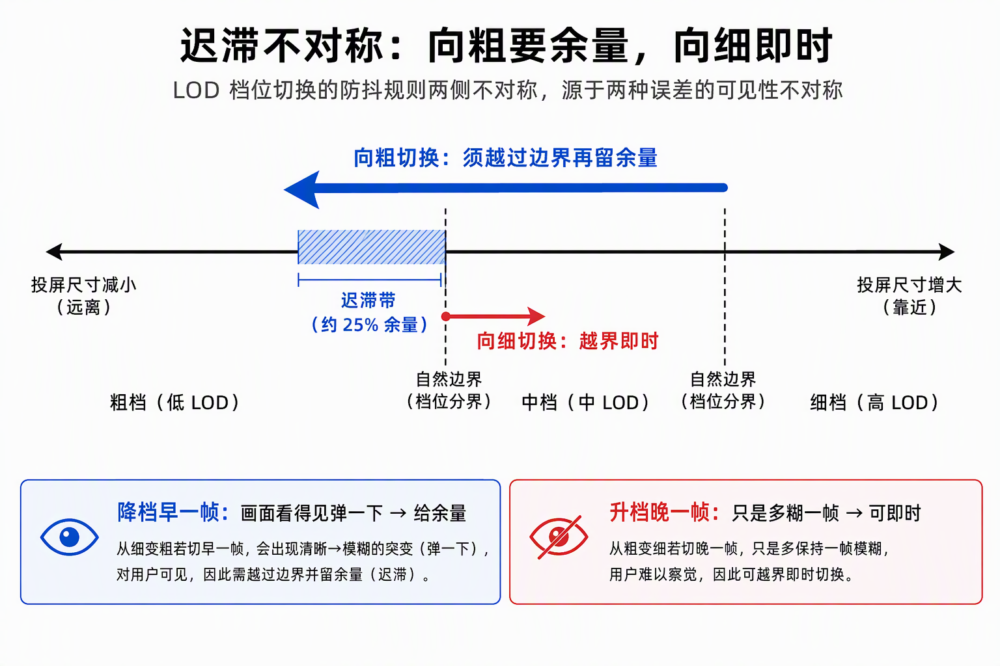
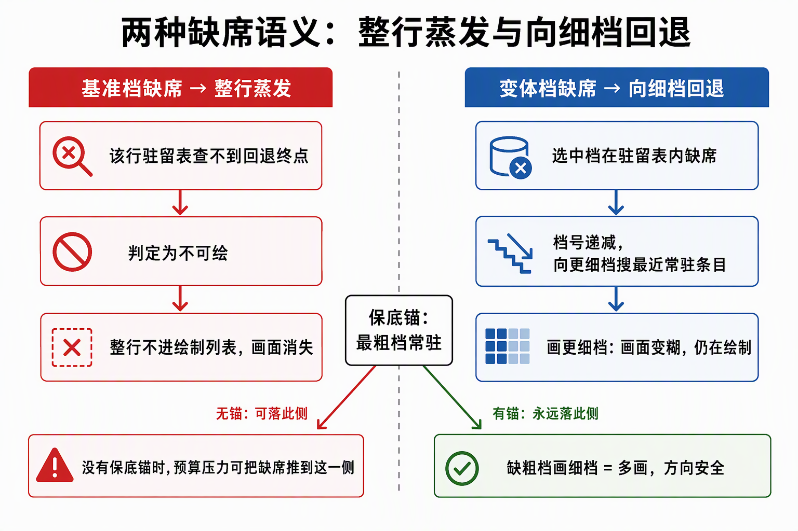
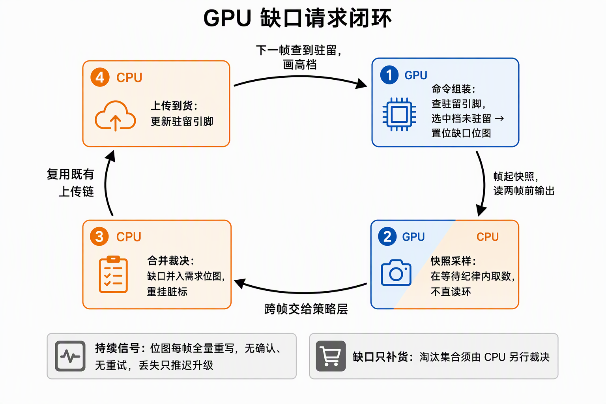

# GPU LOD 与流送：屏幕足迹选档与驻留策略层

LOD 与流送回答两个不同时标的问题。LOD 逐帧、逐实例回答"看得见，但该画多细"——决策在 GPU 执行时完成，输出直接落进本帧的绘制命令；流送跨帧、逐资产回答"什么值得驻留在显存里"——决策留在 CPU 策略层，GPU 只出需求信号。两者共享同一族判据映射——"屏幕足迹 → log2 → 层级"——但取整方向与状态性各由误差性质决定。

## 0. 判定线

- **共享一个映射族，不共享一套参数**：Hi-Z 选 mip 与 GPU LOD 选档同走"屏幕足迹 → log2 → 层级"骨架，但 Hi-Z 用 `ceil(log2(s))`——保守、无状态；LOD 用 `floor(log2(threshold / s))` + 迟滞——可见事件 + 跨帧状态。取整方向与状态性各由误差性质决定，不是同一公式在两处复用。
- **LOD 的保守方向与遮挡相反**：遮挡判错多画（安全）；LOD 往粗判错会糊（可见降质）→ 存疑一律往细判。
- **缺席有两种语义，不可混谈**：基准档缺席 = 整行蒸发（不进 DrawList）；变体档缺席 = GPU 表内向更细档回退（降级可画）。保底锚（最粗档常驻）的作用，就是让缺席永远落在"降级"一侧。
- **流送是纯策略层，零新搬运通道**：请求 = 重挂脏标复用既有重传链，淘汰 = 出账走同一回收账；流的是"驻留关系"，不是文件。

## 一、映射族：同一骨架，两套取整

Hi-Z 金字塔选层（见《[Hi-Z遮挡：深度金字塔与保守遮挡判定](../../开发步骤/6-高级剔除LOD与流送/6.1-Hi-Z遮挡/Hi-Z遮挡原理：深度金字塔与保守遮挡判定.md)》）与 LOD 选档的判据同源：对实例包围盒 8 角点做模型×视图投影，取钳制进屏后像素矩形的最大边 s。自然档位一式给出：

- Hi-Z 选 mip：`ceil(log2(s))`——tile 覆盖 ≥ 足迹，过覆盖只会让遮挡判定偏松（宁多画）；
- LOD 选档：`floor(log2(threshold / s))` 再钳进档位区间——投屏尺寸每减半升一档，s 达到阈值（典型 256px）为最细档。

投屏尺寸天然含 FOV、分辨率、视锥形状因素；距离判据只是它的粗糙近似，换相机参数就要整表重调。

| | Hi-Z 选 mip | GPU LOD 选档 |
|---|---|---|
| 输入 | 投屏足迹最大边 s | 同一个 s |
| 映射 | `ceil(log2(s))` | `floor(log2(threshold / s))` |
| 选什么 | 深度金字塔 mip（采样粒度匹配足迹） | mesh 档（几何密度匹配屏占比） |
| 取整方向 | ceil（过覆盖只会更保守） | floor（每减半升一档） |
| 状态 | 无（每帧现算，读错只损一帧精度） | 有（迟滞环，换档是可见事件） |

方向与状态都由误差性质倒推：Hi-Z 是保守读，选粗了只损当帧判定精度、下帧重算即恢复，所以取 ceil、不设迟滞；LOD 换档会切换实际绘制的几何，且档位状态跨帧存续，所以方向朝"画细"偏置、切换加摩擦。同族映射，迟滞取舍相反。

## 二、保守方向：与遮挡相反

两个判错方向的代价不对称。遮挡判定存疑时恒判"可见"——判错多画，被深度测试自然消化，安全。LOD 若存疑判粗——判错就是把可见物体降质，画面上直接糊掉。所以 LOD 的保守方向钉死为：任一角点落在相机平面背后（透视无意义）→ 恒判最细档；完全离屏 → s = 0 判最粗档（反正不画）。遮挡的保守是"多画"，LOD 的保守是"画细"——同构但语义相反。

## 三、迟滞不对称：向粗要余量，向细即时

只用自然档位，投屏尺寸在阈值附近逐帧波动几个像素，档位就会在两档之间反复横跳，每次换档都是一次可见的画面"弹一下"。迟滞给状态切换加摩擦力，且两侧不对称：

- **向粗切换（远离）**：必须越过该档自然边界再留出余量（典型 25%）才降档；
- **向细切换（靠近）**：越界即时升档；
- 相等保持。

不对称的根据是两种误差的可见性不对称：靠近时晚一帧升档 = 多糊一帧，几乎不可见；远离时早一帧降档 = 画面看得见弹一下。所以"即时"给变细，"余量"给变粗。

与 Hi-Z 对照能看清迟滞为什么只在这边存在：Hi-Z 选 mip 无状态、无跨帧代价，选粗只是判定偏松；LOD 换档是可见事件 + 跨帧状态（档位状态要存上一帧输出），所以不取"最保守"而取"带宽最省 + 迟滞防抖"。同一族映射，迟滞取舍相反。

## 四、回退：向细档搜，终点由常驻决定

选中档在驻留表内缺席时，回退方向是**档号递减、向更细档逐档搜最近的驻留条目**——缺粗档画细档 = 多画几何（安全）；绝不能从缺失的细档向更粗档搜索，那是把安全方向反过来。全档缺席再落到兜底锚。

**回退终点由"什么恒驻留"决定**，这是 LOD 选档与流送策略的交接点：

- 无保底锚时，兜底锚 = 最细基准档——但基准一旦被预算淘汰，整个回退链无终点，相关行只能整行暂缓；
- 引入保底锚后，**最粗档常驻**为回退终点，可绘判定的锚从最细基准迁到保底锚——任何档缺席都只是"降级"，不存在"消失"。

## 五、流送：给增量系统加一个策略层

流送管理器是纯 CPU 策略层，零新搬运通道、零新 Vulkan 形状。资产内容早已在 CPU 侧容器里，没有磁盘分块读取、没有渐进解析；流动的是"数据在 CPU 内存与 GPU 显存之间的驻留关系"，由相机驱动、被预算约束。

管理器职责四件套（（本仓库实现在 `residency_tick`，ash_renderer）每帧顺序执行）：

1. **聚合**：按资产身份归并引用行——同一 mesh 被 N 个实例引用只算一份驻留账、同进同出；
2. **请求**：进入请求半径 ∧ 非驻留 ∧ 冷却已过 → 引用行重挂脏标，走既有重传链（就绪才发布）；
3. **淘汰**：用量超预算 → 按"视锥外优先、距离远优先"逐个整资产出账，走同一回收账；
4. **预算**：按进出单位收账，超支执法。

粒度就是"什么可以不在显存里"那个"东西"的切分：粗粒度以整资产进出，细粒度下沉到逐档变体逐档进出。粒度是记账单位与决策单位，策略层其余结构不变。

## 六、两种缺席语义

"某档不在显存"要按缺席的是哪一档分开说：

| 缺席对象 | 语义 | 结果 |
|---|---|---|
| 基准档（回退链终点） | 整行蒸发 | 不进 DrawList，画面消失 |
| 变体档（链中一环） | GPU 表内向更细档回退 | 降级可画，画面变细 |

两种语义由"锚在哪"统一：没有保底锚时，预算压力可以把基准档也淘汰掉，缺席落在"消失"一侧——这不是完整的大世界流送方案；保底锚把可绘前提从最细档迁到最粗档后，预算再紧，缺席也只落在"降级"一侧。判定"缺席怎么办"之前，先问"回退链的终点是什么"。

## 七、防抖三器

驻留决策跨帧，任何边界条件都可能变成逐帧拉锯。三件防抖器各管一个轴：

1. **请求半径（空间）**：承担距离迟滞，且是单侧的——进入半径才请求，没有对称的"离开半径才淘汰"；淘汰交给预算口径。
2. **冷却窗（时间）**：刚淘汰的身份进冷却表（典型 60 帧），吸收预算边界上的 thrash——站在边界上不会"淘汰→重请求→再淘汰"逐帧打摆。
3. **淘汰不当帧重排队（因果）**：淘汰后若无条件把引用行塞回重驻留队列，同一帧内"淘汰→重传"空转、用量恒定不降；重请求必须交给冷却过期后的"预算内"分支，把进出两个方向在时间上隔开。

## 八、三条路线的选型分界

| 路线 | 解决什么 | 不解决什么 |
|---|---|---|
| sparse residency | 地址空间稀疏映射：省尾 mip、留空洞，绑定粒度到页 | 没有驻留策略层——sparse 不含"该驻留哪些页"的决策 |
| 页级虚拟纹理（VT） | 页表 + feedback 回读，完整的按视口流送策略 | 特性面与读回链最重 |
| 替换式整图 swap | 低清整图 → 高清整图换驻留条目，零特性新增 | 没有"部分驻留"，粒度到整图为止 |

选型口径一句话：**要"省尾 mip"用 sparse；要"按视口流送"才是 VT**。sparse 只提供映射能力，策略层仍要自己建；整资产粒度未被压测算力证伪前，替换式整图 swap 是最短路径——复用既有重传与回收账，特性面零新增。

## 九、GPU 缺口请求闭环

CPU 预测需求（相机启发式）与 GPU 实际画到的档位之间有天然缝隙：GPU 选档依据的是本帧投屏，CPU 预测依据的是上一帧账本。缺口请求闭环把这条缝补上，仍不违反"主进程绝不等服务"：

1. **GPU 写槽号位图**：在查驻留引脚处判定——选中档未驻留即置位（逐槽一个字，位 L = 该槽选中档 L 缺席）；清零归剔除段、置位归命令组装段，两段合成"缺口环每帧全量重写"，不在场槽无陈旧缺口。
2. **帧起快照采样**：帧起在 fence 纪律内采样缺口环（本帧读数 = 两帧前的输出），策略层只消费快照、不直读环——直读会与在飞的 compute 写竞争。
3. **CPU 合并裁决**：缺口并入需求位图（合并模式 = CPU 预测 ∪ GPU 缺口），逐档复核驻留（两帧延迟内可能已到货）后重挂脏标走既有上传链；缺口可豁免请求半径（它是"本帧已命中可见"的证据），但冷却窗防抖仍归 CPU。

**持续信号模型**：无 ACK、无重试——位图每帧全量重写，行在需求集里就是幂等续期；一次丢失只会推迟升级，不会造成状态错乱。绘制始终靠已驻留档回退，不等这次读回返回。

**缺口清单只补货，推不出淘汰集**：缺口 = "需求 − 驻留"的正差集，只覆盖"有人要而没有"的一半；"驻留 − 需求"的负差集（哪些已驻留资源无人需要）需要 CPU 侧的视锥、距离、缓存年龄等信息另行裁决——拿"没人喊缺"直接推断"没人需要"是方向性错误，淘汰权始终在 CPU。

## 来源

- 《[GPULOD原理：投屏选档、迟滞与按档引脚](../../开发步骤/6-高级剔除LOD与流送/6.2-GPULOD/GPULOD原理：投屏选档、迟滞与按档引脚.md)》——投屏判据、迟滞、按档引脚与 Hi-Z 对照表（§一/二/四主正本）
- 《[6.2.1-6.2.6-GPULOD施工记录](../../开发步骤/6-高级剔除LOD与流送/6.2-GPULOD/6.2.1-6.2.6-GPULOD施工记录：场景脚本化、LOD变体表与选档联动.md)》——选档回退方向与"变体表含基准档"陷阱
- 《[粗粒度流送原理：整资产粒度、驻留流与CPU拍板](../../开发步骤/6-高级剔除LOD与流送/6.3-粗粒度流送/粗粒度流送原理：整资产粒度、驻留流与CPU拍板.md)》——驻留流、粒度与 CPU 拍板（§五主正本）
- 《[6.3.1-6.3.6-粗粒度流送施工记录](../../开发步骤/6-高级剔除LOD与流送/6.3-粗粒度流送/6.3.1-6.3.6-粗粒度流送施工记录：驻留管理器、超预算游历与A_B基线.md)》——冷却窗与距离迟滞的分工
- 《[粗细粒度流送的CPU与GPU交互：现状与稀疏请求](../../开发步骤/6-高级剔除LOD与流送/6.4-细粒度流送/粗细粒度流送的CPU与GPU交互：现状与稀疏请求.md)》——两种缺席语义与 6.5/6.6 分界（§六/九主正本）
- 《[6.4.1-6.4.6-细粒度流送施工记录](../../开发步骤/6-高级剔除LOD与流送/6.4-细粒度流送/6.4.1-6.4.6-细粒度流送施工记录：LOD档逐档驻留、贴图字节预算与fallback保底.md)》——淘汰不当帧重排队与三条路线取舍
- 《[6.5.1-6.5.6-低保真常驻保底施工记录](../../开发步骤/6-高级剔除LOD与流送/6.5-低保真常驻与高档按需/6.5.1-6.5.6-低保真常驻保底施工记录：可绘锚迁移、需求档按需与保底常驻.md)》——保底锚与可绘锚迁移（§四回退终点主正本）
- 《[6.6.1-6.6.6-GPU缺口请求施工记录](../../开发步骤/6-高级剔除LOD与流送/6.6-GPU需求驱动细粒度流送/6.6.1-6.6.6-GPU缺口请求施工记录：缺口标记环、快照采样与CPU合并裁决.md)》——缺口闭环与持续信号模型（§九主正本）
- 《[GPU-Driven 本质](../引擎/GPU-Driven%20本质.md)》——决策点后移与"流程编排权留 CPU"的姊妹篇
- 《[虚拟纹理调研](虚拟纹理调研.md)》——sparse 选型口径的调研正本
