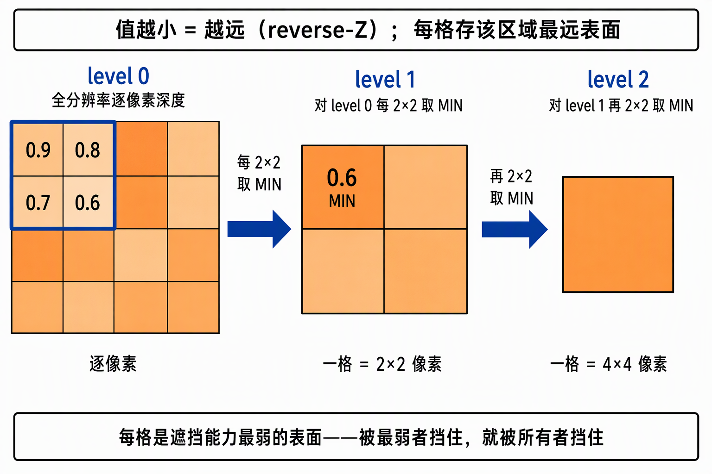
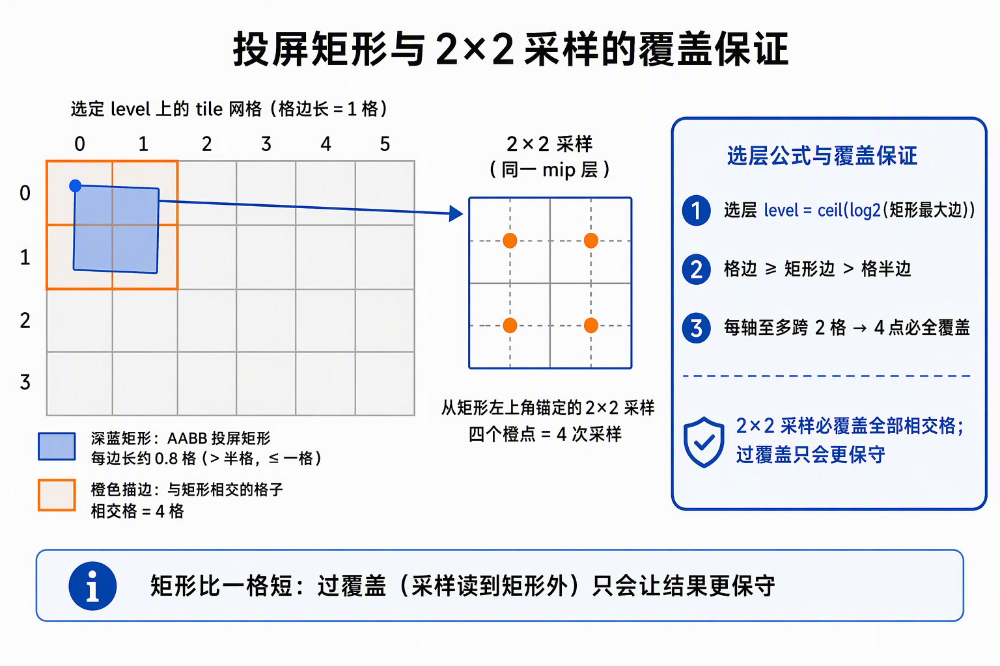
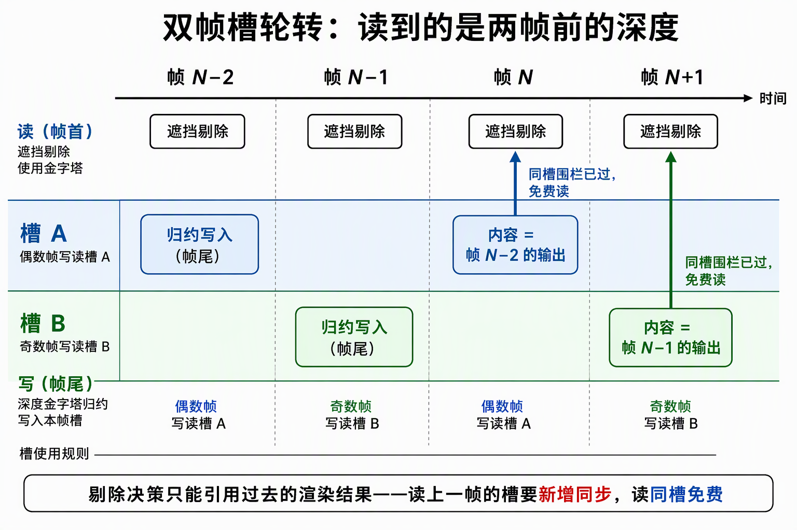

# Hi-Z 遮挡：深度金字塔与保守遮挡判定

Hi-Z 遮挡回答视锥剔除答不了的另一半问题：实例在视野内，但会不会一个像素都画不出来。做法是把上一帧深度缓冲归约成一摞金字塔——每级每格只存一个数：该区域内最远的已缓冲表面（遮挡能力的保守上界）；逐实例用包围盒投屏矩形做 O(1) 采样比较，只有证明"全身都在一切已缓冲表面之后"才剔除。整套机制围绕一条不变式：**只删能证明画不出来的，一切存疑判可见**——宁多画、不漏画，这是它能免回读、免精确求交的全部本钱。

## 0. 判定线

- **一 tile 一值的保守上界**：逐像素的精确深度被换成每格一个"最远已缓冲表面"值。判定永远用 tile 内遮挡能力最弱的成员下结论——被最弱者挡住 = 被所有者挡住；剔除力可以弱，方向不能反。
- **宁多画不漏画**：所有存疑情形（在相机背后、跨近平面、背景混入、深度相等、采样越界）一律判可见。没有任何一条路径能把"可能可见"判成剔除。
- **测试 O(1)**：每实例固定 8 角点投屏 + 4 次纹理采样，与物体大小、场景遮挡复杂度无关。每帧成本两笔：构建 O(像素)——全屏逐级归约链；测试 O(实例)——常量判定。总账与实例数线性、与遮挡复杂度无关，这是它能进 GPU-driven 大场景剔除链的前提。
- **参照是过去**：剔除决策只能引用过去的渲染结果；滞后的错误方向被闸门收敛到"宁可全不剔"。

## 1. 为什么用"最弱遮挡者"下结论

深度缓冲是一张"已缓冲表面地图"：每个像素记着当前离相机最近的表面。剔除命题可以精确陈述为——物体投影区域内，**每一个**已缓冲表面都比它更近 → 它画出的每个像素都会被覆盖 → 一个像素都不出 → 安全剔除。

"每一个"没法逐像素验，也不需要：对区域内的表面集合，只有一个标量结论是可靠的——**连最远的那个都够不着，就够不着任何一个**。所以每格存"区域内最远已缓冲表面"：它是最弱遮挡者，被它挡住就被所有者挡住。反过来用最强者（最近表面）下结论，只能证明"被某个表面挡住"，会错杀只是被部分遮挡的物体。

归约方向由深度约定决定：reverse-Z（近处值大、远处值小，清屏值 0 = 最远）下"远 = 值小"，最远 = **MIN**；正向 Z 的镜像写法是 MAX。MIN/MAX 之差不是精度损失，是把"宁多画"翻转成"宁漏画"——取错方向 = 系统性错杀，这是 Hi-Z 全链最危险的单点，归约着色器、CPU 参照实现、单元测试三方钉同一个方向。背景像素（值 0）混进 MIN 还顺带处理了"部分被挡"：格子里只要有一个背景像素，MIN 就被拉到 0，整格失去遮挡力——一堵占格子 99% 的墙也挡不住这格里的东西。保守得近乎浪费，但方向永远正确。

还有一道前置问题：遮挡回答"看得见吗"，需要知道墙在哪——墙恰恰是渲染的产物，而剔除决策发生在渲染之前。CPU 时代的三条老路（离线烘焙可见性、画一帧小深度再读回、CPU 软光栅代理几何）各有代价：烘焙对动态场景失效，读回是 CPU-GPU 同步点会把流水线排空，软光栅是每帧 CPU 成本加代理维护。GPU-driven 链条里决策权已经整体搬到 GPU 侧，不能为了"要不要画"把 CPU 拉回来等——Hi-Z 的答案是拿上一帧的渲染副产品（深度）当这一帧的证物，测试本身是纯 GPU 计算，零回读。

## 2. 金字塔：预计算一摞粗细不同的挡板图

对 level 0（全分辨率深度）做 2×2 取 MIN 得 level 1，再对 level 1 做 2×2 取 MIN 得 level 2……level L 的一格 = level 0 上 2^L × 2^L 像素区域的最远表面。金字塔就是把"任意粗细的挡板图"预计算成一摞，逐实例按需取层——格子的粗细要与物体投屏大小匹配，测试才是 O(1)：小物体用细格（覆盖准），大物体用粗格（采样数不随物体大小增长）。

两个构建事实：

- **level 0 不派发归约**：level 0 就是原深度图本身，没有内容要算；归约从 level 1 起步（= 深度的 2×2 MIN），逐级向粗。可查层级因此有下限 1（最细 2px 格）——小于 2px 的物体查不到更细的层，对遮挡判定无关紧要。
- **归约目标独立成单通道浮点 mip 链**：遮挡测试要往可写图像里写，深度附件当不了写入目标；逐级归约用计算着色器做（专门的 MIN 归约，不能复用通用的 mip 生成——硬件 mip 生成走点采样重采样，做不出 min/max 归约）；且金字塔每帧重写、按帧槽轮转——**跨帧持久的层是金字塔，不是深度**（见 §6）。

## 3. 4 次采样 O(1) 的数学前提

测试对象是包围盒（AABB）不是真实几何：胖盒投屏更大、最近角点更近，两头都更难判遮挡——方向保守，代价是剔除力折损。判定四步：

1. **投屏**：AABB 8 个角点逐点经相机矩阵投成像素矩形。必须逐角点投——透视不是仿射，"先取包围盒再投屏"与"逐点投屏再取包围"不等价；任一角点在相机平面背后（w ≤ 0）→ 恒判可见。
2. **选层**：`level = ceil(log2(投屏矩形最大边))`，夹进级数范围、下限 1。
3. **物体深度参照**：8 角点深度取最大 = 最近角点。深度沿盒内线段单调，极值必在角点——角点最大值就是整个盒的深度上界；判定语义是"连最近点都过不了才剔"。越过近平面的角点自然把上界推出范围，比较式天然判可见，无需特判。
4. **比较**：物体最近角点 < 覆盖区域内最远已缓冲表面 → 剔除；相等判可见。

第 2 步是"4 次采样成立"的全部数学前提。设最大边为 s，选层保证 2^(L−1) < s ≤ 2^L，即 **tile 边长 ≥ 矩形边 > tile 半边**：矩形每轴至多横跨 2 个 tile → 以左上角锚定的 2×2 采样**必覆盖全部相交 tile**。tap 读到矩形之外的 tile（过覆盖）只会让取到的最小值更小、遮挡者更弱 → 更保守。两条纪律由此而来：4 tap 必须取**同一 mip 层级**（跨层取数没有覆盖保证）；tap 越界一律 clamp 到边缘（clamp 不引入假遮挡，落点仍保守）。

| 存疑情形 | 落点 |
|---|---|
| 角点在相机平面背后（w ≤ 0） | 可见 |
| 越过近平面 | 可见（比较式天然处理） |
| tile 含背景像素 | 可见（MIN 被拉平，格失去遮挡力） |
| 深度相等 | 可见（严格小于才剔） |
| tap 越界 / 离屏 | 可见（clamp 后不引入假遮挡） |
| AABB 比真实几何胖 | 更难剔（两个方向都保守） |

收益形状由场景决定，不是功能常量：实例多而小、深度层次复杂（前景挡后景）时，大量实例被 4 次采样便宜地杀掉；少数铺满屏幕的大物体天然自动退出（AABB ≈ 全屏 → 采样必含背景 0 → 恒可见）；近平面单层平坦的场景没东西可挡。剔除量是场景形状的函数——收益是测量对象，不是验收目标。

## 4. 「免费」的滞后一帧

遮挡测试发生在**绘制之前**（它的结论决定画不画），而深度是绘制的产物——决策时刻，当前帧的真值尚不存在。这不是实现取舍，是逻辑顺序：**剔除决策永远只能引用过去的渲染结果**。所以保守性的完整表述是"相对参照深度不会被错杀"，参照深度是历史上的某帧，不是当前真值。

滞后量由同步形状决定。金字塔按帧槽轮转（两槽交替读写）：帧 N 的遮挡测试读**同槽**金字塔，其内容是帧 N−2 的归约输出。为什么是同槽：同槽的提交围栏在帧 N 开始前已经通过，读它**零新增同步**——"免费"；读上一帧（帧 N−1）的输出则要等另一个槽的围栏，需新增同步把流水线拉住，得不偿失。滞后不是妥协，是"免费"与"新鲜"之间的定价结果。

滞后引入的错误方向（相对当前真值）：

- **遮挡物移开**：按旧深度判遮挡，物体晚一拍出现——出现迟滞，不是永久丢失。
- **相机快速转动**：参照深度大面积失效，错杀从"一帧税"退化成"持续黑屏"——由相机跳变门处理（§5）。

## 5. 相机跳变门

跳变门的判据与滞后窗对齐：比较**本帧**相机与**两帧前**的相机（正是读数滞后的窗宽），用**两帧累计**位移与旋转语义——累计超阈（整帧跳过遮挡剔除，视锥结果照常），稳定两帧后自动恢复。累计语义是刻意的：连续微动每帧都不超阈，但滞后窗内金字塔内容确实落后了，累积超阈同样让路——让路是诚实行为，不是误报。

金字塔未就绪（首建、尺寸变化重建后的 2 帧暖机）走同一个让路出口，理由同构：**内容未就绪的参照深度，比没有参照深度更危险**。完整的让路判据共四条——功能关闭、视锥剔除关闭、金字塔暖机、相机跳变——任一命中，整帧跳过遮挡，标记保持纯视锥结果。帧内时序由屏障收口：同一条命令缓冲里先"遮挡读旧"（前段）、再"渲染写深度"、最后"归约写新"（帧尾），读与写不交叠。闸门只关最刺眼的窗——物体自身快速移动造成的错杀不在门内，是已知边界。

## 6. 工程通道三件

- **深度附件默认不可采样**：作为渲染目标的深度缓冲，图像用法里没有"可采样"位，须显式扩上；写入模式也要从"写完即弃"改成"保留"（storeOp STORE）——因为同一帧尾的归约要采样它。账目随之清晰：深度不跨帧持久，下一帧以未定义内容进场照常清空，**金字塔才是持久层**。
- **深度采样的描述符布局**：着色器引用深度图采样时，布局必须声明为"深度模板只读"（DEPTH_STENCIL_READ_ONLY_OPTIMAL），与帧尾把深度附件转入只读的屏障一致；声明成通用布局会被校验层拒绝。
- **金字塔本体**：单通道浮点（R32F）mip 链，既是归约的可写目标，又是遮挡测试的可采样资源；随渲染目标尺寸变化整体重建，重建后走暖机让路（§5）。

本仓（ash_renderer）把构建与测试实现为两个独立 compute pass：逐级归约接在渲染之后，遮挡测试插在视锥剔除与绘制命令组装之间；施工级钉子（级序、取数通道、描述符布局、池重建）见来源施工记录。

## 7. 与视锥剔除的分工、回读红线

视锥剔除粗而免费：六个平面的纯几何判定，不采任何深度，与场景内容无关；遮挡剔除细而有用：吃画面真实深度，回答"在视野内是否看得见"。两者是串联的粗筛 → 细筛：视锥先杀掉不在视野内的，遮挡再对剩下的问"画得出来吗"。另一个天然边界：透明物不写深度，当不了挡板；被透明物挡住的不透明物体照常绘制（多画，方向保守）。

一条红线收尾：允许为验证与计量做诊断性读回（金字塔逐级统计、逐实例判定中间量），但**只进计量**——任何系统不得读回的结果决定画什么。回读一旦进入绘制决策，免回读闭环即被打破；这是整条 GPU-driven 剔除链的底线。剔除结果如何落进绘制命令、与 LOD 选档如何联动，见《[GPU LOD 与流送](GPU%20LOD%20与流送.md)》。

最后钉一遍边界：保守不等于精确——本方案保证"不剔错"（相对参照深度），不保证"剔尽"，格粗、盒胖、背景混 MIN 都在持续削弱剔除力，剔除量下限是 0；屏幕空间法的天花板——证物只有历史画面内的表面，被画面外遮挡者挡住的物体恒判可见（多画，方向仍保守），这是所有深度金字塔方案共有的性质，不是实现缺陷。

业界同构佐证这套核心命题的稳定：UE 的 HZB culling、Unity GPU Resident Drawer 的 GPU 遮挡剔除，形状都是"深度金字塔构建 + 逐对象包围盒保守测试 + 绘制命令消费"三段，与本文一致；差异在工程外延（如屏幕覆盖率阈值、部分遮蔽计数），不在核心命题。

## 来源

- [Hi-Z遮挡原理：深度金字塔与保守遮挡判定](../../开发步骤/6-高级剔除LOD与流送/6.1-Hi-Z遮挡/Hi-Z遮挡原理：深度金字塔与保守遮挡判定.md)——保守性逐情形论证与复杂度账的完整版
- [6.1.1-6.1.6-Hi-Z遮挡施工记录：测试实体载具、深度金字塔、遮挡第二pass与A/B计量](../../开发步骤/6-高级剔除LOD与流送/6.1-Hi-Z遮挡/6.1.1-6.1.6-Hi-Z遮挡施工记录：测试实体载具、深度金字塔、遮挡第二pass与A_B计量.md)——级序钉、深度取数通道、描述符布局、pool reset 等施工钉子
- [GPU-Driven 本质](../引擎/GPU-Driven%20本质.md)——决策环在显存内闭合的架构定位，Hi-Z 与 GPU LOD 是最早兑现的两笔利息
