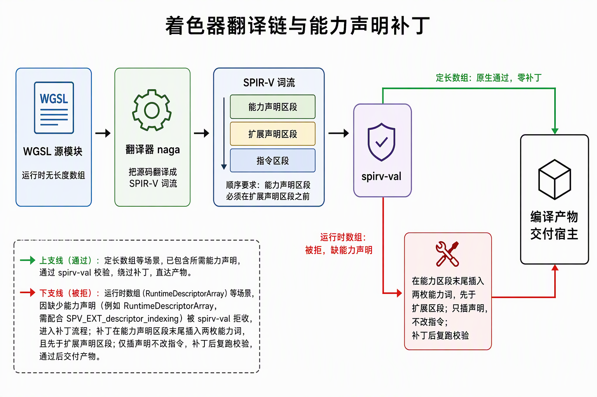
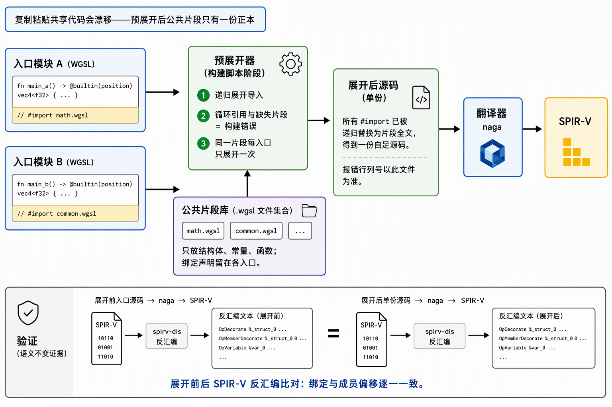
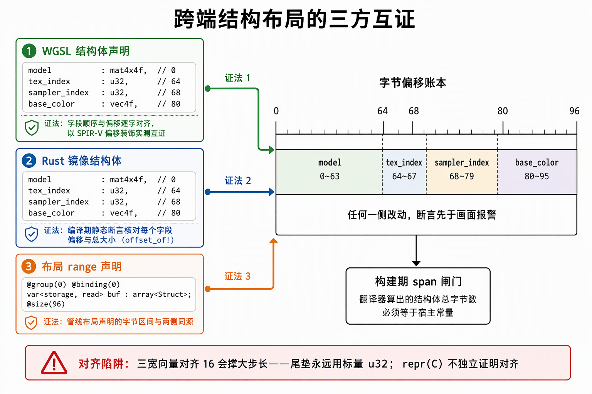

# naga 与 WGSL 工具链：从 WGSL 源码到可消费的 SPIR-V

naga 是 Rust 生态的着色器翻译器：输入前端只有 WGSL/GLSL/SPIR-V 三个，输出后端覆盖 SPIR-V/MSL/GLSL/HLSL/WGSL 方向。本项目锁定 naga 30.0.1（features 仅 `wgsl-in`/`spv-out`），在 build.rs 内把 WGSL 编成 SPIR-V 交给 Vulkan——Vulkan 只消费 SPIR-V，源语言本身是纯选型问题。这条工具链有四个机制事实各配一道构建期手段：HLSL 输入断点（选型规避）、runtime 数组 capability 缺发射（确定性补丁）、语言缺口无 inverse/无 include（数学等价 + 预展开）、跨端结构对齐（三方互证断言），全部不动工具链本体。

## 0. 判定线

- **naga 没有 HLSL 输入前端，`hlsl-out` 是输出方向**（naga 30.0.1 feature 表实查）。"HLSL→SPIR-V" 在 naga 内走不通；选 HLSL 等于整条换成 DXC/glslang，等于放弃纯 Rust 依赖与版本锁定。HLSL 降为备用路线，触发条件是"naga 表达不了必需特性"，至今未命中。
- **naga 的输出缺口用确定性补丁修**：spv 后端对 runtime 数组不发射 `RuntimeDescriptorArray` capability（VUID-04680 拒收；版本相关，升级需复查）。补丁只在词流层插 capability/extension 声明，不改任何指令；补丁后强制重跑 spirv-val 兜底。
- **WGSL 的语言缺口用等价替换绕**：没有 inverse() 就用 cofactor 矩阵（与逆转置差一个 normalize 后消失的标量）；没有 include 就在构建期预展开 `// #import`。两者零工具链改动。
- **跨端布局不靠声明靠断言**：`repr(C)`、"结构体不足 128B" 都不能独立证明 CPU 侧与 WGSL 侧对齐一致；对齐契约由 Rust 镜像静态断言、WGSL 逐字对齐、layout range 三方互证执法，任何一侧改动先于画面报警。

## 1. 源语言选型：WGSL 直译链与 HLSL 断点

维持 WGSL→SPIR-V 不是语言优劣裁决，是按项目约束算出的收益结论：

- **工具链治理**：naga 纯 Rust 依赖、build.rs 内编译、锁 `=30.0.1` 锁行为；DXC 锁的是 SDK 版本，SDK 升级则 dxc 随之漂移，方向相反。
- **Bevy 生态是 WGSL**：view 布局、矩阵约定、prepass/材质参考代码均为 WGSL；用 HLSL 等于每次参考 Bevy 源码手工翻译，升级后还要再同步。
- **实际成本在两种语言完全一致的部分**：binding 布局、capability、SPIR-V 字段偏移核对才是工作量大头；shader 体量小时语言熟练度收益可忽略，HLSL 的 `register`/`binding` 映射到 `@group`/`@binding`，语言迁移本身成本有限。

备用路线（HLSL→DXC→SPIR-V）的工具本机已就位（Vulkan SDK 自带 dxc/glslang），切换时的治理要求是重跑全套验证：数组类型、NonUniform 写法（HLSL 为 `NonUniformResourceIndex()`）、所需 capability、字段偏移，过 spirv-val——验收点不因换工具链豁免。

## 2. capability 补丁：插词的机制与兜底

**缺口是什么**：runtime 形态的 `binding_array<T>` 编出的 SPIR-V 以 `OpTypeRuntimeArray` 实例化 UniformConstant 变量，规范要求声明 `RuntimeDescriptorArray` capability（VUID-StandaloneSpirv-OpTypeRuntimeArray-04680），naga 30.0.1 的 spv 后端不自动发射——spirv-val 直接拒收。定长 `binding_array<T, N>` 原生合法，不走此缺口。NonUniform 装饰由 naga 自动发（§3），连带声明 `ShaderNonUniform` capability 与 `SPV_EXT_descriptor_indexing` 扩展；补丁要补的只是 per-type 的两枚 capability。

**补丁怎么做**（确定性、幂等、约 60 行纯函数）：

1. 第一遍扫描词流开头连续的 `OpCapability` 指令，记下 capability 区段结束点；第二遍继续吃连续的 `OpExtension`，记下 extension 区段结束点；
2. 缺哪枚插哪枚：`RuntimeDescriptorArray` 与 `SampledImageArrayNonUniformIndexing` 两枚 capability 插在 capability 区段末尾，`SPV_EXT_descriptor_indexing` 扩展插在 extension 区段末尾——**capability 必须插在 extension 区段之前**，这是 SPIR-V 逻辑布局的硬性顺序；
3. 已存在的词不重复插（幂等）；补丁只动声明段，不改任何指令。

补丁不是"改到能过"的暗箱操作，插入前后的模块都过得了词流级核对：手写扫描 SPIR-V 词流即可核对 capability 集合、extensions 清单、`OpTypeRuntimeArray` 出现次数、NonUniform 装饰数与逐个 set/binding 对——这些中间结构是编译正确性的直接证据，比只看最终采样读数强。

**兜底链**：补丁后强制重跑 `spirv-val --target-env vulkan1.3`，仍被拒即构建失败；无 spirv-val 的环境降级为无条件补丁 + 构建警告，合法性证据只剩运行期——验证层在 `vkCreateShaderModule` 时内嵌同款校验执法 VUID-04680。负例实验补过一个反直觉事实：被拒的模块建管线本身仍返回成功，错误只由验证层收账——"成功返回 ≠ 规范许可"，所以构建期校验不可省。补丁插的 capability 与 device 侧启用的 feature 位同名对偶（`RuntimeDescriptorArray`↔`runtimeDescriptorArray` 等），两边是一个整体，改任何一边都要同步另一边；这组对偶由 VUID-08740 闭环执法——模块声明 capability 而设备特性未启用 → 验证层收账，反过来特性启用而模块缺声明 → spirv-val 收账。

**为什么不选零补丁的定长数组**：`binding_array<T, N>`（N=容量）SPIR-V 原生合法、零后处理，但改容量=改 shader 常量重编；runtime 形态让描述符容量与 shader 解耦，容量演进不动源码。runtime + 补丁是编译期确定性变换，有 spirv-val 与验证层双重复验兜底，定长数组保留为补丁器失效时的降级出口。

## 3. WGSL 语言事实

以下为 naga 30.0.1 实测行为，版本相关，升级需复查：

- **没有 inverse() 内建**。法线逆转置先退一步问数学目的：着色端需要的是 normalize(逆转置·n)，而 (M⁻¹)ᵀ 与 cofactor 矩阵只差行列式倒数这一个标量，normalize 后消失——于是不需要除法、不需要 inverse，每顶点 9 次乘 6 次减得到正确法线，扛非均匀缩放；det=0（退化缩放）不在资产假设内。
- **块尾裸表达式是语法错误**：WGSL 每条语句必须分号收尾、返回值必须显式 `return`——Rust 的"块尾表达式即返回值"带过来就是语法错误。naga 此时报 "expected `;`"，裸 message 不带位置；把解析/校验错误接上 `emit_to_string_with_path`（带文件路径的源码摘录定位）后，行列号直达出错行。
- **texture 与 sampler 是两个独立 binding**，没有 combined sampler 形态；采样器数组允许同参数去重合并槽位。
- **`var<immediate>` 地址空间承载 push constant**（编译进 push constant 而非 UBO），需要在校验器上显式开启 IMMEDIATES 能力；同理，binding 数组与非一致索引也要在校验器能力面显式声明——naga 的能力面是编译方逐项勾选的，不是默认全开。
- **NonUniform 装饰无需手写**：WGSL 不存在 nonuniformEXT 之类的语法，naga 的 uniformity 分析对非一致索引的绑定数组访问自动发 `NonUniform` 装饰，覆盖纹理/采样器取数与存储 I/O 指针，并连带声明 `ShaderNonUniform` capability。

## 4. 导数内建要求一致控制流

`dpdx`/`dpdy` 这类屏幕空间导数靠 2×2 quad 内相邻线程求差实现；在分支内调用时，quad 里走了不同分支的线程成为 helper invocation，导数值分歧——WGSL 规范要求导数内建在一致（uniform）控制流中使用，分歧即未定义值。派生 TBN（由世界位置导数叉乘构造切线系）若写在法线贴图哨兵分支内就踩中此条；正确落点是把 TBN 计算整体提升到分支外，守卫分支只做扰动。伴随的退化钉：平铺 UV 整数缝处导数为零区，t=b=0 经 `inverseSqrt` 产生 NaN 法线，退化侧 T/B 列落 0、最终 `normalize` 自然回落几何法线。

## 5. 无 include 与 `// #import` 预展开

WGSL 没有 include 机制，跨文件复用公共片段最初只能逐式同源复制，配合头部互证注释止血——但互证靠人眼维持，复制体一多，改一处漏一处的漂移只是时间问题。解法在构建期：独占一行的 `// #import <name>` 由 build.rs 递归展开为 `shaders/common/<name>.wgsl` 全文，循环引用与缺失片段直接构建错误，同一入口内每个片段只展开一次。两条边界纪律：

- 片段只放 struct/常量/函数；`@group`/`@binding` 声明留在各入口——同一资源在不同入口里组号/绑定号可能不同；
- 展开产物落 `OUT_DIR/<stem>.expanded.wgsl`，naga 报错的行列号以该文件为准（诊断定位的基准文件）。

预展开是纯文本变换的语义不变性有实证：以 spirv-dis 对展开前后 23 个 spv 逐一比对绑定与成员偏移，全部一致。10 个公共片段上线后着色器总量 3624→2842 行（入口 2346 + 片段 479），复制漂移的温床随之拆除。

## 6. 跨端结构布局契约：三方互证

WGSL 结构体成员对齐遵循标量规则：`vec3<u32>` 对齐 16，作成员或尾垫会把后续偏移与整体步长撑大——实例：材质记录尾垫用 `vec3<u32>` 时 naga 算出的 span 是 80B，宿主打包 64B，storage 数组逐元素索引从第 1 个记录起全体错位。反向同样成立：裸 `[f32; 4]` 对齐 4，会把本应落在 80 的 16 对齐字段排到 72。两个直接推论：

- **`repr(C)` 不独立证明对齐**，"结构体不足 128B" 也不——Rust 侧镜像类型必须用显式 16B 对齐的 `Mat4`/`Vec4` 钉住对齐；
- **尾垫永远用标量 u32**，不用 vec3/vec4。

执法形态是三方互证、编译期报警：Rust 镜像 struct + `offset_of!`/`size_of` 静态断言（push 布局 0/64/68/80、size 96，且进单元测试与宿主打包同源看护）；WGSL 侧字段顺序与偏移逐字对齐（以 SPIR-V `OpMemberDecorate Offset` 实测互证）；pipeline layout 的 push/UBO range 声明与两侧同源。任何一侧改动，断言先于画面报警。判定条件宽松而充分：naga 算出的 span 相等、且各成员对齐不超过宿主步长，即可推出步长相等——不需要枚举全部对齐组合。build.rs 另设一道跨端布局闸门：naga 校验产物里算出的具名结构体 span 必须等于宿主登记的字节数常量，不等即构建错误——新增记录结构时在闸门表登记。push 的尺寸本身也有一条链要对账：96B ≤ 规范最低保证 128B ≤ 本机查询上限 256B。

## 7. build.rs 要点

- **rerun-if-changed 对新增文件无感知**：逐文件声明只对已声明路径的内容变更触发，新增 `.wgsl` 不触发重编译，宿主 `include_bytes!` 找不到新产物直接构建失败。解法是目录级声明（cargo 递归扫描，覆盖增删）与逐文件声明并存——前者保覆盖、后者保精确触发；每个被 `#import` 展开的公共片段也单独声明，改片段即触发。
- **错误定位是管线的一部分**：解析/校验失败 panic 时附 `emit_to_string_with_path` 的源码摘录与行列号，基准文件是展开产物（§5）。
- **Y 翻转的落点在编译器输出层**：全管线正高度 viewport 朝向依赖 naga spv 写出器对 `@builtin(position)` 注入的 Y 翻转（`WriterFlags::ADJUST_COORDINATE_SPACE`）——翻转发生在编译产物里，shader 源码不写、viewport 保持正高度。默认值已含此位仍显式写出：防升级后默认值变动导致画面整体上下颠倒。跨栈坐标约定之争用"直出已知值"的实验裁决，不靠引用转述。
- **编译期 ABI 对账**：从 naga 校验产物逐入口反射实际用到的 set/binding/描述符种类/数组形状与 push 字节数，生成静态表；宿主创建 pipeline layout 前与之对账，spv 字节也挂在同一静态项上由 `include_bytes!` 消费。声明了没用的 binding 不进表——管线布局对它没有义务。
- **spirv-val 定位与警告纪律**：`VULKAN_SDK` 环境变量优先、回退默认安装路径，`rerun-if-env-changed` 覆盖 SDK 变更；构建警告只承载真异常（如缺 spirv-val 的降级），正常编译轨迹走 stderr 不刷构建日志。
- **构建脚本里 panic 就是报错方式**：编译失败 = 构建错误，panic 带完整错误链不静默——错误处理规范的 panic 禁令不适用构建脚本。

Rust 侧编译期校验基建同样吃工具链坑：ui_test 的 compile-fail 首跑因 proc-macro 依赖没有消费者构建目标被 cargo 跳过、产物表为空而 panic，加占位空 lib 即修复（详见 3.8.1 施工记录）。

## 8. 绑定身份冻结：set-binding 表纪律

冻结表的产出方法本身就是一套可复用的工具链验证流程——**先探针后正式**：在正式着色器动工前，用一个自含最小样例（两张纹理 + 索引，无窗口、无交换链，验证层常开、逐条 VUID 收账）把目标接口全链跑通。验收点四个，缺一不可：设备特性支持、naga 编译成功、SPIR-V 过 spirv-val、最终采样读数正确。capability 补丁、NonUniform 自动装饰、字段偏移互证这些结论全部出自这道前置闸门，而不是正式施工中边画边修。

set/binding/push 接口在探针四验收点通过后**冻结成表**：set0 b0/b1 runtime binding_array（UAB + PARTIALLY_BOUND）、set1 b0 每帧 UBO、`var<immediate>` push constant，texture/sampler 分离实做。冻结的收益在下一步施工兑现：正式 shader 的接口与冻结表逐字段对照、零行新发明——本段的义务是逐字段沿用并核对，不是重新设计一遍再验证一遍，施工当天没有发生任何接口层纠纷。此后接口身份由三层持续执法——表的冻结、跨端偏移三方互证（§6）、编译期 ABI 对账（§7）——"绑定身份"从口头约定变成构建期与验证层双重执法的契约。

## 9. 升级复查清单

本工具链大量行为绑定 naga 30.0.1，升级时逐项复查，任何一项变化都先过探针再进正式管线：

| 绑定版本的事实 | 复查点 |
|---|---|
| 输入前端无 HLSL（feature 表） | 是否新增 `hlsl-in`（有了则备用路线的断点消失） |
| spv 后端不发射 `RuntimeDescriptorArray` | 补丁是否可删（原生合法则拆补丁，词流扫描可证） |
| 无 inverse() 内建 | WGSL 是否新增该内建（有则 cofactor 替换可退役） |
| `ADJUST_COORDINATE_SPACE` 默认含此位 | 默认值变动则画面整体上下颠倒，显式写出是防这道险 |
| `var<immediate>`/binding 数组需显式能力面 | 校验器能力面声明是否仍必要 |

## 来源

- [选型记录：WGSL源语言与HLSL备用路线](../../开发步骤/3-静态取数链路/3.3-贴图与bindless描述符/选型记录：WGSL源语言与HLSL备用路线.md)
- [前置闸门施工记录：naga小样例与set-binding表冻结](../../开发步骤/3-静态取数链路/3.3-贴图与bindless描述符/前置闸门施工记录：naga小样例与set-binding表冻结.md)
- [描述符索引特性族：能力位全景、三层配套与限额双轨](../../开发步骤/3-静态取数链路/3.3-贴图与bindless描述符/描述符索引特性族：能力位全景、三层配套与限额双轨.md)
- [3.4.1~3.4.5 管线与绘制施工记录](../../开发步骤/3-静态取数链路/3.4-管线与绘制/3.4.1-3.4.5-管线与绘制施工记录：正式着色器、图形管线与DrawList同帧消费.md)
- [8.2.3 光照累积 pass 施工记录](../../开发步骤/8-完整延迟渲染管线/8.2-FilamentBRDF与多光源/8.2.3-施工记录：光照累积pass照抄Filament.md)
- [步骤7-8质量复盘](../步骤7-8质量复盘.md)
- [3.8.1 system 标注宏施工记录](../../开发步骤/3-静态取数链路/3.8-system标注宏/3.8.1-system标注宏施工记录：透明标注与编译期校验.md)
