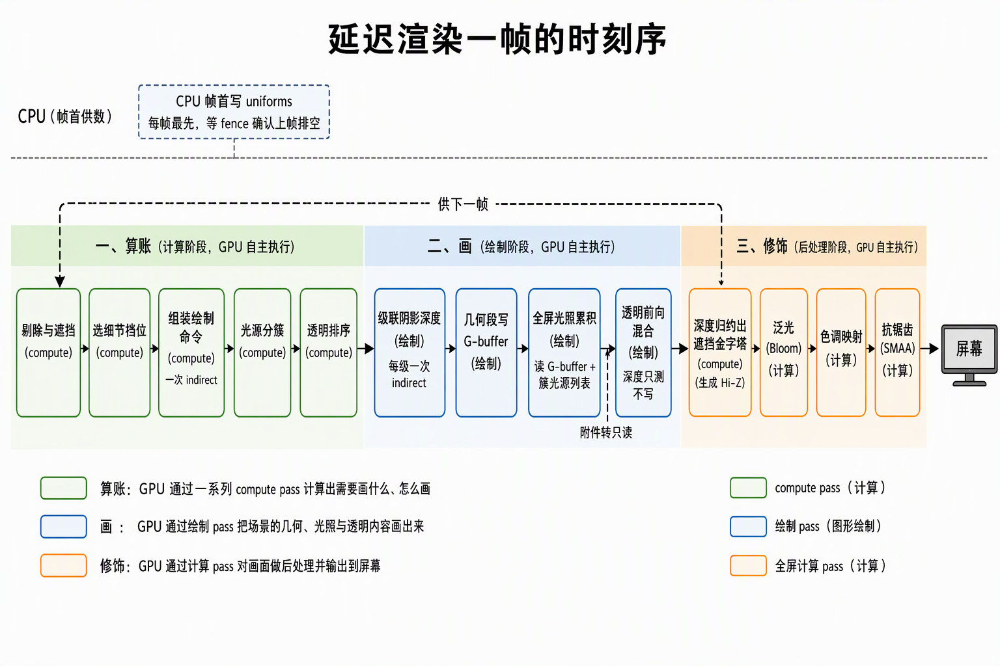
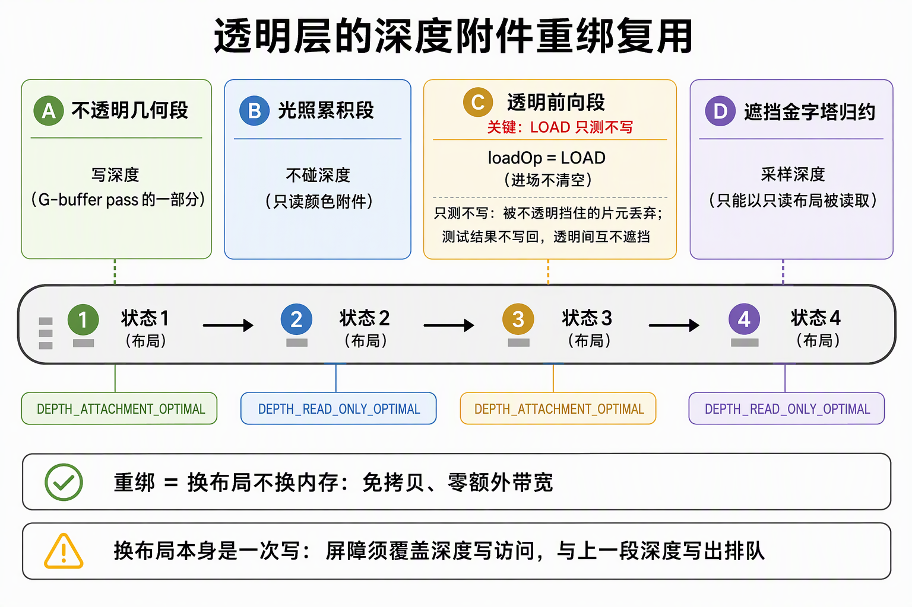
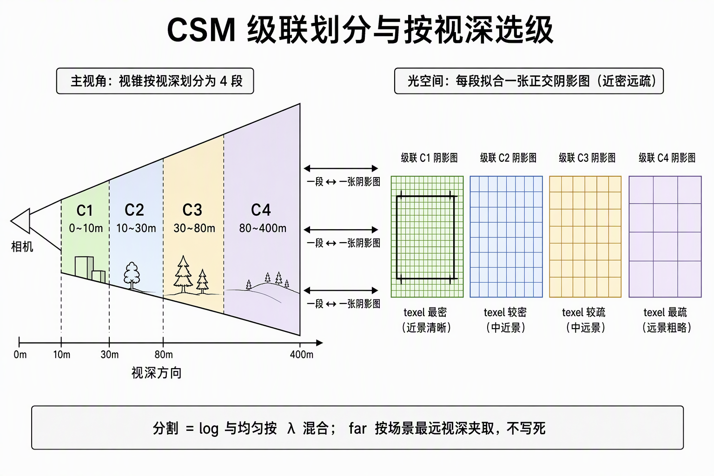
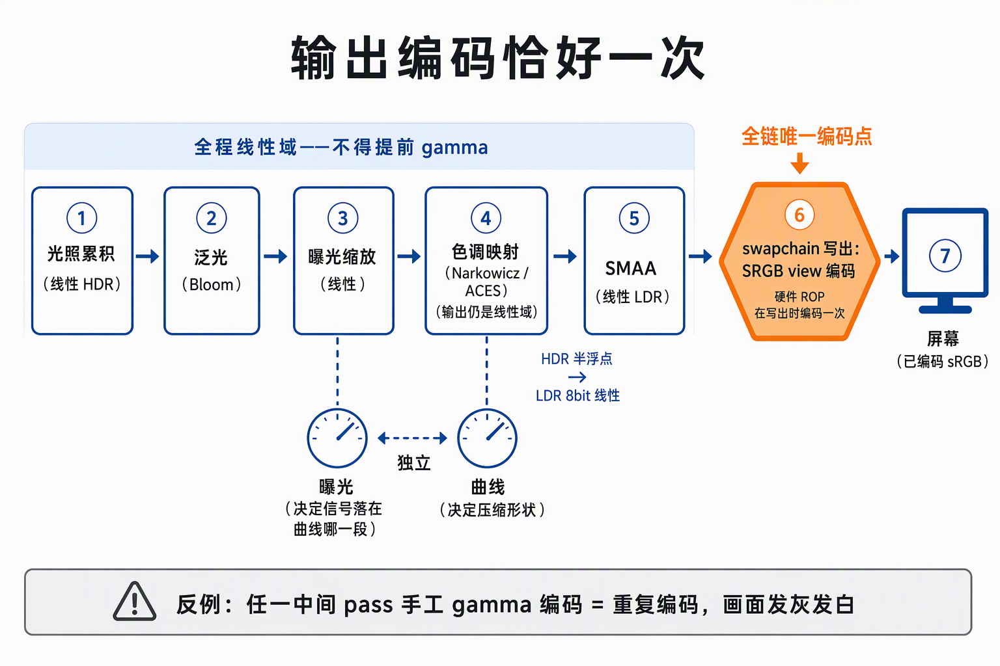

# 延迟渲染管线一帧全景

延迟渲染用一次交换定义整条管线：几何 pass 不做光照，只把每个像素的材质描述写进一组全屏附件（G-buffer）；光照 pass 拿这份描述对全屏只算一遍。着色成本从此与像素数挂钩、与场景物体数解耦，代价是全屏附件的带宽、透明物体进不了延迟路、G-buffer 上开不了 MSAA。一帧因此从"逐物体直出"变成一条多 pass 编排：compute 剔除与命令组装 → 级联阴影 → G-buffer → 全屏光照累积 → 透明前向 → Hi-Z 归约 → Bloom → 色调映射 → SMAA → swapchain。本文按一帧的时间序走完整条链，把每段的机制与配方钉成知识（本仓库 ash_renderer 的施工账面见文末来源）。

## 0. 判定线

- **本质交换：几何 pass 写中间描述（G-buffer），换逐像素光照一次算完。** 光照成本 = 像素数，与物体数解耦；G-buffer 的宽度（几张附件、每张几字节）就是整条管线的带宽账单。
- **附件每省一张都是净赚**：世界位置由深度反投影重建，不占附件；motion vectors 无消费者时留槽位不付带宽。
- **reverse-Z 必须成套**：无限反向透视投影 + 深度清值 0 + GREATER 比较 + 阴影 bias 符号跟随，四处一体；混入任一件常规约定，症状不是"测试不太对"而是近远景全反。
- **Y 轴方向问题只允许落一处**：光栅层 viewport 保持正高度直出，全屏 pass 的 uv→NDC 换算承担唯一一次 Y 方向对齐；几何链翻转零次。
- **输出编码恰好一次**：光照、Bloom、色调映射全程线性域，唯一的 sRGB 编码发生在 swapchain SRGB view 的 ROP 写出；中间任何一步手工 gamma 都是重复编码。
- **主相机的语义不能照搬给 shadow 视锥**：遮挡剔除不参与 shadow pass（Hi-Z 是主相机语义）、shadow draw 取主 LOD 档再粗一档。

## 一、为什么延迟：先记材质，后算光

forward（前向）渲染画每个物体时把它受到的全部光照直接算出来，着色成本 = 物体数 × 光源数，多光源随物体数线性涨。延迟渲染把这件事拆成两步：几何 pass 把材质信息记到 G-buffer，光照 pass 全屏逐像素取描述算光——多光源与物体数解耦。收益的另一半是**光源预分簇**：光照 pass 不遍历全场景光源，只取像素所在簇（屏幕 tile × 视深片切出的 3D 簇）里预构建的光源列表。

代价链三笔：

1. **带宽与显存**：几何 pass 写三张全屏附件，光照 pass 全部读回；G-buffer 编码压缩（法线八面体化、材质打包）是延迟管线的核心课题。
2. **透明不友好**：透明片元不能覆写深度，"像素间互相覆盖无所谓"的前提对透明不成立——透明永远走前向混合（见第五节）；纯透明场景下延迟的收益几乎归零。
3. **无 MSAA**：多重采样要求每张附件 ×4 存储与带宽，且几何/光照两段分离后边缘归属信息丢失；抗锯齿改由后处理承担（SMAA/TAA）。

Forward+ 是两者间的混合形态：光源分簇后仍前向逐物体算光——多光源问题被分簇解决，但"逐物体算光"的形状没变。工程上延迟与 Forward+ 不是二选一：不透明走延迟、透明走 Clustered Forward 正是常见组合。管线模式全景另见《[渲染管线模式与VisBuffer](../引擎/渲染管线模式与VisBuffer.md)》。

## 二、一帧时刻序全景

一帧三个区间：先算账，再画，最后修饰。全链共享一条同步纪律：宿主每帧的写入都发生在 fence 等待（确认帧槽资源已排空）之后，帧内资源按帧槽双缓冲轮转——这一条是全链唯一的安全证据，不再逐环节重复。

| # | 环节 | 做什么 | 产物 |
|---|---|---|---|
| 0 | 宿主帧首（CPU） | 写帧 UBO（相机/方向光/逆矩阵）、shadow UBO（级联矩阵）、cluster 均匀数据；光源常驻表增量；透明键缓冲填 -inf（排序 padding 基线） | 各 UBO 与账本就位 |
| 1 | compute 半边（GPU） | 视锥标记 → Hi-Z 遮挡（吃上一帧金字塔）→ LOD 选档 → 不透明命令组装 → shadow 命令组装 → 光源分簇 → 透明收集 → bitonic 排序 → 透明命令组装 | 三套间接命令环 + 簇光源列表 |
| 2 | shadow pass × 级联 | 每级联一个小 render pass，深度只写（D32、reverse-Z、GREATER），各一次 indirect draw | 级联深度图 ×4 |
| 3 | G-buffer pass | 不透明场景一次 indirect 多目标写出：albedo + 法线 + 材质参数 + 深度（清 0） | G-buffer + 帧槽深度 |
| 4 | 附件转只读 | 颜色附件转 SHADER_READ_ONLY、深度转 DEPTH_READ_ONLY | 布局迁移 |
| 5 | 光照累积（全屏） | 读 G-buffer + 簇光源列表 + 级联深度图，逐像素算全部直接光 | HDR 线性目标 |
| 6 | 透明 forward | 深度重绑回附件（loadOp LOAD 只测不写），HDR 目标上 alpha 混合，一次 indirect | HDR 目标（增量） |
| 7 | Hi-Z 归约 | 深度归还 READ_ONLY，逐级 dispatch 重写本帧槽金字塔 | Hi-Z 金字塔（供下一帧遮挡） |
| 8 | Bloom | prefilter 软膝提亮部 → 逐级半分辨率降采样 → 升采样逐级直加 | bloom 各级目标 |
| 9 | 色调映射 | HDR + bloom 汇入，过 tone curve | LDR 目标（线性域） |
| 10 | SMAA 三 pass | 边缘检测 → 混合权重 → 邻域混合 | 直出 swapchain |
| 11 | UI + 提交 | UI 同 render pass 接画（raster order 盖顶），转 PRESENT_SRC 提交 | 屏 |

compute 半边各环节的输入输出（上帧金字塔、标记环、命令环）全在显存内部流转，决策环不经过 CPU——"画哪些"由这条 GPU-driven 骨架决定，本文其余部分决定"怎么画"。

一帧里的资源按"谁写、谁读、活多久"分四类账：

| 账面 | 写者 | 读者 | 生命周期 |
|---|---|---|---|
| 常驻描述符表（对象/材质/光源） | 事件驱动的增量账本 | 全管线 | 进程级 |
| 帧 UBO / 级联矩阵 / 簇均匀数据 / bloom 参数 | 宿主帧首（fence 后） | 各 pass | 帧槽环 |
| G-buffer、HDR/LDR、bloom 各级、命令环、簇列表 | 几何与 compute 各段 | 下游 pass | 帧槽，每帧覆写 |
| Hi-Z 金字塔 | 帧末归约 | 下一帧 compute 遮挡 | 帧槽，滞后一帧语义 |

## 三、G-buffer 契约

G-buffer 是几何 pass 与光照 pass 之间的接口契约，槽位一旦冻结就被两侧同时依赖。一套典型布局：

| 槽 | 内容 | 编码 | 取舍 |
|---|---|---|---|
| 0 | albedo | 8bit×4 UNORM，线性值 | sRGB 解码交给输入端纹理，附件存线性 |
| 1 | 法线 | 世界空间 xyz 直存 half | 8B/px 换取数便利；八面体压缩 4B/px 是优化方向 |
| 2 | motion vectors | 留位，不分配本体 | 无消费者时不付 8B/px；TAA 落地时插入 |
| 3 | 材质参数 | 8bit×4 打包 | metallic / AO / 感知粗糙度 / reflectance 各一通道 |
| — | 深度 | D32 反向 Z | 世界位置的重建源 |

**世界位置不占附件，由深度反投影重建**：全屏像素 uv → NDC → 乘逆视图投影矩阵 → 齐次除以 w。这条链省一张全屏附件，精度押在 reverse-Z（浮点精度集中近处）上；后续 GI/反射要取的世界位置都从这里来，不需要额外附件。

**motion vectors 的去留**是"契约先行、本体按消费者落地"的样板：槽位与语义先钉死进布局契约，本体等真正需要逐像素运动向量的消费方（TAA/运动模糊）落地时再建——契约钉死避免后补附件时的槽位重排，空槽不付带宽。

## 四、reverse-Z 成套与 Y 轴落点

常规投影把近处映射到深度 1 附近，而浮点数的表示密度在 0 附近最高、1 附近最疏——高精度端恰好给了不需要精度的远端。reverse-Z 把映射倒过来（近→1、远→0），深度精度集中到近处。它是**成套**的语义包，四处一体：

- **投影矩阵**：无限远反向透视（近平面映射到 1，远平面趋于 0）；
- **清值**：0（对应"无限远"）；
- **比较算子**：GREATER（值更大 = 更近）；
- **阴影 bias 符号跟随**：遮挡判定写成"候选深度 d > 自身深度 + bias"（近 = 大，bias 加在阈值同侧）。

四处必须同源落码；只改其中一处（比如比较算子换回 LESS），症状不是精度略差而是近远景全反——这不是调参问题，语义包不能拆。

**NDC 的 Y 轴恰好翻一次，落点选在 uv→NDC 换算。** Vulkan 的 NDC Y 向下，与纹理 uv 相反；这个方向差被全屏 pass 的 `ndc.y = 1 − 2·uv.y` 一处吸收。场景几何从投影矩阵到光栅不做第二次翻转——viewport 保持正高度直出即与投影矩阵同向（"Vulkan 必须负高度翻转 viewport"的教科书直觉在本组合下不成立，实测反例在案）。判定式：几何链翻转零次，全屏取数链换算一次，两处不得同时存在。

## 五、透明层：深度重绑复用 + Clustered Forward + GPU 排序

透明片元不能写深度（会挡住身后的透明），也就进不了"先记材质后算光"的延迟路——它走前向：逐物体带材质直接算光、与背后内容按序混合。透明层要解决三件事：光源从哪来、深度从哪来、顺序谁来定。

**光源复用不透明侧的分簇**：视锥按屏幕 tile × 视深片切 3D 簇，逐簇预构建光源列表；透明片元按所在簇取灯——一次分簇，两侧消费。

**深度来自附件重绑复用，零带宽。** 深度纹理不可直接采样（要用它得另配取数目标并拷贝一次），但**附件可以重绑**：同一块深度内存在 G-buffer 写出 → DEPTH_READ_ONLY → ATTACHMENT（透明 pass）→ READ_ONLY（Hi-Z 归约）之间换布局不换内存，免拷贝零带宽。关键在透明 pass 的 loadOp 用 LOAD：**只测不写**——进场不清深度，透明片元在不透明深度上做测试（被不透明挡住的片元直接丢弃），但结果不写回（透明间互不遮挡，顺序交给排序）。重绑的屏障要覆盖深度写访问位：布局迁移本身是一次写，须与 G-buffer pass 的深度 store 排队。

**顺序归 GPU**：compute 对透明实例原子计数紧凑成数组（附视深键）→ bitonic 排序 → 命令组装消费。三个配方细节：

- 帧首把键缓冲填成 -inf 的位型做 padding：排序后 padding 沉底，真实条目占据升序数组**尾部**；从尾部反向取 = 最远先画（back-to-front）。
- bitonic 网络要求 pow2 容量，全容量恒定派发（16384 容量对应 105 次派发）；上一帧透明计数为 0 的帧跳过排序，不跑空网络。
- 键排序的精度是**物体级**（与 CPU 排序同档）；透明互穿的逐片元正确性（精确 OIT）是另一档问题，不在物体级排序的射程内。

## 六、CSM 级联定稿配方

单张 shadow map 无法同时照顾近处 1m 与远处 300m：CSM（级联阴影贴图）把主相机视锥按视深切成若干段，每段各渲染一张小深度图——近处级联覆盖窄、texel 密，远处覆盖宽、texel 疏；光照时按像素视深选级。

**切分（PSSM 混合分割）**：分割比例按 λ 混合 log 分布与均匀分布（λ=0.75 即 log 为主）；near 按近景需求定死，far 不写死——按场景最远视深夹进一个带内（如 80~400m），高机位俯瞰时整场景仍在带内。

**逐级拟合四步**（治两类病：影子脱离投射体、级联边界闪动）：

1. 切片 8 角点反投影到光空间，取 AABB 收紧正交盒；
2. 包围球做 XY 拟合——正交盒退化为"中心 + 半径"，剔除对光空间朝向的形状依赖；
3. texel 网格取整——光空间平移量化到 texel 网格上，相机移动时阴影边缘不闪；
4. 深度向太阳侧延伸到场景顶——投射体高于拟合盒时影子不从半空截断。

shadow 深度链与主相机共用同一套 reverse-Z（光空间正交投影同样做反 Z 偏置），clear 0 + GREATER 成套不变。

**PCSS 三步（软阴影）**：滤波半径不固定，随遮挡物距离变——

1. **blocker search**：小核（3×3）在阴影图上找"比片元更近"的遮挡物平均深度；
2. **比值折算**：遮挡物越近半影越宽，按遮挡深度与片元深度的比值折算滤波半径（钳到 1~8 texel）；
3. **变半径 PCF**：用折算半径做 5×5 采样——接触处锐利、远处自然变软。

**两道防漏光 bias**：法线偏移（沿 G-buffer 法线把采样点抬离表面）+ 斜率 bias（比较阈值随入射角放大，掠射面多让一点）。斜率 bias 必须对**光照向量**算、不能对相机视线算——阴影图是光的视角，自遮蔽判据沿光的入射方向成立；错用相机向量，阈值随相机移动乱摆。

## 七、shadow pass 的两条语义钉

shadow pass 消费同一条 GPU-driven 剔除链，但主相机的两条语义不能照搬：

- **遮挡剔除不参与 shadow pass。** Hi-Z 金字塔是主相机的深度语义：它判定的是"主相机看不见"，而 shadow 视锥要画的恰是主相机看不见的物体（被挡住的物体仍可能向别处投影）；用主相机深度对 shadow 视锥做遮挡判定在语义上不合法。shadow pass 不做遮挡剔除是行业默认。
- **shadow draw 取主 LOD 档再粗一档。** LOD 档位按主相机屏幕覆盖选；阴影图的采样密度是 texel 不是屏幕像素，直接沿用会过细。粗一档在阴影图分辨率下不可辨，省下的是几何处理与命令量。

## 八、HDR 链与输出编码恰好一次

从光照累积到屏幕是一条全程线性的链，编码只允许发生一次：

- **HDR 域**：光照累积与透明混合落进同一张半浮点线性目标；Bloom 全程在 HDR 域做——prefilter 软膝（阈值 1.0 / knee 0.5）提出高亮区，逐级半分辨率降采样、升采样逐级直加，最高一级并入色调映射输入。
- **色调映射**：曲线是选型旋钮——单式近似拟合（Narkowicz）与完整 ACES 成像链（进契约色域、过拟合曲线、回 sRGB 域）是两档保真；增益乘在曲线域上。
- **LDR 域后处理**：tone curve 输出进 8bit 线性目标，SMAA 三 pass（边缘检测 → 混合权重 → 邻域混合）直出 swapchain；UI 在 swapchain 上接画，不参与后处理。
- **编码恰好一次**：曝光、bloom 叠加、tone curve 全是线性域数学，唯一的 sRGB 编码发生在 swapchain SRGB view 的 ROP 写出（present 路径硬件编码）。中间任何 pass 手工 pow 一次 gamma 就是重复编码——着色与后处理 shader 里看不到任何 gamma 代码，是"恰好一次"成立的正面证据。

**EXPOSURE 与 tone curve 是两个独立旋钮。** 曝光是线性缩放，决定信号落在曲线的哪一段（线性段 / 肩部 / 截断）；tone curve 决定压缩形状。定锚方法：给直射中灰面与白墙设定目标 HDR 值，反解曝光系数，让白墙落在拟合曲线线性段上沿、肩部留给真高光。锚点错进肩部的症状是受光面发灰（肩部斜率骤降导致去饱和）——这与曲线选型无关，换曲线救不了错锚。

## 来源

- 主正本：[功能流程导读：完整延迟渲染管线一帧全景](../../开发步骤/8-完整延迟渲染管线/功能流程导读：完整延迟渲染管线一帧全景.md)
- G-buffer 与透明层：[8.1.2 深度反投影](../../开发步骤/8-完整延迟渲染管线/8.1-G-buffer与不透明几何/8.1.2-施工记录：深度反投影重建世界位置.md)、[8.1.3 透明 Clustered Forward](../../开发步骤/8-完整延迟渲染管线/8.1-G-buffer与不透明几何/8.1.3-施工记录：透明ClusteredForward层.md)、[8.1.4 GPU bitonic 排序](../../开发步骤/8-完整延迟渲染管线/8.1-G-buffer与不透明几何/8.1.4-施工记录：GPUbitonic透明排序.md)
- CSM 与 PCSS：[8.3 功能流程导读](../../开发步骤/8-完整延迟渲染管线/8.3-CSM与PCSS级联阴影/8.3-功能流程导读：从方向光到PCSS阴影的各级账面.md)、[8.3.1 级联底座](../../开发步骤/8-完整延迟渲染管线/8.3-CSM与PCSS级联阴影/8.3.1-施工记录：CSM级联底座.md)、[8.3.4 PCSS 采样](../../开发步骤/8-完整延迟渲染管线/8.3-CSM与PCSS级联阴影/8.3.4-施工记录：PCSS采样进光照累积.md)
- HDR / Bloom / SMAA / ACES：[8.4 施工记录](../../开发步骤/8-完整延迟渲染管线/8.4-HDR与ToneMapping/8.4-施工记录：HDR、ToneMapping与Bloom.md)、[8.5 施工记录](../../开发步骤/8-完整延迟渲染管线/8.5-SMAA抗锯齿/8.5-施工记录：SMAA三pass.md)、[8.6 施工记录](../../开发步骤/8-完整延迟渲染管线/8.6-还原FilamentACES/8.6-施工记录：还原Filament完整ACES与曝光重校.md)
- reverse-Z 成套与 viewport Y 定案：[3.4 管线与绘制施工记录](../../开发步骤/3-静态取数链路/3.4-管线与绘制/3.4.1-3.4.5-管线与绘制施工记录：正式着色器、图形管线与DrawList同帧消费.md)
