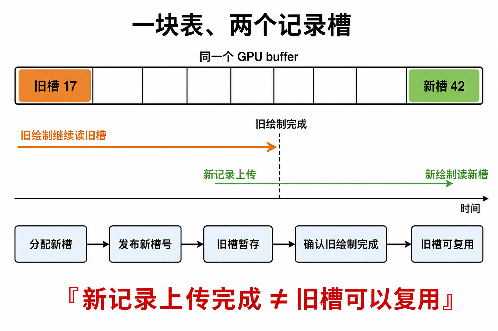
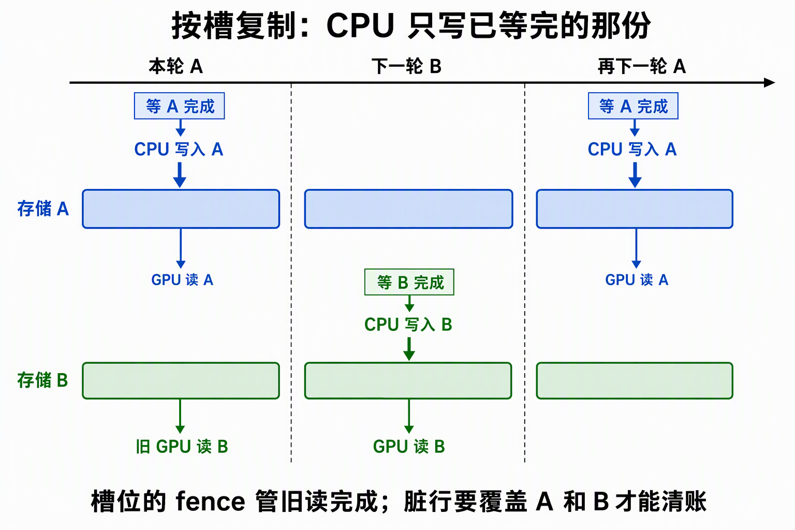

# CPU 与 GPU 异步访问：三种存储与更新策略

本文从“CPU 要写、GPU 可能还在读”这一冲突出发，解释 ash_renderer 的**稳定缓冲＋记录换槽**、**帧槽分份**与**等待后原地重建**三种布局如何避免重叠访问；作为阅读 `init` 和后续资源模块的机制参考，不据此改变现有代码或宣称所有更新都只能用这三招。

> 依据：2026-10-27 当前检出的 `ash_renderer` 源码。下文的“布局”指物理存储份数、记录版本与时间上的所有权安排，不是 Vulkan 的 `VkDescriptorSetLayout`、结构体字节对齐或显存类型分区。

## 先分清三件事

**三种策略解决的是同一个冲突：下一次写入是否会覆盖尚在被 GPU 读取的字节。** Buffer 是否 `HOST_VISIBLE` 只决定 CPU 能不能直接写；提交与可见性机制决定 GPU 何时看到内容；两者都不能代替“上一位读者用完了吗”的判断。

| 问题 | 本项目对应手段 | 单靠它能否防止在飞读写重叠？ |
|---|---|---|
| 写在哪 | 单表新记录槽、当前帧槽的独立环、或重建前的旧目标 | 决定是否碰同一地址；需要配合回收／等待纪律 |
| CPU 写入何时可供 GPU 读 | HOST_VISIBLE 写入后必要时 flush；经 staging 拷贝时由上传票据让图形队列等待，并在需要处落实内存依赖 | **不能**证明上一次 GPU 读取已经结束 |
| 旧读者何时离开 | 当前帧槽 fence、所有在飞 draw 的 fence、或 `device_wait_idle` | 能确定复用／销毁时机，但不负责非 coherent 内存的 flush |

本项目 `BufferRole::Storage` 需要 `HOST_VISIBLE`；`HOST_COHERENT` 只是偏好。`GpuBuffer::write` 在非 coherent 内存上按 atom 对齐 flush，`read` 相应 invalidate；**fence 管执行完成，flush/invalidate 管内存可见性**。所有帧槽当前为两个（`MAX_FRAMES_IN_FLIGHT = 2`）。

## 方式一：一块固定 GPU 缓冲，变动记录换槽

**对象表的 buffer 只有一份，但表内同一对象的记录可以先旧后新同时存在。** 它不是“一份内存随便原地覆盖”；安全性来自**新记录槽发布＋旧记录槽延迟复用**。对象表上限 131072 条，每条 48 B，总计 6 MiB `DEVICE_LOCAL` 存储；两帧的 set2/b0 都绑定这一块 buffer，描述符不随对象改变。



图中的槽 17／42 只是示意编号。对象身份、mesh 内容票据或材质身份改变时，上传链先分配新对象槽、向账本发布新槽号并将旧槽放入停尸房；随后 48 B 记录进入 staging 批次，由 transfer 复制到对象表，图形提交等待上传票据。账本发布新槽号不代表 GPU 此时就能读到新记录，真正的读取仍要等上传票据满足。**上传完成只保证新记录可读，不等于旧槽可回收**；旧槽必须再等所有可能读取它的在飞 draw 完成才返还 free list。分配与回收两条账不能混成一条。模型矩阵或材质内容的变更不必逐次换对象槽，它们分别走帧槽环；不要误以为每次物体移动都换对象记录。

**适用形状**：记录相对稳定、槽位可留余量、允许新旧版本短暂并存，且要维持固定的大表与描述符身份。代价是暂时多占槽位、每次换槽需要上传与账本同步，停尸房排空可能等待在飞 draw。对象表这一做法并非说“CPU/GPU 异步时必须双份完整 buffer”：此处重复的是*个别记录*，不是整张 6 MiB 表。

## 方式二：按在飞帧槽复制物理存储

**同一条逻辑数据对应两个物理 buffer；CPU 只改已等完 fence 的当前槽，上一帧的 GPU 读另一槽。** 这是 `LightTable` 光源环、模型环、材质环等的更新形状。每个帧槽的 descriptor set 指向本槽 buffer；切到下一槽时绑定对应那一套，而不是把同一套描述符改来改去。



图里的 A／B 对应当前实现的槽 0／1。在 `draw_frame` 里，先 `wait_for_slot` 等**当前槽上次提交**的 fence，再取当前槽索引并写各环；fence 只在真正提交前重置。CPU 写光源等 `HOST_VISIBLE` 存储时，非 coherent 内存由 `GpuBuffer::write` 补 flush。**等当前槽不必等另一槽**：两槽互不覆盖，代价是多一份物理存储。

这种策略的第二本账是**变更如何传播给每一份**。静止的记录不必每轮都上传，但发生改变时每个槽在下次可安全写入时，都得收到最新值：

- 模型/LOD 变体表的脏账**按槽分别记录**，每槽覆盖后才消账；材质环则每帧按在场唯一材质全量写入。两种工作量不同，却共用“等当前槽再写”的安全前提。
- 光源表每槽 256 × 64 B = 16 KiB，两槽 32 KiB，比单份多 16 KiB；正常交替调用 `LightTable::write_dirty(slot)`，一条脏光源写到两个槽以后稳态零写。

**现役实现边界，不能误读成强保证**：`LightTable::dirty` 记录的是“剩余写次数 = 2”，而不是“已写过哪些槽”。如果同一脏行连续调用两次 `write_dirty(0)`，会重复写槽 0 并清账，槽 1 仍留旧值；正常 `draw_frame` 交替两槽、每轮调用一次时不会触发这条路径，但 `write_dirty` 方法本身未阻止。后续若要重入、手动重置槽位或复用该方法，需按槽位追踪覆盖位；这项是**现状约束／潜在正确性缺口**，不是已经修复的保证。

**适用形状**：数据经常原地变化（例如光的位置或物体变换），又不愿每次更换索引；相对较小的表/环适合用复制空间换常态无等待。这里“每轮都复制一整张表”是误解：光源和模型可只写脏行，材质环才按本项目当前实现全写。

## 方式三：旧使用者全部离开后再改或重建

**先把 GPU 相关在飞工作排空，再原地写、销毁旧资源或创建替代品。** 本项目的典型冷路径是窗口变化后的 swapchain 及尺寸相关资源重建：`Swapchain::rebuild` 在实际尺寸变化时 `device_wait_idle`，之后销毁旧 swapchain 并建新；窗口最小化和尺寸未变时会早退。`driver/host/frame.rs` 的重建链随后也处理 FramePool 深度、G-buffer、cluster、Bloom、SMAA、Hi-Z 等，部分资源重建内部各自再次等待设备空闲。

```text
旧 draw / transfer 尚在运行 → device_wait_idle → 旧队列工作完成
                                             → 拆旧资源／重建新资源
                                             → 后续帧重新录制
```

**这不是普通光源/材质逐帧改值的方法**：全设备等待会阻断并行，`swapchain.rs` 的源码注释给单次真重建约 60 ms 的量级（现场估值，不是通用基准）；适合低频结构变化。若只影响某帧槽且能证明它的 fence 已完成，方式二用较小粒度的等待，不必 `device_wait_idle`。也可针对相关提交做精确等待；“等待”是消除竞态的策略，`device_wait_idle` 只是本项目冷路径采取的一个较粗实例。

**WSI 边界不能混同**：`device_wait_idle` 保证队列里的工作完成，**不自动证明呈现引擎已经消费了交换链相关的 `render_finished` 信号量**；不能把本图解释成所有 WSI 对象都可仅凭 idle 安全复用。具体交换链重建和呈现同步另按 `render/core/swapchain.rs` 与帧提交路径校验。

## 横向选择：份数和同步位置在哪里

| 维度 | 单表＋换记录槽 | 每帧槽一份 | 等待后原地修改／重建 |
|---|---|---|---|
| 物理布局 | 一块固定 buffer；新旧记录槽暂时并存 | 两份 buffer（本项目）；各有对应的帧槽描述符 | 一份当前资源；修改／替换前先让相关旧使用完成 |
| 旧 GPU 读能否与 CPU 准备新数据并行 | 能，旧槽保留，新槽走上传 | 能，另一槽仍可被读 | 准备可并行，但修改／拆旧要等到安全点 |
| 常态开销 | 单表容量＋少量过渡槽、上传票据与延迟回收 | 每份的存储空间、按槽传播变更 | 阻塞在安全点；冷路径可接受 |
| 本项目例子 | InstanceTables 对象表，MeshPool 的回收账同类但粒度不同 | LightTable、模型环、材质环 | swapchain 与相关尺寸资源重建 |
| 关键防线 | 不在旧读完成前复用旧记录槽 | 当前槽 fence 完成，所有槽最终得到最新值 | 等待范围覆盖所有相关在飞使用，拆除顺序另核对 |

**写入媒介不是第四种竞态策略。** `vkCmdUpdateBuffer`、staging＋`vkCmdCopyBuffer`、映射 HOST_VISIBLE 内存，回答的是“怎样把新字节放上 GPU”，不自动回答“旧 GPU 读完没有”。单份 buffer 也可经 staging 更新，但在**相同地址原地覆盖**前必须保证旧读完成或建立合法顺序；光加“写完后供后续 shader 读”的屏障挡不住之前仍在读的提交。因此“想把光源表改成独一份，只能 `vkCmdUpdateBuffer`”不成立，`vkCmdUpdateBuffer` 只是可选媒介，且本项目光源表当前并未使用它。

## 读源码时自问四句

1. 谁拥有实际 buffer/image？索引/描述符是指向一个固定对象还是随槽变化？
2. 新数据写在哪个地址；那片字节可能正被哪个在飞命令读取？
3. 哪个 fence、上传票据或队列空闲点分别证明“旧读者已走”和“新数据已到”？不要把两件事混为一谈。
4. 旧记录/旧资源何时允许复用或销毁；如果有多份物理存储，哪些份已经同步到最新版本？

## 源码与关联阅读

- [第 1 站：入口与初始化链](第1站：入口与初始化链.md#四lighttable-为什么每帧槽一份)：最初提出三种做法的阅读笔记；本文为详细机制正本。
- `ash_renderer/src/render/assets/instance_table.rs`：对象表单 buffer、每槽描述符与旧槽 graveyard；`ash_renderer/src/driver/upload.rs`：换槽、staging 上传与回收节拍；`ash_renderer/src/render/assets/uploader.rs`：上传票据。
- `ash_renderer/src/render/shading/light_table.rs`：光源双份环与脏行写次数；`ash_renderer/src/scene/mechanism/ledger.rs`：模型/LOD 各槽脏账；`ash_renderer/src/driver/host/drawlist.rs`：材质环全写。
- `ash_renderer/src/driver/host/frame.rs` 与 `ash_renderer/src/render/pipeline/frames.rs`：当前帧槽等待、写环与提交；`ash_renderer/src/render/core/resources.rs`：HOST_VISIBLE、coherent 偏好及非 coherent flush/invalidate。
- `ash_renderer/src/render/core/swapchain.rs`：冷路径排空、重建与 WSI 边界。本文只描述代码现状，不以文字代替 Vulkan 验证层及运行测试。
