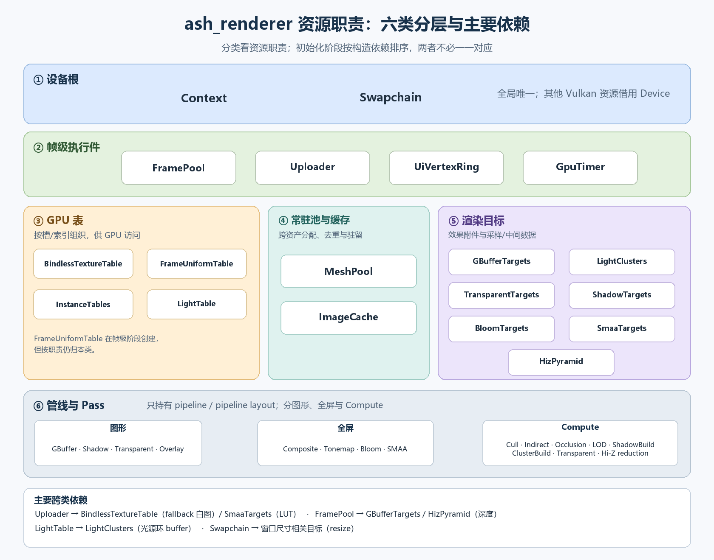
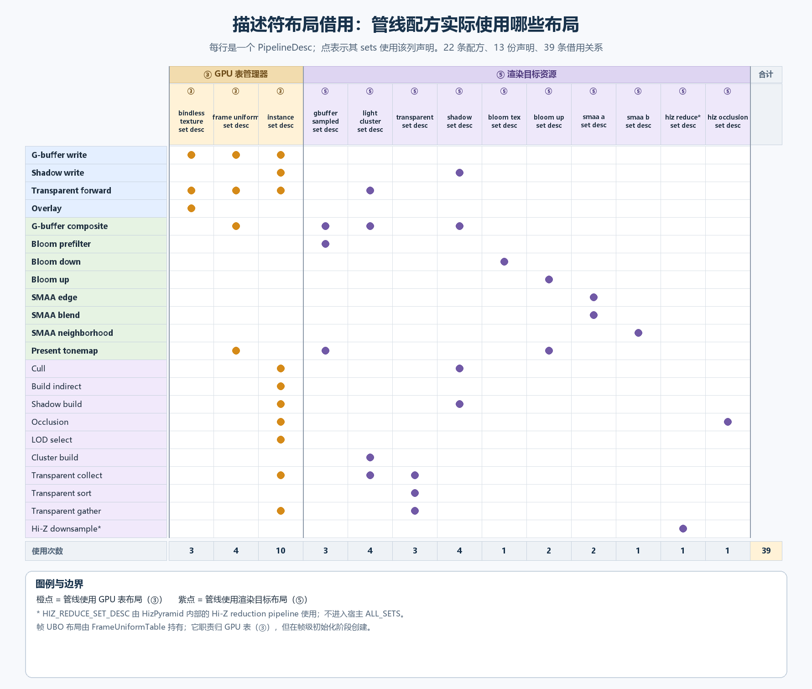

# 第1站：入口与初始化链

本站读 `main.rs` 与 `driver/host/` 的初始化和拆除链，目的是拿到全库 Vulkan 资源对象的目录和依赖图；不钻任何构造函数（它们各归后续站），也不主张代码改动。

> 进度：进行中。已讲 init 读法、资源对象五类、init 双层结构、LightTable 双份原因、两个对象的命名评估；待讲 `init_chain!` 宏、`main.rs` 与 `driver/host/mod.rs` 的插件拓扑。代码引用只写符号名不写行号，`init.rs` 仍在变动。

## 一、读法：把 init 当目录和依赖图读

创建链（`try_init_vulkan`）里有 31 个构造函数，每个都落在后续某一站的范围里。本站读它只看三样：

1. **只看参数，不看函数体。** 参数就是依赖关系。例如 `tables.set0_layout()` 传给了 GBufferPipeline、TransparentPipeline、OverlayPipeline，说明这三条管线的布局借用常驻描述符表的布局；`frames.depth_view(s)` 传给 GBufferTargets、`frames.depth_image(s)` 传给 HizPyramid，说明深度图本体归 FramePool，别人只是引用。
2. **创建顺序就是依赖顺序。** 被借用的先建，借用者后建。创建链已按五类分段重排（①设备根 → ②帧级执行件 → ③常驻数据表 → ④渲染目标 → ⑤管线，⑤ 内部再按图形/全屏/Compute 分组），段间序不能调——②③④ 的资源被 ⑤ 借布局，必须先建；段内的先后只是为了读起来顺。
3. **拿依赖核对拆除顺序。** `init_chain!` 的声明顺序就是拆除顺序，规则是借用者先拆、被借用者后拆：OcclusionPass 借 `hiz.occlusion_layout()`，所以排在 HizPyramid 前；Context 排最后，因为 Device 归它销毁。拆除顺序**不是**创建顺序的完全倒序——HizPyramid 几乎最后建却第二个拆，因为只有存在借用关系的两者之间才有先后约束。

什么时候才钻进构造函数：参数和旁边的注释解释不了"这一行为什么在这个位置"时。

本站唯一需要探一眼函数体的地方：`BindlessTables::new` 与 `SmaaTargets::new` 都收 `&mut uploader`，因为前者要上传 0 号槽的白色兜底贴图、后者要上传两张查找表（LUT），而且只提交不等完成。这解释了排空护栏 `InitDrainGuard` 为什么必须声明在 Uploader 之后、第一个会提交上传的步骤之前：从这里起，失败路径上 GPU 可能还有没做完的传输。

## 二、资源对象五类

按对象里装的是哪种 Vulkan 句柄来分（逐个读过结构体字段，不按名字猜）。`InitChain` 的 31 个资源正好分成五类：

| 类 | 装的是什么 | 判断依据 | 成员 |
|---|---|---|---|
| ① 设备根 | instance、device、queue、surface、swapchain | 全局只有一份，别人都向它借 Device | Context、Swapchain |
| ② 帧级执行件 | 命令池与命令缓冲、同步对象、每帧槽的瞬态缓冲 | 按在飞帧数开 N 份，每帧轮换 | FramePool（另持有各帧槽深度附件本体）、Uploader、UiVertexRing、GpuTimer（query pool） |
| ③ 常驻数据表 | 大 buffer + 描述符 + 槽位分配账 | 有分配器（free list、槽号、graveyard），数据跨帧长期常驻 | BindlessTables、InstanceTables、MeshPool、ImageCache、LightTable |
| ④ 渲染目标（`*Targets`） | 附件图像或中间 buffer + 采样它们的描述符集 + 少量 UBO | 属于某个渲染效果自己的资源族；多数随窗口 resize 重建（ShadowTargets 例外：级联阴影图尺寸固定，没有 `rebuild`） | GBufferTargets、ClusterTargets、ShadowTargets、BloomTargets、SmaaTargets、HizPyramid |
| ⑤ 管线（`*Pipeline(s)` / `*Pass(es)`） | 只有 `vk::Pipeline` + `vk::PipelineLayout` | 无状态，不持有任何数据 | 见下 |

第 ⑤ 类内部按三种骨架分，每个管线类型都只是一层薄包装：

| 骨架 | 内部类型 | 成员 |
|---|---|---|
| 图形管线 | `PipelineHandle`（layout + pipeline） | GBufferPipeline、ShadowPipeline、OverlayPipeline、TransparentPipeline |
| 全屏管线（画一个全屏三角形） | `FullscreenPipeline` | CompositePipeline、PresentTonemapPipeline、BloomPipelines（3 条）、SmaaPipelines（3 条） |
| Compute 管线 | `ComputePipeline`（`render/gpu/compute.rs`） | CullPass、IndirectPass、OcclusionPass、LodPass、ShadowBuildPass、TransparentPasses（sort、build、collect、gather 共 4 条） |

命名规律：**`*Pass` 是 compute，`*Pipeline` 是光栅化。**

另有 AtlasGpu（overlay 图集）出现在 `init_chain!` 声明表里但不归创建链：它由 overlay 插入，只参与拆除。

### 五类与依赖层级

所有对象都借用 Context 的 Device，图里不再逐条画。除此之外，跨类的资源依赖只有五条：Uploader 在创建 BindlessTables 和 SmaaTargets 时就提交上传（兜底白图、查找表），FramePool 把各帧槽的深度视图交给 GBufferTargets、深度图像交给 HizPyramid，LightTable 把光源环 buffer 交给 ClusterTargets。带"尺寸"标记的六个对象按 Swapchain 的窗口尺寸创建，窗口变化时重建；ShadowTargets 尺寸固定，不带标记。Swapchain 的输出格式另外交给 SmaaPipelines 和 OverlayPipeline，图里未画。

③④ 与 ⑤ 之间只有描述符集布局的借用，按（管线, 布局）计共 32 条，按出借方展开如下（BloomPipelines 借 tex、up 两个布局，SmaaPipelines 借 A、B 两个布局，卡片里各合并成一个标签）：

这两张图就是拆除规则的来源：⑤ 借的只是 ③④ 的描述符集布局，所以管线总是先拆；③④ 之间只有 LightTable 到 LightClusters 一条依赖，顺序比较自由；① 永远最后拆。被借最多的是 InstanceTables 的 set2（9 个管线），它必须排在全部 compute 管线和大部分图形管线之后拆。

### 三个需要留意的

1. **LightTable**：名字没问题，就是一张常驻表（③）。每帧槽一份 ring buffer 只是它的物理存储方式，InstanceTables 里的模型环、材质环也是这样；原因见第四节。
2. **HizPyramid**：名字准确（Hi-Z 金字塔是通用术语），只是不守 `*Targets` 后缀。它是渲染目标（R32F mip 链图像），内部还嵌了一条 `ReductionPass` 归约 compute 管线。嵌进去是有意的：归约描述符按（帧槽, 级）各一套，窗口一变要和金字塔图像一起重建，放在同一个对象里重建只动一处。**不改名。**
3. **ClusterTargets**：名字和内容真的错位，详见第五节（已按 O1 拆分解决）。

### 各类归哪一站

| 站 | 本站讲到的对象 |
|---|---|
| 第 2 站 | Context |
| 第 3 站 | Swapchain；FramePool（文件在 `render/pipeline/frames.rs`，讲帧槽时用到） |
| 第 5 站 | MeshPool、Uploader、ImageCache、BindlessTables、InstanceTables |
| 第 6 站 | CullPass、IndirectPass、HizPyramid、OcclusionPass、LodPass、ShadowBuildPass |
| 第 7 站 | GBufferTargets、GBufferPipeline、LightTable、LightClusters、ClusterBuildPass、TransparentTargets、TransparentPasses、TransparentPipeline、ShadowTargets、ShadowPipeline、CompositePipeline、PresentTonemapPipeline、BloomTargets、BloomPipelines、SmaaTargets、SmaaPipelines、OverlayPipeline、UiVertexRing |
| 主线外 | GpuTimer（`render/stats/perf.rs`，性能计时，需要时再看） |

## 三、init 为什么分 `init_vulkan` / `try_init_vulkan` 两层

结论：这层是职责边界，不是无用嵌套。外层 `init_vulkan` 管 Bevy 侧的事（system 签名、错误定级、插入 World、收账日志），内层 `try_init_vulkan` 只管按依赖顺序建 Vulkan 资源。判断一层嵌套是否无用的标准：外层是否只是把调用转手一下——这里外层做了三件内层做不了的事。

真正不能少的是两条边界，函数只是实现它们最省事的手段：

1. **错误只在一处定级为 Tier②。** 内层错误类型是 `VulkanError`，一路裸 `?` 即可；外层只写一次 `.or_fatal(...)`。若压平成一层：每步裸 `?` 虽能编译，但 `VulkanError` 自动转成的 `BevyError` 默认级别是 `Severity::Panic`（出处 `crates/bevy_ecs/src/error/bevy_error.rs` 的 `From` 实现），只能靠 handler 兜底按 Tier② 走，违反规范"Tier② 必须显式标注"；每步都写 `.or_fatal` 则违反"业务代码错误处理只许一行"。
2. **全有或全无。** 内层不碰 `Commands`，只返回 `InitChain` 值；外层拿到 `Ok` 才 `insert_all`。边建边插的话，第 15 步失败时前 14 个资源已进 World，`run_if(resource_exists::<Context>)` 守卫会放行帧循环，拆除也要面对半成品。

失败路径的半建资源靠函数作用域局部变量的逆序析构清理，排空护栏 `InitDrainGuard` 正是利用这一点最先析构、先等 GPU 做完上传；成功路径用 `std::mem::forget` 跳过它，等待责任交给 `teardown_vulkan`。

替代写法：用立即调用的闭包包住创建链，不新增具名函数，但嵌套深度不变、可读性更差（Rust 稳定版没有 `try` 块）。

这个模式不该扩散：全库 `fn try_` 只此一处，`draw_frame`、`flush_uploads` 步骤少、不需要全有或全无，直接在 system 内 `or_fatal`。第 9 站读它们时可以对照。

窗口句柄的取法：外层用 `Query` + `single().or_fatal(...)` 取，内层只接 `&RawHandleWrapper`，内层因此不再依赖 Bevy 的 `Query`。不能改用 `Single` 参数：`Single` 匹配不到实体时整个 system 被静默跳过、错误不进统一通道（`crates/bevy_ecs/src/system/system_param.rs` 中 `Single` 的参数校验返回 `skipped`），结果是 Vulkan 永不初始化、程序也不退出。

## 四、LightTable 为什么每帧槽一份

光源表逻辑上只有一张，物理上存两份（`MAX_FRAMES_IN_FLIGHT` = 2），因为 CPU 是直接往 GPU 可见的内存里**原地改**，而上一帧的 GPU 可能还在读同一块内存：

- CPU 录第 N 帧时，第 N-1 帧可能还在 GPU 上读光源表。只有一份的话，改一盏灯就可能改到 GPU 正在读的内存，同一帧里前一半像素用旧灯、后一半用新灯。
- 两份时，第 N 帧只写 `rings[N % 2]`。`wait_for_slot` 等到的 fence 保证上一个用这份的帧（N-2）已经跑完，N-1 读的是另一份，互不干扰。
- 代价：正常交替两槽时，每次改动分别写到两个槽（脏行计数从 2 起），以及多 16 KiB（256 槽 × 64 B）。**注意现役实现只计写入次数、不计已写槽号**；如果重复调用同一槽两次，另一槽可能仍是旧值，方法本身不保证“两槽都覆盖”。

三种布局与同步策略详见[《CPU 与 GPU 异步访问：三种存储与更新策略》](CPU与GPU异步访问：三种存储与更新策略.md)。以下保留简表作为本站索引：

| 做法 | 适用的写形状 | 例子 |
|---|---|---|
| 永不原地改：换新槽，旧槽进停尸房等 GPU 用完 | 很少变 | 对象表（DEVICE_LOCAL 独一份，131072 槽 × 48B ≈ 6MB） |
| 每帧槽一份，CPU 只写本帧那份 | 频繁原地改 | 模型环、材质环、LOD 变体表环、光源表 |
| 先等 GPU 空闲再写 | 只在初始化、resize 这类冷路径 | 各 `rebuild` |

灯属于第二种：位置、颜色、强度可能每帧都动（全动态场景前提）；当前实现让光源槽号保持稳定，用双份物理表承载更新，和模型环（物体的变换矩阵）同类。**这不是唯一可行方案**：单份表也可以经 staging 拷贝、`vkCmdUpdateBuffer` 等媒介更新，但若覆盖同一地址，必须先保证旧 GPU 读者完成，再让新 GPU 读者看到写入。`vkCmdUpdateBuffer` 只改变数据怎么写，不自动解决前一批 draw 仍在读取的风险。另一种路线是为记录换槽并延迟回收（对象表所用的办法），需要处理 cluster 列表所引用的稳定身份。当前的双环实现用约 16 KiB 额外空间避免常态等待，保持与现有模型环同一套帧槽纪律。

## 五、ClusterTargets 与 TransparentPasses 的名字交叉错位

> 已解决（2026-10-28）：按 [O1](代码阅读优化计划.md#o1-cluster-职责拆分) 拆成 `LightClusters` + `ClusterBuildPass` 与 `TransparentTargets` + `TransparentPasses` 两套描述符集；本节保留拆分前的分析。

按 shader 绑定查证，ClusterTargets 的描述符集（b0~b7）装的是两件事：

| 绑定 | 内容 | 读者 |
|---|---|---|
| b0~b3 | cluster 光源格：参数、光源表引用、每格灯列表、计数 | `cluster_build`、不透明合成 `gbuffer_composite`、透明前向绘制 `transparent_forward` |
| b4~b7 | 透明物体命令链：透明行索引、深度键、间接命令、计数 | 只有透明 compute：`transparent_collect`、`transparent_gather`、`transparent_sort` |

旁边的 TransparentPasses 反过来：四条 compute 里的 `build` 就是 `cluster_build`，给光源分格，不止为透明服务。两个名字交叉：叫 Cluster 的装着透明链，叫 Transparent 的装着 cluster 构建。来历是 `cluster.rs` 在 8.1 作为"透明 Clustered Forward 层"诞生，后来不透明合成也开始读 cluster 光源，名字没跟着变。

单纯给 ClusterTargets 改名找不到好名字，这本身就说明它装了两件事。评估过的拆分方案（不加嵌套层，一个资源束换成两个平级的）：

| 拆后 | 内容 | 类别 |
|---|---|---|
| `LightClusters` | cluster 光源格（原 b0~b3） | ④，随窗口重建 |
| `ClusterBuildPass` | 从 TransparentPasses 移出的 `cluster_build` | ⑤ compute，正好符合 `*Pass` 规律 |
| `TransparentTargets` | 透明命令链（原 b4~b7） | ④ |
| `TransparentPasses` | 剩下 sort、collect、gather | ⑤ compute |

代价：描述符集拆成两个 layout，三个透明 compute shader 的 group/binding 编号要改，pipeline layout、描述符写入、init 创建链与拆除顺序、帧录制里的绑定都要跟着动；合成与透明前向绘制只读 b0~b2，绑定号不变。属于小型结构改动，改完要做透明物体与多点光的画面验证。

**状态：建议拆分，未拍板。** 倾向等第 7 站读 `cluster.rs` 时再定；施工候选与待决问题集中登记在[代码阅读优化计划 O1](代码阅读优化计划.md#o1-cluster-职责拆分)。

## 六、本站校验点

- **护栏位置只靠注释维持**：`InitDrainGuard` 必须声明在第一个会提交上传的创建步骤之前。以后若有人把会提交 GPU 任务的步骤挪到它前面，护栏就护不住，编译器不会报错。
- **拆除序要逐条对借用**：读 `init_chain!` 声明表时，每一条"先于"都应能在创建链的参数里找到对应的借用。
- **ClusterTargets / TransparentPasses 名字交叉错位**：见第五节，已按 O1 拆分解决。
